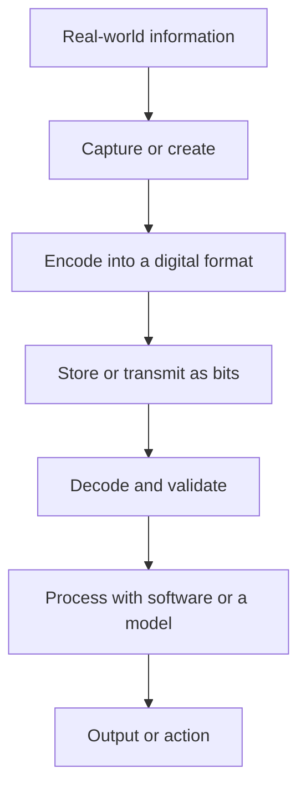
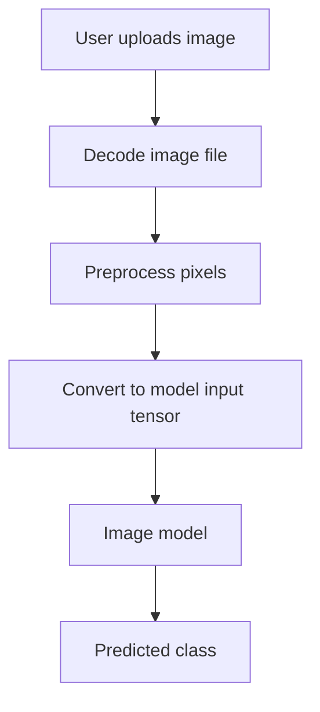

# Lesson 01 — What Is Data?

> **Phase:** 00 — Computer Fundamentals  
> **Level:** Beginner  
> **Status:** First-pass lesson; revise after exercises  
> **Prerequisites:** None  
> **Next lesson:** [Bits, Bytes and Binary](02-bits-bytes-binary.md)

## 1. Learning objectives

By the end of this lesson, you should be able to:
- Define data in simple terms.
- Distinguish structured, semi-structured and unstructured data.
- Recognize text, numeric, image, audio, video and location data.
- Explain why computers need digital representations of data.
- Use Python to inspect a few basic data types and serialize structured data.

## 2. What is data?

**Data is a recorded value, observation or collection of facts that can be stored, processed or communicated.**

Examples:
- `"Rishi"` is text data.
- `25` is integer data.
- `98.5` is decimal/float data.
- A photograph is image data.
- A voice recording is audio data.
- A movie is video data.
- GPS coordinates are location data.

Data and information are related, but not identical. Data is the recorded value; information is what we understand from that value in a context.

Example:
- Data: `38`
- Context: today's temperature in degrees Celsius
- Information: the temperature is 38°C, which is hot.

## 3. Common data types by content

| Kind | Example | Common digital representation |
|---|---|---|
| Text | A message or document | Characters encoded as bytes; later possibly tokens |
| Numeric | Age, price, sensor reading | Binary integer or floating-point representation |
| Image | Photograph | Encoded file; decoded into pixel values |
| Audio | Voice recording | Encoded audio; decoded into a sequence of samples |
| Video | Movie clip | Container with encoded video frames and possibly audio |
| Location | Latitude and longitude | Numeric coordinates plus coordinate-system metadata |
| Structured records | Customer table | Typed fields and records |
| Semi-structured records | JSON object | Keys, values, arrays and nested objects |

A file extension is a clue, not a complete explanation of its contents. A file can also contain metadata, compression and multiple streams.

## 4. Data organization

### 4.1 Structured data

Structured data follows a defined schema, often represented as rows and columns.

| Employee | Age | Department |
|---|---:|---|
| Rishi | 25 | Engineering |
| Anika | 27 | Finance |
| Dev | 24 | Support |

Typical examples: relational database tables, spreadsheets and consistently structured sensor records.

### 4.2 Semi-structured data

Semi-structured data has organizational markers such as keys, tags or nested objects, but does not need to fit one fixed table.

Example JSON:

```json
{
  "name": "Rishi",
  "age": 25,
  "skills": ["Python", "AWS", "AI"]
}
```

Typical examples: JSON, XML and many application logs.

### 4.3 Unstructured data

Unstructured data does not naturally fit a single fixed tabular schema. Examples include photographs, audio recordings, videos, PDFs and free-form documents.

"Unstructured" does not mean that the data has no internal structure. An image has pixels and dimensions; audio has samples and timing; video has frames and timestamps. It means there is no simple universal row-and-column schema for the content.

## 5. How does a computer work with data?

A computer's hardware operates using physical electrical states. Digital systems represent information using discrete states, commonly abstracted as binary digits: 0 and 1.

A simplified path is:



Examples:
- Text is encoded using a character encoding such as UTF-8.
- An image file is decoded into pixel values.
- Digital audio is represented as samples over time.
- Video commonly contains a sequence of timestamped frames and may contain an audio stream.

The details differ by modality. We will study each pipeline in the data fundamentals phase.

## 6. How data becomes useful to AI

Consider an image-classification application that predicts whether a picture contains a cat or a dog.



The model does not receive the human experience of "looking at a photo." It receives a numerical representation produced by the input pipeline. It uses patterns learned during training to produce a prediction.

This is a simplified illustration. Different vision models use different preprocessing and architectures.

## 7. Python lab: inspect data

### 7.1 Basic Python values

```python
name = "Rishi"
age = 25
temperature = 38.5
is_learning_ai = True

print(type(name))             # <class 'str'>
print(type(age))              # <class 'int'>
print(type(temperature))      # <class 'float'>
print(type(is_learning_ai))   # <class 'bool'>
```

Python objects have types. The type influences which operations make sense.

### 7.2 Represent a structured record

```python
person = {
    "name": "Rishi",
    "age": 25,
    "skills": ["Python", "AWS", "AI"],
}

print(person["name"])
print(person["skills"][0])
```

A Python dictionary is a convenient in-memory key/value structure. It is not automatically a database.

### 7.3 Serialize structured data as JSON

```python
import json

person = {
    "name": "Rishi",
    "age": 25,
    "skills": ["Python", "AWS", "AI"],
}

json_text = json.dumps(person, indent=2)
print(json_text)

restored_person = json.loads(json_text)
print(restored_person["name"])
```

- `json.dumps` converts a Python-compatible object into JSON text.
- `json.loads` parses JSON text into Python objects.
- JSON is a text format. It is not the same thing as Python's in-memory dictionary.

### 7.4 Text becomes bytes when encoded

```python
message = "Hello, AI!"

encoded = message.encode("utf-8")
decoded = encoded.decode("utf-8")

print(encoded)          # bytes
print(type(encoded))    # <class 'bytes'>
print(decoded)          # Hello, AI!
```

UTF-8 encodes text into bytes. The next lesson explains how bits and bytes work.

### 7.5 Inspect an image as numerical data

Install Pillow if needed:

```bash
python -m pip install pillow
```

Then:

```python
from PIL import Image

image = Image.open("sample.jpg")
print("Format:", image.format)
print("Mode:", image.mode)
print("Size:", image.size)

rgb_image = image.convert("RGB")
pixels = list(rgb_image.getdata())

print("First pixel:", pixels[0])
print("Number of pixels:", len(pixels))
```

A pixel in an RGB image is commonly represented by three channel values. The exact range and representation depend on the image mode and processing pipeline. We will explore image tensors in Phase 01.

## 8. Common misunderstandings

| Incorrect assumption | Correct understanding |
|---|---|
| All data is text | Data can be numeric, visual, audio, video, structured and more |
| A computer understands a photo like a human | Software decodes it into numerical values and a model processes those values |
| Unstructured means no structure exists | It means there is no simple fixed tabular schema for the content |
| A token is the same as a byte | Tokens are tokenizer-defined units; bytes are groups of binary digits |
| Every AI model uses embeddings in the same way | Representations and architectures vary by model |

## 9. Real-world applications

- Banking: transactions, customer records, documents and fraud signals.
- Healthcare: structured observations, medical images and clinical text.
- E-commerce: product catalogs, photographs, reviews and click events.
- Voice assistants: audio input, transcripts, language-model context and generated speech.
- Autonomous systems: camera frames, sensor readings, location and timing data.

## 10. Connection to my AI engineering learning

This topic is foundational to all the projects in the portfolio.

| Project area | Data encountered or expected | What to inspect in source |
|---|---|---|
| Tiny LLM | Text, token IDs, tensors | Dataset loader, tokenizer and training input |
| RAG application | Documents, text chunks, metadata, vectors | File parser, chunker, embedding and retrieval code |
| VLM experiments | Image files, pixel tensors and text prompts | Image processor, model inputs and inference code |
| Telugu voice assistant | Audio, transcript text and generated audio | Audio capture, ASR, orchestration and TTS components |
| EV AI application | Depends on actual product scope | Input schema, data source and model/API boundary |

**Evidence status:** These are project areas to investigate, not claims that every listed component has already been implemented. Add exact repository links, function names and tests after inspecting each project's source.

## 11. Interview preparation

### Beginner questions
1. What is data?
2. What is the difference between data and information?
3. What are structured, semi-structured and unstructured data?
4. Give examples of text, image, audio and video data.
5. Why does a computer need a digital representation?

### Intermediate questions
1. Is JSON structured or semi-structured data? Why?
2. What happens when a Python string is encoded as UTF-8?
3. Why is an image ultimately processed numerically by a typical computer-vision model?
4. Does unstructured data mean that it has no internal organization?

### Project-based question
**How does data enter your RAG application and become useful to the LLM?**

A good answer should describe the actual flow in your implementation: document input, parsing, chunking, metadata, embeddings, retrieval and context passed to the model. Verify every component against the source code before claiming it.

## 12. Exercises

1. Give two examples each of structured, semi-structured and unstructured data.
2. Create a Python dictionary for a book with title, author, year and topics.
3. Convert that dictionary to JSON text and parse it back.
4. Encode the sentence `"AI starts with data"` into UTF-8 bytes and decode it.
5. Open an image using Pillow and print its dimensions and mode.
6. Draw a data pipeline for a voice assistant.

### Self-check

You are ready for the next lesson when you can explain:
- what data is;
- the three data-organization categories;
- why computers use digital representations;
- how JSON and UTF-8 relate to data handling;
- why AI models need numerical inputs.

## 13. Key takeaways

- Data is recorded values or observations that can be stored and processed.
- Data can be text, numbers, images, audio, video and more.
- Structured, semi-structured and unstructured describe ways data is organized.
- Computers process digital representations, not human meaning directly.
- AI applications transform input data into model-compatible representations.

## 14. References

- [Python built-in types](https://docs.python.org/3/library/stdtypes.html)
- [Python JSON documentation](https://docs.python.org/3/library/json.html)
- [Python codecs documentation](https://docs.python.org/3/library/codecs.html)
- [Pillow documentation](https://pillow.readthedocs.io/)
