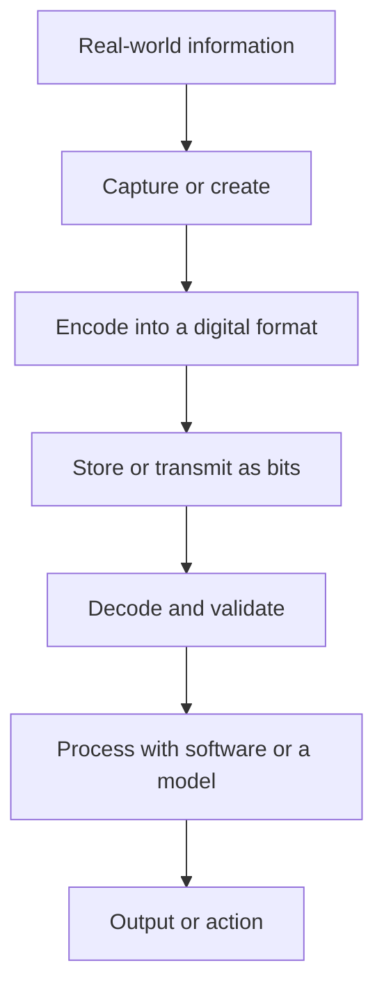
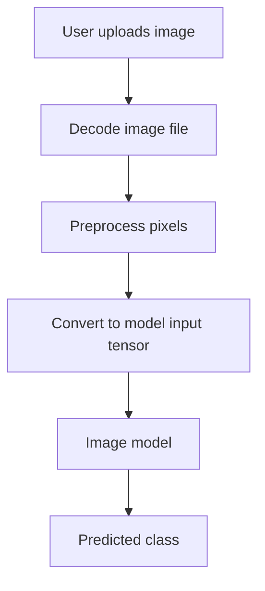
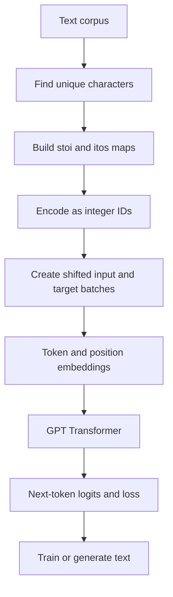

# Lesson 01 — What Is Data?

> **Module:** 00 — Computer Fundamentals  
> **Level:** Beginner  
> **Prerequisites:** None  
> **Next lesson:** [Lesson 02 — Bits, Bytes and Binary](02-bits-bytes-binary.md)


*Illustrative computing hardware image. This is a visual aid, not a diagram of a specific processor.*

## Learning objectives

After this lesson, you should be able to define data, distinguish data organization categories, identify common modalities, explain why computers need digital representations, and inspect basic values with Python.

## 1. What is data?

**Data is a recorded value, observation or collection of facts that can be stored, processed or communicated.**

Examples:
- `"Rishi"` — text
- `25` — integer
- `98.5` — decimal value
- A photograph — image data
- A voice recording — audio data
- A movie — video data
- GPS coordinates — location data

Data and information are related but not identical. Data is a recorded value; information is the meaning we interpret from data in context. For example, `38` is data. When we learn that it is today's temperature in degrees Celsius, it becomes meaningful information.

## 2. Common forms of data

| Modality | Human example | Typical digital representation |
|---|---|---|
| Text | Message or book | Characters encoded as bytes; later possibly tokens |
| Numeric | Age or sensor reading | Binary integer or floating-point value |
| Image | Photograph | Encoded file decoded into pixel values |
| Audio | Speech recording | Encoded audio decoded into samples over time |
| Video | Movie | Container holding encoded frames and possibly audio |
| Location | GPS position | Coordinates plus reference-system metadata |

## 3. How data is organized

### Structured data

Structured data follows a defined schema, often rows and columns.

| Employee | Age | Department |
|---|---:|---|
| Rishi | 25 | Engineering |
| Anika | 27 | Finance |
| Dev | 24 | Support |

Common examples are relational database tables and spreadsheets.

### Semi-structured data

Semi-structured data has organizational markers such as keys, tags or nested objects, but need not fit one fixed table.

```json
{
  "name": "Rishi",
  "age": 25,
  "skills": ["Python", "AWS", "AI"]
}
```

JSON and XML are common examples.

### Unstructured data

Unstructured data does not naturally fit a single fixed tabular schema. Examples include images, audio recordings, videos, PDFs and free-form documents. It does not mean the content has no internal structure: images have pixels and dimensions; audio has samples and timing; video has frames and timestamps.

## 4. How a computer represents data

Computers operate using physical electrical states. Digital systems represent information using discrete states, commonly abstracted as binary digits: 0 and 1.



The details differ by modality:
- Text uses character encodings such as UTF-8.
- Image files are decoded into pixel arrays.
- Digital audio is represented as samples over time.
- Video commonly contains timestamped frames and may contain an audio stream.

A file extension is only a clue. A format may also contain compression, metadata and multiple streams.

## 5. How data enters an AI system

Consider an image classifier that predicts whether an image contains a cat or dog.


*Illustrative example image. A classifier receives decoded and preprocessed pixel data.*



The model receives a numerical representation produced by the input pipeline. It uses patterns learned during training to make a prediction.

## 6. Python lab: inspect different data

### 6.1 Basic Python values

```python
name = "Rishi"
age = 25
temperature = 38.5
is_learning_ai = True

print(type(name))             # str
print(type(age))              # int
print(type(temperature))      # float
print(type(is_learning_ai))   # bool
```

### 6.2 Structured data using a dictionary

```python
person = {
    "name": "Rishi",
    "age": 25,
    "skills": ["Python", "AWS", "AI"],
}

print(person["name"])
print(person["skills"][0])
```

A dictionary is a convenient in-memory key/value structure. It is not automatically a database.

### 6.3 Convert a Python object to JSON

```python
import json

person = {"name": "Rishi", "age": 25, "skills": ["Python", "AWS", "AI"]}
json_text = json.dumps(person, indent=2)
print(json_text)

restored = json.loads(json_text)
print(restored["name"])
```

- `json.dumps` converts a Python-compatible object into JSON text.
- `json.loads` parses JSON text into Python objects.
- JSON is a text format; it is not the same as Python's in-memory dictionary.

### 6.4 Text becomes bytes when encoded

```python
message = "Hello, AI!"
encoded = message.encode("utf-8")
decoded = encoded.decode("utf-8")

print(encoded)
print(type(encoded))  # bytes
print(decoded)
```

UTF-8 defines how Unicode text is represented as bytes. We will study the binary level in the next lesson.

### 6.5 Inspect image pixels

Install Pillow:

```bash
python -m pip install pillow
```

Run this with a local image named `sample.jpg`:

```python
from PIL import Image

image = Image.open("sample.jpg")
print("Format:", image.format)
print("Mode:", image.mode)
print("Size:", image.size)

rgb = image.convert("RGB")
pixels = list(rgb.getdata())
print("First pixel:", pixels[0])
print("Number of pixels:", len(pixels))
```

For an RGB image, a pixel is commonly a tuple of red, green and blue channel values. The exact representation depends on image mode and the processing pipeline.

## 7. Connect the concept to the Tiny LLM project

### Project reference

**[SEVT Logistics — tiny-llm-jetson](https://github.com/SEVT-Logistics-Private-Limited/tiny-llm-jetson)**

This repository is a practical companion for text and LLM topics. Its README documents GPT-style model experiments at multiple scales, a Telugu-language model and a separate Telugu voice-assistant deployment.

| What to study | Why it matters |
|---|---|
| [Project README](https://github.com/SEVT-Logistics-Private-Limited/tiny-llm-jetson#readme) | Project goals, model progression and hardware context |
| [tiny_llm.py](https://github.com/SEVT-Logistics-Private-Limited/tiny-llm-jetson/blob/main/tiny_llm.py) | Character corpus, tokenizer, token IDs, batching and GPT model |
| [tiny_llm_1m.py](https://github.com/SEVT-Logistics-Private-Limited/tiny-llm-jetson/blob/main/tiny_llm_1m.py) | Larger configuration using the same general text-processing pattern |
| [tiny_llm_telugu.py](https://github.com/SEVT-Logistics-Private-Limited/tiny-llm-jetson/blob/main/tiny_llm_telugu.py) | Telugu text dataset and character-level vocabulary |
| [test_tiny_llm.py](https://github.com/SEVT-Logistics-Private-Limited/tiny-llm-jetson/blob/main/test_tiny_llm.py) | Reload checkpoint and generate text |
| [Telugu model card](https://github.com/SEVT-Logistics-Private-Limited/tiny-llm-jetson/blob/main/model-card-telugu.md) | Model configuration, data and reported training results |

### What the code demonstrates

In `tiny_llm.py`, a repeated English text string is used as the corpus. The code builds a set of unique characters, creates character-to-integer and integer-to-character maps, encodes the corpus into integer IDs, and creates input/target sequences for next-character prediction.



Simplified code pattern from the project:

```python
text = "to be or not to be that is the question " * 200
chars = sorted(set(text))
stoi = {c: i for i, c in enumerate(chars)}
itos = {i: c for c, i in stoi.items()}
encode = lambda s: [stoi[c] for c in s]
decode = lambda ids: "".join(itos[i] for i in ids)
data = [stoi[c] for c in text]
```

**Important distinction:** The scripts use a character-level tokenizer, not a modern subword tokenizer such as BPE. A character is mapped to an integer ID; the embedding layer later maps that ID to a learned vector.

### Local GPT model versus deployed voice assistant

The custom GPT training scripts and deployed voice assistant API are separate paths. The current `telugu_voice_api.py` imports the Google Gemini SDK for speech recognition, language response generation and speech output. Do not describe the deployed API as serving the local TinyGPT checkpoint unless that integration is changed and verified.

## 8. Interview preparation

### Beginner questions
1. What is data?
2. What is the difference between data and information?
3. What are structured, semi-structured and unstructured data?
4. Give examples of text, image, audio and video data.
5. Why does a computer need digital representations?

### Intermediate questions
1. Is JSON structured or semi-structured? Explain.
2. What happens when a Python string is encoded using UTF-8?
3. Why does a computer-vision model need numerical image input?
4. Does unstructured data mean there is no internal organization?

### Project question

**How does text become model input in your Tiny LLM project?**

A source-based answer: the script starts with a text corpus, constructs a character vocabulary, maps each character to an integer ID, builds shifted sequences for next-character prediction, and passes IDs to token and position embedding layers. See [tiny_llm.py](https://github.com/SEVT-Logistics-Private-Limited/tiny-llm-jetson/blob/main/tiny_llm.py).

## 9. Exercises

1. Give two examples each of structured, semi-structured and unstructured data.
2. Create a Python dictionary for a book with title, author, year and topics.
3. Serialize the dictionary to JSON and parse it back.
4. Encode `AI starts with data` into UTF-8 bytes and decode it.
5. Open an image with Pillow and print its dimensions and mode.
6. Explain the character-to-ID mapping in `tiny_llm.py`.
7. Draw the data path from Telugu corpus text to integer IDs in `tiny_llm_telugu.py`.

## 10. Key takeaways

- Data is recorded values or observations that can be stored and processed.
- Data can be text, numbers, images, audio, video and more.
- Structured, semi-structured and unstructured describe ways data is organized.
- Computers operate on digital representations.
- The Tiny LLM project demonstrates one concrete text path: characters → integer IDs → model inputs.
- Project statements should be supported by source code, tests or model cards.

## 11. References

- [Python built-in types](https://docs.python.org/3/library/stdtypes.html)
- [Python JSON documentation](https://docs.python.org/3/library/json.html)
- [Python codecs documentation](https://docs.python.org/3/library/codecs.html)
- [Pillow documentation](https://pillow.readthedocs.io/)
- [Tiny LLM project README](https://github.com/SEVT-Logistics-Private-Limited/tiny-llm-jetson#readme)