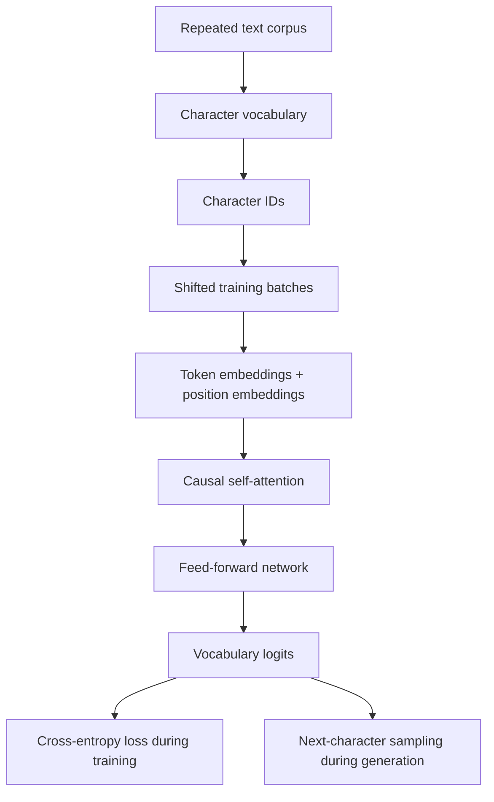

# Project — Tiny LLM on Jetson

*Illustrative hardware image. Refer to the project's own documentation for exact hardware setup and photographs.*

## Repository details

| Field | Details |
|---|---|
| Repository | [SEVT Logistics — tiny-llm-jetson](https://github.com/SEVT-Logistics-Private-Limited/tiny-llm-jetson) |
| Visibility | Public |
| Primary language reported by GitHub | Python |
| Default branch | `main` |
| Project README | [Open README](https://github.com/SEVT-Logistics-Private-Limited/tiny-llm-jetson#readme) |

## What the project contains

The project README documents two related workstreams:

1. **GPT-style model experiments:** small decoder-only Transformer implementations trained from scratch on a repeated English character corpus and scaled through multiple configurations. The README also describes a Telugu text model trained on a Telugu corpus.
2. **Telugu voice-assistant application:** a separate application/API path for speech input, language response and speech output.

The repository contains model scripts, model cards, checkpoint tests, a Telugu API file and a compression experiment directory.

## Model data flow shown in the code

The `tiny_llm.py` implementation contains character-level vocabulary creation, text-to-ID conversion, shifted input/target batches, token and position embeddings, a decoder-style Transformer block using PyTorch `MultiheadAttention` with a causal mask, a feed-forward network, residual connections, LayerNorm, cross-entropy loss, AdamW optimization and autoregressive generation.

## Project files worth reading

| File | Why it is useful |
|---|---|
| [README.md](https://github.com/SEVT-Logistics-Private-Limited/tiny-llm-jetson/blob/main/README.md) | Goals, model progression, hardware and assistant overview |
| [tiny_llm.py](https://github.com/SEVT-Logistics-Private-Limited/tiny-llm-jetson/blob/main/tiny_llm.py) | Small GPT implementation from text to generation |
| [tiny_llm_1m.py](https://github.com/SEVT-Logistics-Private-Limited/tiny-llm-jetson/blob/main/tiny_llm_1m.py) | Larger model configuration |
| [tiny_llm_telugu.py](https://github.com/SEVT-Logistics-Private-Limited/tiny-llm-jetson/blob/main/tiny_llm_telugu.py) | Telugu corpus, vocabulary and model configuration |
| [model-card.md](https://github.com/SEVT-Logistics-Private-Limited/tiny-llm-jetson/blob/main/model-card.md) | First model rung, training details and interpretation |
| [model-card-1m.md](https://github.com/SEVT-Logistics-Private-Limited/tiny-llm-jetson/blob/main/model-card-1m.md) | Second rung and reported evaluation |
| [model-card-150m.md](https://github.com/SEVT-Logistics-Private-Limited/tiny-llm-jetson/blob/main/model-card-150m.md) | Larger experiment and documented limitations |
| [model-card-telugu.md](https://github.com/SEVT-Logistics-Private-Limited/tiny-llm-jetson/blob/main/model-card-telugu.md) | Telugu model configuration and reported results |
| [test_tiny_llm.py](https://github.com/SEVT-Logistics-Private-Limited/tiny-llm-jetson/blob/main/test_tiny_llm.py) | Checkpoint loading and generation test |
| [telugu_voice_api.py](https://github.com/SEVT-Logistics-Private-Limited/tiny-llm-jetson/blob/main/telugu_voice_api.py) | FastAPI application and Gemini SDK calls |
| [compression/README.md](https://github.com/SEVT-Logistics-Private-Limited/tiny-llm-jetson/blob/main/compression/README.md) | Compression workflow and limitations described by the project |

## Distinguish the two model/application paths

The local TinyGPT training scripts and deployed Telugu voice assistant API are not the same runtime path. The current `telugu_voice_api.py` uses the Google Gemini SDK for audio transcription, response generation and speech output. It also uses FastAPI for HTTP endpoints.

- Study `tiny_llm.py` and `tiny_llm_telugu.py` for custom GPT architecture and training.
- Study `telugu_voice_api.py` for FastAPI endpoints and Gemini API orchestration.
- Do not claim the deployed assistant invokes the local TinyGPT checkpoint unless an actual integration path is added and tested.

## Learning-to-project links

| Handbook topic | Project evidence |
|---|---|
| Text representation and character tokenization | `tiny_llm.py`, `tiny_llm_telugu.py` |
| Token IDs and vocabulary | `stoi`, `itos`, `encode`, `decode` in model scripts |
| Training examples | `get_batch()` and shifted targets |
| Embeddings | `self.tok`, `self.pos` |
| Attention and causal masking | `Block.forward()` |
| Transformer blocks | `Block` and `TinyGPT` classes |
| Loss and optimization | `F.cross_entropy`, `AdamW`, training loops |
| Generation | `TinyGPT.generate()` |
| Checkpoint testing | `test_tiny_llm.py` |
| API and speech orchestration | `telugu_voice_api.py` |

## Reproduction and evidence

Use instructions in the project README and individual scripts. Hardware, dependencies, dataset access and checkpoints affect reproducibility. Record exact commands, environment versions and output when repeating experiments.

**Evidence note:** This page summarizes files inspected in the linked public repository. Metrics are project-documented results, not independently reproduced in this handbook.