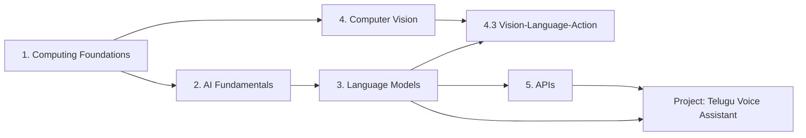
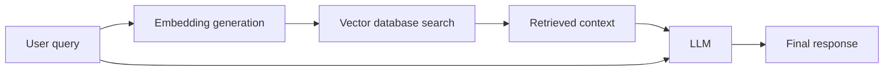
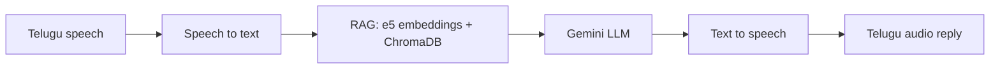

# AI Engineering Handbook

[](https://github.com/SEVT-Logistics-Private-Limited/Ai-Engineering-Handbook/actions/workflows/ci.yml)


A structured, hands-on guide to AI engineering. It starts from how computers represent data and builds up to Transformers, LLMs, Retrieval-Augmented Generation and vision-language models. Every chapter combines clear explanations, diagrams and **runnable, tested code**, and links concepts to a real deployed project.

**Author:** Rishi Sasanala · Yodha AI (SEVT Logistics Private Limited)

---

## Contents

- [Who this is for](#who-this-is-for)
- [What you'll learn](#what-youll-learn)
- [Learning roadmap](#learning-roadmap)
- [Chapters](#chapters)
- [Featured project](#featured-project)
- [Repository structure](#repository-structure)
- [Getting started](#getting-started)
- [Roadmap and contributing](#roadmap-and-contributing)

## Who this is for

- **Beginners** who want to understand AI from first principles, without hand-waving
- **Engineers** who want a concise reference with working code for the core concepts behind LLM applications
- **Reviewers** who want to see how these concepts were applied in a production project

## What you'll learn

| Area | Concepts |
|---|---|
| Computing foundations | Binary, bits and bytes, text encoding, CPU vs GPU |
| AI fundamentals | AI vs ML vs Deep Learning, NLP, epochs, batches, the training loop |
| Language models | Tokenization, embeddings, Transformer architecture, self-attention, multi-head attention, masking, GPT-style LLMs, temperature |
| LLM applications | Prompt engineering, hallucination and its mitigation, Retrieval-Augmented Generation (RAG), RAG evaluation |
| Computer vision | Pixels and RGB, resolution, video frames and FPS, Vision Transformers, VLMs, VLAs, ROS |
| Engineering | REST vs SOAP, FastAPI, CI, deployment on Azure Container Apps |

**Technologies used in the examples and project:** Python, NumPy, FastAPI, PyTorch, Google Gemini, ChromaDB, Docker, Azure, GitHub Actions.

## Learning roadmap

Follow the chapters in order. Each one builds on the previous one.



## Chapters

### 1. [Computing Foundations](docs/01-computing-foundations/README.md)
How computers represent all data as numbers: binary, bits and bytes, and why AI runs on GPUs.

### 2. [AI Fundamentals](docs/02-ai-fundamentals/README.md)
AI, ML and Deep Learning, NLP, and the training loop (epochs, batches, loss, backpropagation).

### 3. [Language Models](docs/03-language-models/README.md)

| # | Topic | Highlights |
|---|---|---|
| 3.1 | [Tokenization](docs/03-language-models/01-tokenization.md) | Tokens, token IDs, why tokens drive cost and context |
| 3.2 | [Embeddings](docs/03-language-models/02-embeddings.md) | Meaning as vectors, cosine similarity, semantic search |
| 3.3 | [Transformer Architecture](docs/03-language-models/03-transformer-architecture.md) | Layers, positional encoding, encoder vs decoder |
| 3.4 | [Attention Mechanism](docs/03-language-models/04-attention-mechanism.md) | Query/Key/Value, multi-head attention, causal masking |
| 3.5 | [Large Language Models](docs/03-language-models/05-large-language-models.md) | GPT-style models, autoregressive generation, temperature |
| 3.6 | [Prompt Engineering](docs/03-language-models/06-prompt-engineering.md) | Zero/one/few-shot, chain of thought, role prompting |
| 3.7 | [Hallucination](docs/03-language-models/07-hallucination.md) | Causes and mitigations |
| 3.8 | [Retrieval-Augmented Generation](docs/03-language-models/08-retrieval-augmented-generation.md) | Ingestion, chunking, retrieval, evaluation |

### 4. [Computer Vision](docs/04-computer-vision/README.md)

| # | Topic | Highlights |
|---|---|---|
| 4.1 | [Digital Images](docs/04-computer-vision/01-digital-images.md) | Pixels, RGB, resolution, image processing |
| 4.2 | [Video Fundamentals](docs/04-computer-vision/02-video-fundamentals.md) | Frames, FPS, storage, frame sampling |
| 4.3 | [Vision-Language-Action Models](docs/04-computer-vision/03-vision-language-action.md) | VLM, VLA, ROS, patch embeddings |

### 5. [APIs](docs/05-apis/README.md)
REST vs SOAP, other API types, and building a validated REST API with FastAPI.

### At a glance: the RAG workflow

One example of the visual style used throughout the handbook:



## Featured project

### [Telugu Voice AI Assistant (Yodha)](projects/telugu-voice-assistant/README.md)

A deployed voice assistant that listens in Telugu, answers vehicle-service questions using RAG over vehicle manuals, and replies in Telugu speech.



| | |
|---|---|
| Live app | [Open the assistant](https://telugu-voice-app.gentletree-f4002f64.southindia.azurecontainerapps.io/assistant) |
| Source | [tiny-llm-jetson](https://github.com/SEVT-Logistics-Private-Limited/tiny-llm-jetson) |
| Concepts applied | Tokenization, embeddings, Transformers, prompting, RAG, REST APIs, CI/CD |

## Repository structure

```text
.
├── docs/                          # The handbook, one folder per chapter
│   ├── 01-computing-foundations/
│   ├── 02-ai-fundamentals/
│   ├── 03-language-models/        # 8 topic pages
│   ├── 04-computer-vision/        # 3 topic pages
│   └── 05-apis/
├── examples/                      # Runnable code for every chapter
│   ├── computing_foundations/
│   ├── ai_fundamentals/
│   ├── language_models/
│   ├── computer_vision/
│   ├── apis/
│   └── tests/                     # pytest suite that runs every example
├── projects/
│   └── telugu-voice-assistant/    # Project write-up and screenshots
├── assets/images/                 # Figures generated from the examples
├── scripts/                       # Figure generation and link checking
├── ROADMAP.md                     # Covered and planned topics
└── CONTRIBUTING.md                # Page template and conventions
```

## Getting started

**Read:** start at [Chapter 1](docs/01-computing-foundations/README.md) and follow the **Next →** links at the bottom of each page.

**Run the examples:**

```bash
git clone https://github.com/SEVT-Logistics-Private-Limited/Ai-Engineering-Handbook.git
cd Ai-Engineering-Handbook
python -m venv .venv && source .venv/bin/activate
pip install -r requirements.txt

python examples/language_models/rag_pipeline.py   # run any example
pytest examples/tests -q                          # run them all
```

See [`examples/README.md`](examples/README.md) for the full index.

## Roadmap and contributing

- [ROADMAP.md](ROADMAP.md): covered topics and what's planned next (audio, agents, fine-tuning, systems)
- [CONTRIBUTING.md](CONTRIBUTING.md): the topic page template, conventions and pre-merge checks
