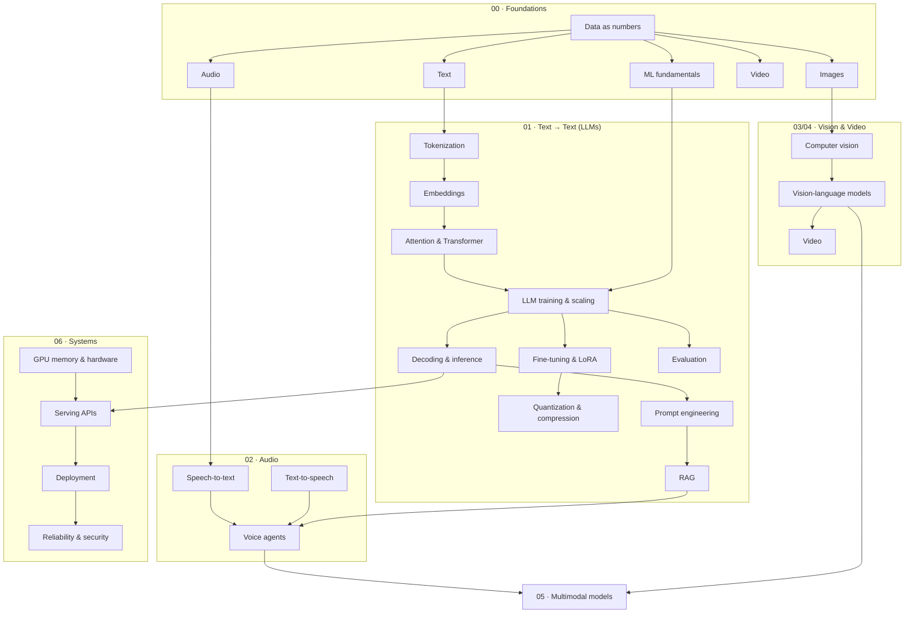

# AI Engineering Handbook

This handbook goes from the raw bytes of text, images, audio and video up to production LLM and voice systems. Each topic is tied to the code we actually shipped.

**Maintainer:** Rishi Sasanala · Yodha AI (SEVT Logistics Private Limited)
**Reference project:** [`tiny-llm-jetson`](https://github.com/SEVT-Logistics-Private-Limited/tiny-llm-jetson). It has from-scratch GPTs (984 params → 3B), a LoRA + ternary compression pipeline, and a live Telugu voice assistant ("Yodha") with RAG over vehicle manuals.

---

## How every topic page is built

Every page follows the same contract (see [`CLAUDE.md`](CLAUDE.md)):

| Section | Purpose |
|---|---|
| **1. First principles** | What the thing *is*, derived from what it is built on. No hand-waving. |
| **2. Diagram** | A Mermaid diagram of the real mechanism, not a decorative box chart. |
| **3. Deep dive** | Engineer-level detail: shapes, math, costs, trade-offs. |
| **4. In our project** | How `tiny-llm-jetson` uses it, with permalinks to the exact lines. Marked **Not yet used** when that is the truth. |
| **5. Common pitfalls** | Failure modes we hit or that commonly bite in production. |
| **6. References** | Primary sources (papers, specs). |

---

## Learning path

---

## Table of contents

Legend: ✅ used in our project · 🟡 partially / planned · ⬜ not yet used

### 00 · Foundations: what data *is*
| # | Topic | Project |
|---|---|---|
| 00.1 | [Data as numbers: bits, encodings, tensors, modalities](docs/00-foundations/01-data-as-numbers.md) | ✅ |
| 00.2 | [Text: Unicode, UTF-8, scripts (Telugu)](docs/00-foundations/02-text.md) | ✅ |
| 00.3 | [Images: pixels, channels, color, compression](docs/00-foundations/03-images.md) | ⬜ |
| 00.4 | [Audio: sampling, PCM, codecs, spectrograms](docs/00-foundations/04-audio.md) | ✅ |
| 00.5 | [Video: frames, codecs, temporal redundancy](docs/00-foundations/05-video.md) | ⬜ |
| 00.6 | [ML fundamentals: loss, gradients, backprop, optimizers](docs/00-foundations/06-ml-fundamentals.md) | ✅ |

### 01 · Text → Text: Large Language Models
| # | Topic | Project |
|---|---|---|
| 01.1 | [Tokenization](docs/01-text/01-tokenization.md) | ✅ |
| 01.2 | [Embeddings (token, positional, sentence)](docs/01-text/02-embeddings.md) | ✅ |
| 01.3 | [Attention & the Transformer block](docs/01-text/03-attention-transformer.md) | ✅ |
| 01.4 | [LLM training & scaling](docs/01-text/04-llm-training-scaling.md) | ✅ |
| 01.5 | [Decoding & inference](docs/01-text/05-decoding-inference.md) | ✅ |
| 01.6 | [Fine-tuning: SFT & LoRA](docs/01-text/06-fine-tuning-lora.md) | ✅ |
| 01.7 | [Quantization, distillation & compression](docs/01-text/07-quantization-compression.md) | ✅ |
| 01.8 | [Prompt engineering & context injection](docs/01-text/08-prompt-engineering.md) | ✅ |
| 01.9 | [Retrieval-Augmented Generation (RAG)](docs/01-text/09-rag.md) | ✅ |
| 01.10 | [Evaluation](docs/01-text/10-evaluation.md) | ✅ |

### 02 · Audio: speech in, speech out
| # | Topic | Project |
|---|---|---|
| 02.1 | [Speech-to-text (ASR)](docs/02-audio/01-speech-to-text.md) | ✅ |
| 02.2 | [Text-to-speech (TTS)](docs/02-audio/02-text-to-speech.md) | ✅ |
| 02.3 | [Voice agents: VAD, barge-in, streaming, latency](docs/02-audio/03-voice-agents.md) | ✅ |

### 03 · Vision
| # | Topic | Project |
|---|---|---|
| 03.1 | [Computer vision: CNNs → ViT](docs/03-vision/01-computer-vision.md) | ⬜ |
| 03.2 | [Vision-language & image generation](docs/03-vision/02-vision-language-generation.md) | ⬜ |

### 04 · Video
| # | Topic | Project |
|---|---|---|
| 04.1 | [Video understanding & generation](docs/04-video/01-video-models.md) | ⬜ |

### 05 · Multimodal
| # | Topic | Project |
|---|---|---|
| 05.1 | [Multimodal models: one model, many modalities](docs/05-multimodal/01-multimodal-models.md) | 🟡 |

### 06 · Systems: making it run in production
| # | Topic | Project |
|---|---|---|
| 06.1 | [GPU memory math & hardware (Jetson vs A100)](docs/06-systems/01-gpu-memory-hardware.md) | ✅ |
| 06.2 | [Serving LLM APIs: FastAPI, SSE, fallbacks, caching](docs/06-systems/02-serving-apis.md) | ✅ |
| 06.3 | [Deployment & MLOps: Docker, Azure, CI/CD](docs/06-systems/03-deployment-mlops.md) | ✅ |
| 06.4 | [Reliability & security](docs/06-systems/04-reliability-security.md) | ✅ |

### Projects
| Project | Dossier |
|---|---|
| `tiny-llm-jetson` + Yodha voice assistant | [projects/tiny-llm-jetson.md](projects/tiny-llm-jetson.md) |

---

## Topic → project map (quick lookup)

| Topic | Where it lives in `tiny-llm-jetson` |
|---|---|
| Char-level tokenizer | `tiny_llm*.py` (`stoi` / `itos`) |
| Causal self-attention, weight tying | `tiny_llm*.py` `Block`, `TinyGPT` |
| bf16 AMP, gradient checkpointing, clipping | `tiny_llm_400m.py` → `tiny_llm_5b.py`, `tiny_llm_telugu.py` |
| Scaling ladder 984 → 3.07B | model cards `model-card*.md` |
| First real-language model (Telugu, 25M) | `tiny_llm_telugu.py` |
| LoRA SFT with answer-only loss | `compression/finetune_telugu_3b.py` |
| Ternary QAT + distillation + 2-bit packing | `compression/ternary_qat_3b.py` |
| 4-bit GGUF quantization | `compression/README.md` (Path A) |
| RAG (ChromaDB + multilingual-e5) | `voice-assistant/api.py` `retrieve_manual_context` |
| Prompting / context injection | `voice-assistant/api.py` `build_system`, `get_context` |
| STT / TTS / voice loop / VAD / barge-in | `voice-assistant/api.py`, `voice-assistant/telugu_assistant.html` |
| SSE streaming, LLM fallback chain | `voice-assistant/api.py` |
| Docker + ACR + Azure Container Apps CI/CD | `voice-assistant/Dockerfile`, `.github/workflows/deploy.yml` |

---

## Status & roadmap

- **v1 (this version):** the full skeleton, with every topic written and grounded in `tiny-llm-jetson` at commit [`9a7b564`](https://github.com/SEVT-Logistics-Private-Limited/tiny-llm-jetson/tree/9a7b564c8d764d1eff92218261f2fd2cef99099e).
- **Next:** merge in the learning notes from the ChatGPT study sessions (see [`notes/README.md`](notes/README.md)), and add exercises per topic.
