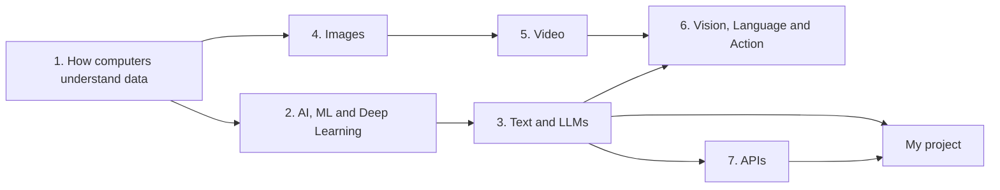

# AI Engineering Handbook

My AI learning notes, cleaned up and organised. Everything here comes from what I've actually studied, starting from the very basics and building up to LLMs, RAG and vision models. Where I've used a topic in my own project, the page says so.

**Author:** Rishi Sasanala · Yodha AI (SEVT Logistics Private Limited)
**Source:** my handwritten notes ([`notes/handwritten-notes.pdf`](notes/handwritten-notes.pdf))
**My project:** [Telugu Voice AI Assistant](projects/telugu-voice-assistant.md) ([repo](https://github.com/SEVT-Logistics-Private-Limited/tiny-llm-jetson))

---

## How to read this

Read the chapters in order. Each one builds on the one before.

## Chapters

| # | Chapter | What's inside |
|---|---|---|
| 1 | [How computers understand data](docs/01-how-computers-understand-data.md) | Numbers only, binary, bits and bytes, CPU vs GPU |
| 2 | [AI, ML and Deep Learning](docs/02-ai-ml-deep-learning.md) | AI vs ML vs DL, NLP, epochs, batches, the training loop |
| 3 | [Text and LLMs](docs/03-text-and-llms.md) | Tokens, embeddings, Transformer, attention, masking, LLMs, temperature, prompting, hallucination, RAG |
| 4 | [Images](docs/04-images.md) | Pixels, RGB, resolution, how a computer processes an image |
| 5 | [Video](docs/05-video.md) | Frames, FPS, how video is stored |
| 6 | [Vision, Language and Action](docs/06-vision-language-action.md) | VLM, VLA, ROS |
| 7 | [APIs](docs/07-apis.md) | What an API is, REST vs SOAP, other API types |
| – | [My project: Telugu Voice AI Assistant](projects/telugu-voice-assistant.md) | How it works, and which topics it uses |
| – | [What's next](docs/whats-next.md) | Topics from my roadmap I haven't covered yet |

## Quick map: topic → where I used it

| Topic | Used in my project? |
|---|---|
| Tokens, embeddings | ✅ Embeddings for searching the vehicle manuals |
| Transformer, attention heads, context length | ✅ My Telugu model: 8 layers, 8 heads, context 128 |
| LLM | ✅ The assistant's answers come from an LLM |
| Prompt engineering | ✅ A system prompt gives the assistant its personality and rules |
| RAG, chunking, retrieval | ✅ Answers grounded in vehicle manuals (ChromaDB) |
| APIs (REST) | ✅ FastAPI endpoints for speech-to-text, chat and text-to-speech |
| Images, video, VLM, VLA, ROS | Not yet |
