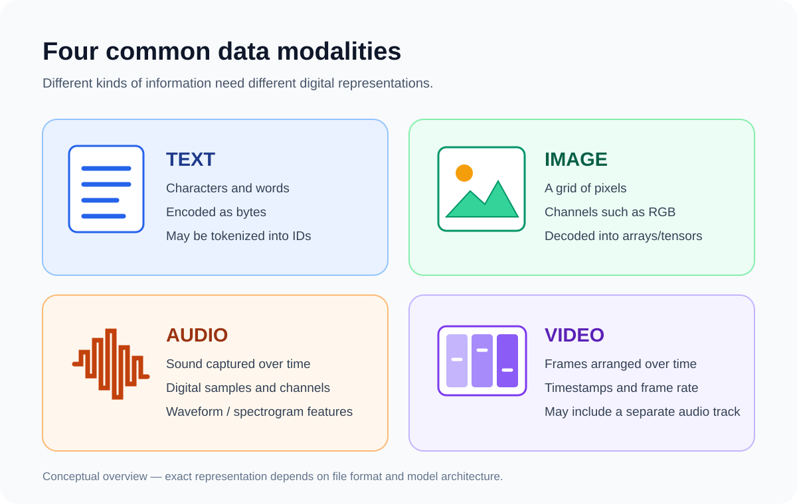

# AI Engineering Handbook

**From digital-data fundamentals to production AI engineering.**

A visual, practical handbook for understanding AI from first principles. Each lesson combines plain-language explanations, diagrams, worked examples, Python labs, project evidence and interview preparation.

*The handbook starts with the data itself, then follows how different modalities are represented and processed by AI systems.*

## Explore the handbook

| Module | What you will learn | Start here |
|---|---|---|
| 00 — Computer fundamentals | Data, binary, bits, bytes, computing and AI foundations | [Fundamentals](00-fundamentals/README.md) |
| 01 — Data fundamentals | How text, images, audio and video are represented | [Data fundamentals](01-data-fundamentals/README.md) |
| 02 — Data processing | Encoding, preprocessing, tokenization, tensors and embeddings | [Processing](02-data-processing/README.md) |
| 03–04 — ML and deep learning | How models learn, neural networks, optimizers and Transformers | [Machine learning](03-machine-learning/README.md) |
| 05 — Text AI and LLMs | NLP, tokenization, attention, GPT, training and inference | [Text AI](05-text-ai/README.md) |
| 06 — Image AI | Pixels, image processing, CNNs and vision models | [Image AI](06-image-ai/README.md) |
| 07 — Audio AI | Digital sound, speech recognition and speech generation | [Audio AI](07-audio-ai/README.md) |
| 08 — Video AI | Frames, temporal information and video understanding | [Video AI](08-video-ai/README.md) |
| 09 — Multimodal AI | VLMs, image-text alignment and multimodal architectures | [Multimodal AI](09-multimodal-ai/README.md) |
| 11 — RAG | Parsing, chunking, embeddings, retrieval and grounded generation | [RAG](11-rag/README.md) |
| 13 — AI engineering | Python, APIs, FastAPI, data stores, deployment and monitoring | [AI engineering](13-ai-engineering/README.md) |
| 14 — Project portfolio | Architecture, implementation evidence, tests and lessons learned | [Projects](14-projects/README.md) |

See the [complete roadmap](ROADMAP.md), [learning map](docs/LEARNING-MAP.md), [learning tracker](LEARNING-PROGRESS.md) and [glossary](GLOSSARY.md).

## Featured project: Tiny LLM on Jetson

This handbook is connected to the practical project: **[SEVT Logistics — tiny-llm-jetson](https://github.com/SEVT-Logistics-Private-Limited/tiny-llm-jetson)**.

The project README documents GPT-style model experiments at multiple scales, a Telugu-language model and a separate Telugu voice-assistant deployment.

Useful entry points:
- [Project overview and model progression](https://github.com/SEVT-Logistics-Private-Limited/tiny-llm-jetson#readme)
- [Tiny GPT implementation](https://github.com/SEVT-Logistics-Private-Limited/tiny-llm-jetson/blob/main/tiny_llm.py)
- [1M parameter experiment](https://github.com/SEVT-Logistics-Private-Limited/tiny-llm-jetson/blob/main/tiny_llm_1m.py)
- [Telugu GPT implementation](https://github.com/SEVT-Logistics-Private-Limited/tiny-llm-jetson/blob/main/tiny_llm_telugu.py)
- [Telugu model card](https://github.com/SEVT-Logistics-Private-Limited/tiny-llm-jetson/blob/main/model-card-telugu.md)
- [Tiny GPT checkpoint test](https://github.com/SEVT-Logistics-Private-Limited/tiny-llm-jetson/blob/main/test_tiny_llm.py)
- [Telugu voice API](https://github.com/SEVT-Logistics-Private-Limited/tiny-llm-jetson/blob/main/telugu_voice_api.py)
- [Compression experiments](https://github.com/SEVT-Logistics-Private-Limited/tiny-llm-jetson/tree/main/compression)

### Important project distinction

The TinyGPT scripts implement and train small GPT-style models. The current telugu_voice_api.py uses the Google Gemini SDK for speech recognition, language response generation and speech output. Do not describe the deployed voice assistant as serving the locally trained TinyGPT checkpoint unless the integration is changed and verified.

## How to use this handbook

1. Start with [Lesson 01 — What Is Data?](00-fundamentals/01-what-is-data.md).
2. Follow the diagrams and explain the flow aloud in your own words.
3. Run the Python exercises and record your output.
4. Open the linked project files and compare the theory with actual implementation.
5. Complete the questions and exercises before moving forward.
6. Use the [topic template](resources/templates/TOPIC-TEMPLATE.md) for every new lesson.

## Documentation standard

Every topic aims to include a beginner-friendly definition, why it exists, internal working, Mermaid diagrams, terminology, worked examples, runnable Python, testing and limitations, project evidence, interview questions, exercises and trusted references.

## Evidence and accuracy rules

A topic appearing in this handbook does not automatically mean it was implemented in a project. Project claims must point to an actual source file, function, configuration, test or model card. Label unverified items as **To verify**. Never publish credentials, confidential customer data or proprietary material.

**Learn the fundamentals. Understand the architecture. Build the technology. Document the evidence.**