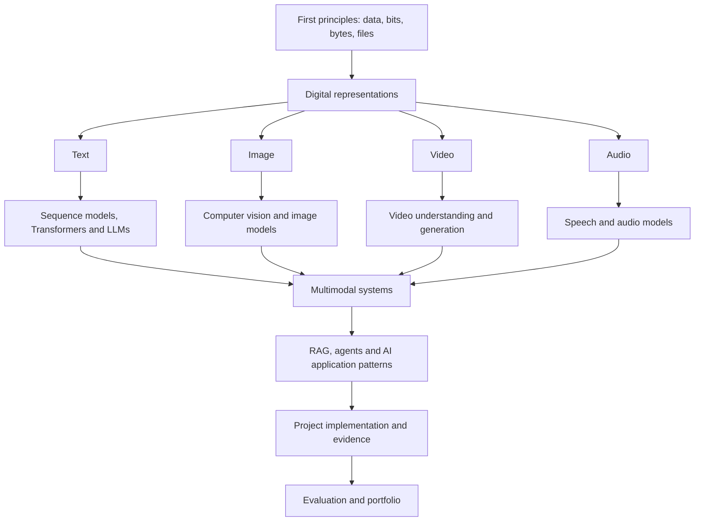

# First-Principles AI Knowledge Base

**A modality-first AI/ML learning repo and evidence-backed engineering portfolio.**

This repository is designed to teach AI from the ground up. It deliberately separates **concept pages** (what a technology is and how it works) from **project-evidence pages** (what was actually built, what your exact contribution was, and what evidence supports it).

> **Current phase: structure only.** Concept explanations and project implementation claims are intentionally not written yet. Missing project facts remain `TODO: supply`.

## Learning path



## Navigate the repo

| File/folder | Purpose |
|---|---|
| [TAXONOMY.md](TAXONOMY.md) | Ordered fundamentals and modality taxonomies, tagged Phase 1 or Later |
| [PHASE-PLAN.md](PHASE-PLAN.md) | MVP scope and later expansion |
| [NAMING-AND-CROSSLINKING.md](NAMING-AND-CROSSLINKING.md) | Naming, IDs, cross-links and evidence standards |
| [concepts/](concepts/README.md) | One concept per page; explanations only |
| [evidence/](evidence/README.md) | One project-to-concept evidence page per relationship |
| [projects/](projects/README.md) | Owner-supplied project registry |
| [templates/](templates/) | Shared concept and evidence templates |

## Topic-to-project mapping

The mapping below is a **candidate fit based only on the short project summaries supplied by the owner**. It is not evidence of implementation. All project details and proof remain `TODO: supply` until source material is provided and reviewed.

| Topic area | Tiny GPT — Jetson + Colab | Telugu voice assistant — STT/TTS | YODA — agentic workflows |
|---|---|---|---|
| Text representation / tokenization | Candidate fit; details `TODO: supply` | `TODO: supply` | `TODO: supply` |
| Embeddings / sequence models | Candidate fit; details `TODO: supply` | `TODO: supply` | `TODO: supply` |
| Transformers / LLMs | Candidate fit; details `TODO: supply` | Model/provider integration `TODO: supply` | `TODO: supply` |
| Audio representation / preprocessing | `TODO: supply` | Candidate fit; details `TODO: supply` | `TODO: supply` |
| STT / TTS | `TODO: supply` | Candidate fit; details `TODO: supply` | `TODO: supply` |
| RAG / retrieval | `TODO: supply` | `TODO: supply` | `TODO: supply` |
| Agents / tools / workflows | `TODO: supply` | `TODO: supply` | Candidate fit; details `TODO: supply` |
| Multimodal I/O | `TODO: supply` | Candidate fit; exact modalities `TODO: supply` | `TODO: supply` |

Every confirmed mapping must link to an evidence page under `evidence/`; each evidence page must link back to its concept page. Never infer implementation from a project name or technology list.

## Repository structure

```text
first-principles-ai/
├── README.md
├── TAXONOMY.md
├── PHASE-PLAN.md
├── NAMING-AND-CROSSLINKING.md
├── concepts/
│   ├── README.md
│   ├── foundations/README.md
│   ├── text/README.md
│   ├── image/README.md
│   ├── video/README.md
│   ├── audio/README.md
│   └── multimodal/README.md
├── evidence/
│   ├── README.md
│   ├── foundations/README.md
│   ├── text/README.md
│   ├── image/README.md
│   ├── video/README.md
│   ├── audio/README.md
│   └── multimodal/README.md
├── projects/README.md
└── templates/
    ├── CONCEPT-PAGE-TEMPLATE.md
    └── PROJECT-EVIDENCE-TEMPLATE.md
```

Modality folders contain pages directly; avoid nesting deeper than necessary.

## Non-negotiable rules

1. One technology per concept page.
2. One project-to-concept relationship per evidence page.
3. Keep concept explanations and project case studies separate.
4. Link concept → all related evidence pages and evidence → its primary concept page.
5. Use `TODO: supply` for unknown project details; do not invent them.
6. Mark every topic Phase 1 or Later.
7. Use Mermaid for editable diagrams when concept writing begins.
8. Never publish credentials, customer data or confidential project material.

## Supplied project context

- Tiny GPT-style LLM training on Jetson + Colab.
- Telugu voice assistant (STT/TTS pipeline).
- YODA agentic workflow system.

Architecture, contributions, stack, decisions, results, failures and metrics are all `TODO: supply` until provided.

## Next step

Answer the five Phase 2 questions in the setup conversation. Then concept/evidence pairs can be written in taxonomy order, starting with first-principles foundations and Text.