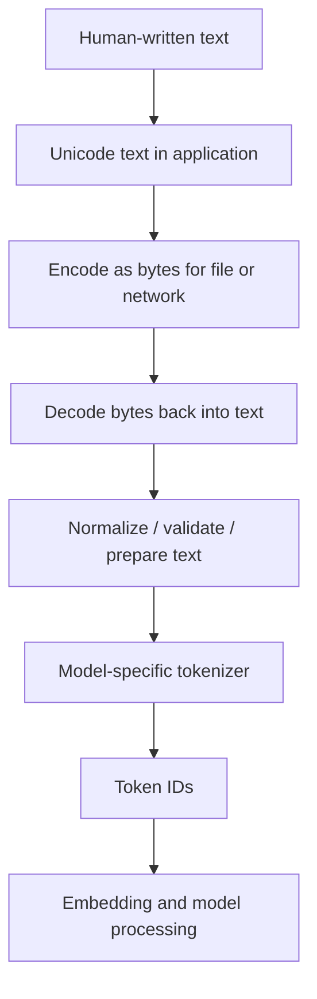
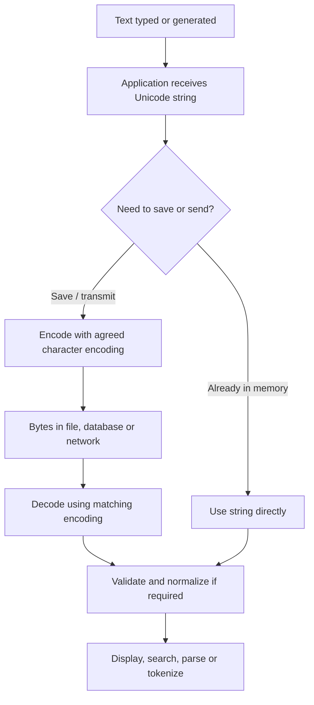
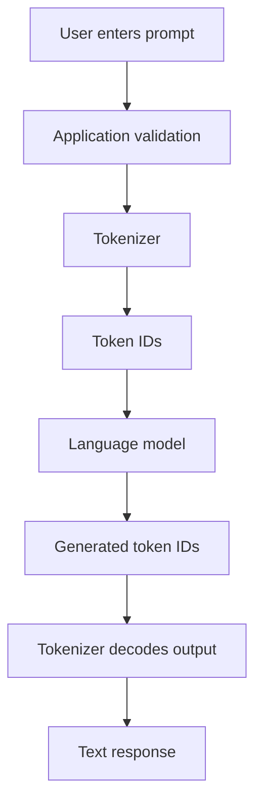

# TXT-010 — What Is Text?

> **Audience:** Complete beginner  
> **Depth:** First principles to engineering practice  
> **Prerequisites:** None  
> **Next concept:** Text encoding — ASCII, Unicode and UTF-8  
> **Related evidence:** [Tiny GPT — text corpus and character representation](../../evidence/text/tiny-gpt-jetson-colab--what-is-text.md)

## Definition

**Text is information expressed as a sequence of symbols that people interpret as language, labels, instructions or other written content.**

In everyday life, text includes words, numbers, punctuation, messages, books and source code. In computing, text is handled as an ordered sequence of characters (more precisely, Unicode code points in Python's `str` model) and can be encoded into bytes so it can be stored or transmitted.

Consider the sentence:

```text
AI begins with data.
```

A person sees a sentence with meaning. A computer program sees a sequence of symbols in a defined order. A program can count, compare, search, transform, store or transmit that sequence. An AI model uses a further model-specific process to turn text into model inputs.

### Text is not the same as a word

These are different levels:

| Level | Example | What it means |
|---|---|---|
| Document | A README file | A larger container of written content |
| Sentence | `AI begins with data.` | A grammatical or semantic unit |
| Word | `begins` | A language-dependent unit |
| Character / code point | `A`, `.` | A symbol represented in a character system |
| Byte | `0x41` in UTF-8 for `A` | A storage/transmission unit |
| Token | A tokenizer-defined unit | A unit used by a particular NLP/model tokenizer |

Do not treat character, byte, word and token as interchangeable. A single visible symbol may use multiple bytes, a word may become multiple model tokens, and some writing systems do not use spaces between every word.

## How it is represented

### 1. Human-readable symbols

Text is composed from letters, marks, digits, punctuation, whitespace and control characters. What a user perceives as one character can sometimes consist of several underlying Unicode code points. For example, an accented letter can be stored as one precomposed code point or as a base letter followed by a combining mark.

### 2. Unicode code points

Unicode assigns code points to characters and related elements used across writing systems. A code point is written as `U+` followed by hexadecimal digits, for example:

| Symbol | Code point |
|---|---|
| `A` | `U+0041` |
| `é` (precomposed) | `U+00E9` |
| `త` | `U+0C24` |

Unicode is a character repertoire and encoding-related standard; it is not itself the same thing as UTF-8 bytes. Unicode text needs an encoding when represented as bytes.

### 3. Python strings

In Python, `str` is the type for text. Python strings are immutable sequences of Unicode code points. `len(text)` counts code points, not necessarily user-perceived characters or words.

```python
message = "Hello, తెలుగు!"

print(type(message))
print(len(message))
print(message[0])
```

### 4. Bytes and text are different

`bytes` represents a sequence of byte values. `str` represents text. Converting between them requires an encoding or decoding rule.

```python
text = "café"
raw_bytes = text.encode("utf-8")
restored_text = raw_bytes.decode("utf-8")

print(text)                  # café
print(raw_bytes)             # UTF-8 byte sequence
print(restored_text)         # café
print(type(text))            # str
print(type(raw_bytes))       # bytes
```

UTF-8 is a widely used variable-length encoding for Unicode text. The next concept page will explain ASCII, Unicode and UTF-8 carefully, including byte-level examples.

### 5. Text used by an AI model

A language model does not generally consume a Python sentence as a human-readable string directly. A model's tokenizer converts text into model-specific units, then maps those units to integer IDs. The model can then map IDs into learned vectors and process them. Different model families can use different tokenizers and input conventions.



**Important:** Byte encoding and model tokenization solve different problems. UTF-8 converts Unicode text to bytes. A tokenizer converts text into units chosen for a particular model or NLP task.

## Processing pipeline

### A. A typical text-file pipeline



### B. Text-to-text AI pipeline (preview)



This second flow is a preview. Tokenization, embeddings, model architecture and generation will each receive their own concept pages.

## Key models

Text is a data modality, not a model architecture. Different model families can operate on text:

| Model family | High-level role |
|---|---|
| Rule-based text processors | Apply explicit rules such as matching, parsing or validation |
| N-gram language models | Estimate a next symbol/word from a limited preceding context |
| Recurrent sequence models (RNN/LSTM/GRU) | Process ordered sequences while carrying a state |
| Transformer models | Process sequences using attention and related neural-network layers |
| Large language models (LLMs) | Large-scale language models commonly based on Transformer-family architectures |

These are signposts for later topics, not full explanations of the architectures.

## I/O modes

For this concept, focus on text as input and output data. The model capability depends on the downstream system.

| Input | Output | Example task |
|---|---|---|
| Text | Text | Chat, completion, summarization or translation |
| Text | Label / structured data | Classification or information extraction |
| Text + retrieved text | Text | RAG-grounded answer |
| Text + image | Text | Image question answering in a vision-language system |
| Audio | Text | Speech recognition (audio modality; text is the transcript) |
| Text | Audio | Speech synthesis (text is the input; audio is generated) |

## Python implementation

All examples below use the Python standard library; no third-party package is needed.

### Example 1 — A text value is a Python `str`

```python
message = "AI starts with data."

print("Value:", message)
print("Type:", type(message).__name__)
print("Code-point count:", len(message))
print("First symbol:", message[0])
print("Contains AI?", "AI" in message)
```

### Example 2 — Inspect Unicode code points

```python
message = "Aéత"

for symbol in message:
    print(symbol, f"U+{ord(symbol):04X}")
```

`ord()` returns the Unicode code point for a single Python character (one code point).

### Example 3 — Encode text into UTF-8 bytes and decode it

```python
message = "Hello, తెలుగు!"

encoded = message.encode("utf-8")
decoded = encoded.decode("utf-8")

print("Original:", message)
print("Bytes:", encoded)
print("Byte count:", len(encoded))
print("Decoded:", decoded)
assert decoded == message
```

The byte count can differ from `len(message)`. UTF-8 uses one to four bytes per Unicode code point.

### Example 4 — Normalize equivalent Unicode text

```python
import unicodedata

precomposed = "é"
combined = "e\\u0301"  # e followed by a combining acute accent

print("Same Python string?", precomposed == combined)
print("Lengths:", len(precomposed), len(combined))

precomposed_nfc = unicodedata.normalize("NFC", precomposed)
combined_nfc = unicodedata.normalize("NFC", combined)

print("Same after NFC?", precomposed_nfc == combined_nfc)
```

Unicode normalization can make canonically equivalent text use a consistent representation. Whether and where to normalize depends on the application; do not normalize blindly when exact original text must be preserved.

### Example 5 — Read and write a UTF-8 text file

```python
from pathlib import Path

path = Path("sample.txt")
original = "First principles: text is data.\nతెలుగు కూడా text."

path.write_text(original, encoding="utf-8")
restored = path.read_text(encoding="utf-8")

print(restored)
assert restored == original
```

Explicitly specifying the encoding makes the file contract clear and avoids relying on a machine's locale-dependent default.

### Example 6 — A deliberately simple word split

```python
sentence = "Text processing starts with understanding text."
words = sentence.split()

print(words)
print("Whitespace-separated items:", len(words))
```

`str.split()` is useful for demonstrations and simple whitespace-delimited text. It is not a production-grade multilingual tokenizer. Punctuation, compounds, languages without whitespace word boundaries and language-specific segmentation need more careful handling.

## Failure modes and common pitfalls

| Pitfall | Why it happens | Engineering practice |
|---|---|---|
| Encoding mismatch / mojibake | Bytes are decoded with the wrong encoding | Define the encoding at file/API boundaries; use UTF-8 where appropriate |
| Treating a character as one byte | Unicode symbols can require multiple UTF-8 bytes | Keep `str` and `bytes` distinct; encode/decode explicitly |
| Assuming `len()` counts visible characters | Python counts code points, not grapheme clusters | Use a grapheme-aware library when user-perceived character counts matter |
| Assuming one word equals one token | Tokenizers split text according to model-specific rules | Inspect the exact tokenizer and token count for the target model |
| Assuming whitespace splitting works for every language | Word boundaries vary by writing system and language | Use language-aware segmentation/tokenization |
| Unicode normalization differences | Visually similar text can have different code-point sequences | Normalize consistently where appropriate; preserve raw input when required |
| Lost newlines or whitespace | Trimming, serialization or platform conversion changes text | Define whitespace policy and test round-trips |
| Truncation | Input exceeds storage, API or model context limits | Validate length and make truncation explicit and observable |
| Hidden/control characters | Copy/paste, OCR or external content can contain invisible code points | Inspect and validate untrusted text at system boundaries |
| Prompt injection in retrieved/user text | Text can contain instructions that conflict with application intent | Treat external text as untrusted data; isolate instructions and enforce tool permissions |

## Related project evidence

- [Tiny GPT — text corpus and character representation](../../evidence/text/tiny-gpt-jetson-colab--what-is-text.md)

If you have another project that handles text, create a separate evidence page for that project-to-concept relationship. Do not mix multiple project case studies into one evidence page.

## Further reading

- [Python — Text Sequence Type (`str`)](https://docs.python.org/3/library/stdtypes.html#text-sequence-type-str)
- [Python — Unicode HOWTO](https://docs.python.org/3/howto/unicode.html)
- [Python — `unicodedata`](https://docs.python.org/3/library/unicodedata.html)
- [The Unicode Standard](https://www.unicode.org/standard/standard.html)
- [RFC 3629 — UTF-8](https://www.rfc-editor.org/rfc/rfc3629)

## Review checklist

- [ ] I can explain what text means in computing.
- [ ] I can distinguish a character/code point, byte, word and token.
- [ ] I can explain why `str` and `bytes` are different in Python.
- [ ] I can encode and decode a string using UTF-8.
- [ ] I understand why `len()` is not always a visible-character count.
- [ ] I can explain why a model tokenizer is not the same as UTF-8 encoding.