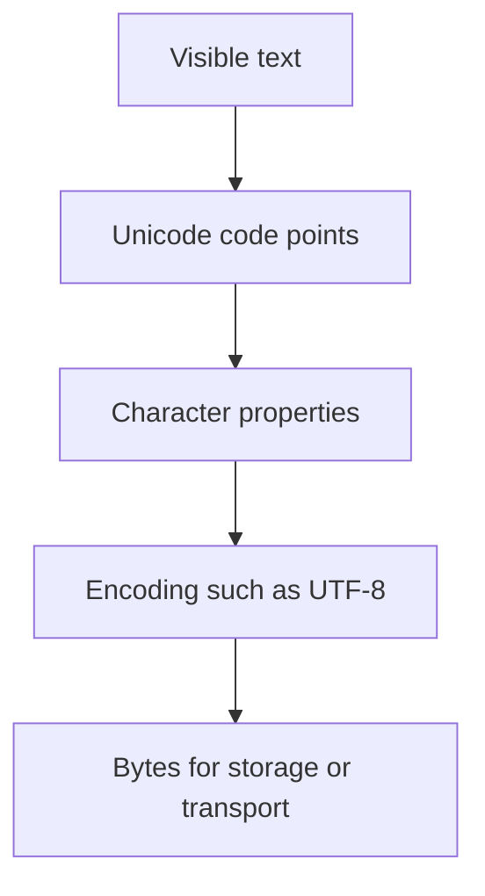

# TXT-020 — Character Sets and Unicode Code Points

> **Audience:** Beginner  
 > **Depth:** Engineer-level  
 > **Prerequisite:** Previous Text concepts in taxonomy order.

## Definition

A character set defines a repertoire of symbols a system can represent. A code point is the number assigned to a character by a standard. Unicode assigns code points to writing systems, symbols and emoji. A font controls appearance; a code point identifies a text element. One visible, user-perceived character can contain multiple code points, such as a base letter plus a combining mark.

## How it is represented

Unicode code points are written as U+ followed by hexadecimal digits. In Python, ord() returns the code point of one string element and chr() creates a string from a valid code point. A grapheme cluster is closer to what a reader perceives as one character and may combine several code points.

## Processing pipeline



## Key models

This is a character representation standard, not a neural model. Related mechanisms include Unicode normalization, grapheme segmentation and language-aware text segmentation.

## I/O modes

Input: Unicode text. Output: code-point inspection, normalized text or encoded bytes. Two strings can look identical while containing different code-point sequences.

## Python implementation

The example isolates the core mechanism; it is a learning exercise, not a full production pipeline.

```python
import unicodedata

for text in ["A", "é", "e\\u0301", "త", "🙂"]:
    print("Text:", text)
    for char in text:
        print(f"  U+{ord(char):04X}", unicodedata.name(char, "UNKNOWN"))

print("Same raw value:", "é" == "e\\u0301")
print("Same after NFC:", unicodedata.normalize("NFC", "é") ==
      unicodedata.normalize("NFC", "e\\u0301"))
```

## Failure modes

- A code point is not always a visible grapheme; combining marks and emoji sequences can use several code points.
- A font-rendering problem is not necessarily an encoding problem.
- Do not assume every script uses spaces to separate words.
- Normalize identifiers or signed text only when the application contract permits it.
- Visually similar Unicode confusables can create security issues in identifiers.

## Related project evidence
- [Separate evidence page](../../evidence/text/todo-project--character-sets-and-code-points.md).
- Implementation claims and personal contribution are treated separately.

## Further reading
- [Unicode Standard](https://www.unicode.org/standard/standard.html)
- [Python Unicode HOWTO](https://docs.python.org/3/howto/unicode.html)
- [Python unicodedata](https://docs.python.org/3/library/unicodedata.html)

## Review checklist
- [ ] Explain the concept in your own words.
- [ ] Draw the pipeline and explain each stage.
- [ ] Run and modify the Python example.
- [ ] Identify failure modes and how to test them.