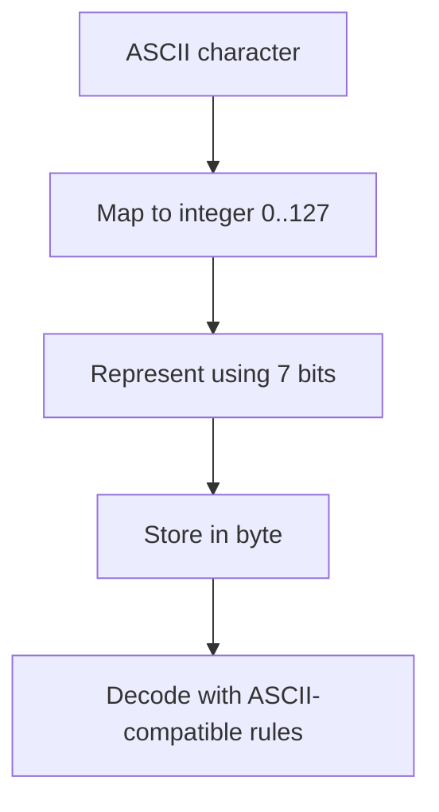

# TXT-030 — ASCII: The Original 7-Bit Character Code

> **Audience:** Beginner  
 > **Depth:** Engineer-level  
 > **Prerequisite:** Previous Text concepts in taxonomy order.

## Definition

ASCII (American Standard Code for Information Interchange) assigns numeric values to a small repertoire of English letters, digits, punctuation and control characters. Classic ASCII uses 7 bits and defines 128 values, from 0 through 127. It cannot directly represent Telugu or most world writing systems. UTF-8 preserves ASCII values for the first 128 Unicode code points.

## How it is represented

Uppercase A is decimal 65, hexadecimal 0x41 and binary 01000001. ASCII includes printable characters and control values such as line feed. Although stored in an 8-bit byte on most systems, classic ASCII is a 7-bit character set.

## Processing pipeline



## Key models

ASCII is an encoding, not a language model. Modern applications generally use Unicode encodings such as UTF-8; ASCII remains important for compatibility and protocol design.

## I/O modes

Input: text restricted to ASCII. Output: ASCII bytes. Non-ASCII input should be rejected or processed using a Unicode encoding; do not silently discard it.

## Python implementation

The example isolates the core mechanism; it is a learning exercise, not a full production pipeline.

```python
text = "Hello, AI!"
data = text.encode("ascii")
print(data, list(data), data.decode("ascii"))

non_ascii = "తెలుగు"
try:
    non_ascii.encode("ascii")
except UnicodeEncodeError as exc:
    print("ASCII cannot represent this text:", exc)
```

## Failure modes

- Classic ASCII is 7-bit, not an 8-bit universal character set.
- "Extended ASCII" is ambiguous because multiple incompatible code pages existed.
- Never drop unsupported user characters silently.
- ASCII is a subset of Unicode-compatible UTF-8, not a synonym for Unicode.

## Related project evidence
- [Separate evidence page](../../evidence/text/todo-project--ascii.md).
- Implementation claims and personal contribution are treated separately.

## Further reading
- [RFC 20 — ASCII](https://www.rfc-editor.org/rfc/rfc20)
- [Python codecs](https://docs.python.org/3/library/codecs.html)
- [Unicode UTF-8 FAQ](https://www.unicode.org/faq/utf_bom.html)

## Review checklist
- [ ] Explain the concept in your own words.
- [ ] Draw the pipeline and explain each stage.
- [ ] Run and modify the Python example.
- [ ] Identify failure modes and how to test them.