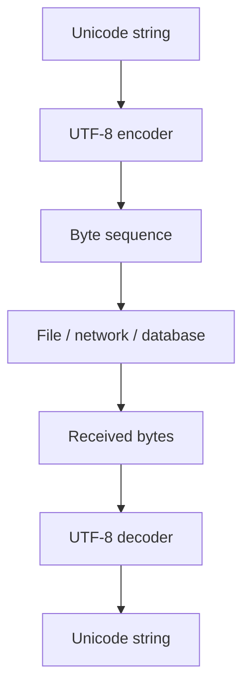

# TXT-040 — Unicode and UTF-8 Encoding / Decoding

> **Audience:** Beginner  
 > **Depth:** Engineer-level  
 > **Prerequisite:** Previous Text concepts in taxonomy order.

## Definition

Unicode defines code points for text across writing systems. UTF-8 encodes Unicode text as bytes. Encoding converts a string into bytes; decoding interprets bytes using an agreed encoding and reconstructs text. UTF-8 is variable length: each code point uses one to four bytes.

## How it is represented

Python str represents Unicode text; bytes represents byte values. ASCII code points use one byte in UTF-8 and keep their original numeric values. Non-ASCII code points use multi-byte sequences with defined leading and continuation-byte patterns.

## Processing pipeline



## Key models

UTF-8 is an encoding format, not an AI model. UTF-16 and UTF-32 are other Unicode encodings. Every byte boundary should define which encoding is expected.

## I/O modes

Input: Unicode text and UTF-8. Output: bytes. The reverse operation takes bytes plus the same encoding and returns text. Invalid byte sequences must be handled deliberately.

## Python implementation

The example isolates the core mechanism; it is a learning exercise, not a full production pipeline.

```python
text = "Aéత🙂"
data = text.encode("utf-8")

print("Byte values:", list(data))
print("Hex:", data.hex(" "))
print("Byte count:", len(data))
print("Code-point count:", len(text))
assert data.decode("utf-8") == text

try:
    b"\\xff".decode("utf-8")
except UnicodeDecodeError as exc:
    print("Invalid UTF-8:", exc)
```

## Failure modes

- UTF-8 encoding is not the same operation as model tokenization.
- Byte count and Python string length are different measures.
- Decoding bytes with the wrong encoding causes errors or mojibake.
- errors="ignore" can silently lose information.
- State encodings explicitly in file, storage and API contracts.

## Related project evidence
- [Separate evidence page](../../evidence/text/tiny-gpt-jetson-colab--unicode-and-utf8-encoding-decoding.md).
- Implementation claims and personal contribution are treated separately.

## Further reading
- [RFC 3629 — UTF-8](https://www.rfc-editor.org/rfc/rfc3629)
- [Python Unicode HOWTO](https://docs.python.org/3/howto/unicode.html)
- [Python str.encode](https://docs.python.org/3/library/stdtypes.html#str.encode)

## Review checklist
- [ ] Explain the concept in your own words.
- [ ] Draw the pipeline and explain each stage.
- [ ] Run and modify the Python example.
- [ ] Identify failure modes and how to test them.