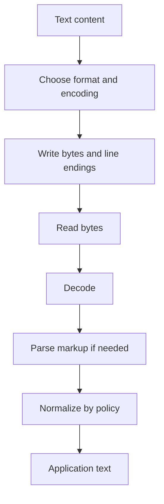

# TXT-050 — Text Files, Markup, Normalization and Newlines

> **Audience:** Beginner  
 > **Depth:** Engineer-level  
 > **Prerequisite:** Previous Text concepts in taxonomy order.

## Definition

A text file stores bytes that software decodes into characters using an encoding. Plain text contains written content without a rich document structure. Markup formats such as Markdown, HTML and XML add syntax to describe structure or presentation. Normalization and newline handling make text processing more consistent across systems.

## How it is represented

A text file is bytes plus an encoding convention and often a format grammar. Line endings may be LF or CRLF. Unicode normalization can make canonically equivalent code-point sequences consistent. Markup remains text, but a parser interprets its syntax.

## Processing pipeline



## Key models

Use format-aware tools such as pathlib, open(), json, HTML/XML parsers and Markdown parsers. Do not parse nested document formats with ad-hoc string splitting.

## I/O modes

Input: text or markup. Output: encoded files, parsed structures or normalized text. Define whether original whitespace, formatting and line endings must be preserved.

## Python implementation

The example isolates the core mechanism; it is a learning exercise, not a full production pipeline.

```python
from pathlib import Path
import unicodedata

path = Path("sample.txt")
original = "First line\\r\\nSecond line\\r\\ncafe\\u0301"

with path.open("w", encoding="utf-8", newline="\\n") as file:
    file.write(original.replace("\\r\\n", "\\n"))

with path.open("r", encoding="utf-8", newline=None) as file:
    loaded = file.read()

normalized = unicodedata.normalize("NFC", loaded)
print(repr(loaded))
print(repr(normalized))
```

## Failure modes

- File extensions do not guarantee a particular encoding.
- Line endings vary across operating systems and tools.
- Whitespace normalization can corrupt code, poetry and fixed-width data.
- Use parsers for HTML, XML and JSON rather than regular expressions.
- Preserve original text when auditability or exact reproduction matters.

## Related project evidence
- [Separate evidence page](../../evidence/text/todo-project--text-files-markup-normalization-newlines.md).
- Implementation claims and personal contribution are treated separately.

## Further reading
- [Python pathlib](https://docs.python.org/3/library/pathlib.html)
- [Python open()](https://docs.python.org/3/library/functions.html#open)
- [Python json](https://docs.python.org/3/library/json.html)

## Review checklist
- [ ] Explain the concept in your own words.
- [ ] Draw the pipeline and explain each stage.
- [ ] Run and modify the Python example.
- [ ] Identify failure modes and how to test them.