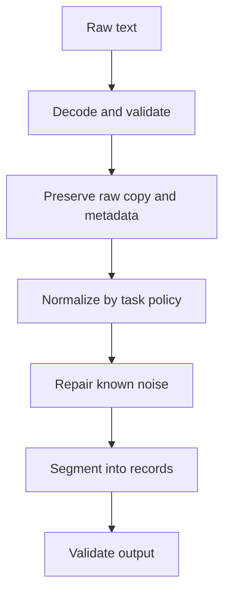

# TXT-060 — Text Cleaning and Preprocessing

> **Audience:** Beginner  
 > **Depth:** Engineer-level  
 > **Prerequisite:** Previous Text concepts in taxonomy order.

## Definition

Text preprocessing transforms raw text into a form suitable for a downstream task. It may include decoding, validation, whitespace handling, normalization, noise removal, sentence splitting and language-specific preparation. There is no universal cleaning recipe: transformations must preserve information the task needs.

## How it is represented

Inputs are Unicode strings or documents. Outputs may be cleaned strings, sentences, structured fields or model-specific inputs. A reliable pipeline preserves the raw source and records transformations that affect content.

## Processing pipeline



## Key models

Components include Unicode normalization, regular expressions for known patterns, HTML parsers, language detection, sentence segmentation and domain-specific cleaning. LLM pipelines should often preprocess conservatively because punctuation and casing can be meaningful.

## I/O modes

Input: raw or noisy text. Output: normalized text or structured segments, ideally with transformation metadata. Keep the raw input for debugging and audit.

## Python implementation

The example isolates the core mechanism; it is a learning exercise, not a full production pipeline.

```python
import re
import unicodedata

def clean_for_search(raw: str) -> str:
    text = unicodedata.normalize("NFC", raw)
    text = text.replace("\\u00a0", " ")
    text = re.sub(r"[ \\t]+", " ", text)
    text = re.sub(r"\\n{3,}", "\\n\\n", text)
    return text.strip()

raw = "  AI\\u00a0engineering   notes.\\n\\n\\nNext line.  "
print(repr(clean_for_search(raw)))
```

## Failure modes

- Over-cleaning removes meaningful punctuation, casing, numbers or layout.
- Lowercasing can damage names, acronyms and case-sensitive identifiers.
- Removing stop words can remove negation and reverse meaning.
- Language-specific segmentation needs language-aware tools.
- Test preprocessing on normal, noisy and adversarial examples.

## Related project evidence
- [Separate evidence page](../../evidence/text/todo-project--text-cleaning-and-preprocessing.md).
- Implementation claims and personal contribution are treated separately.

## Further reading
- [Python re](https://docs.python.org/3/library/re.html)
- [Unicode normalization](https://docs.python.org/3/library/unicodedata.html)
- [Unicode Text Segmentation UAX #29](https://www.unicode.org/reports/tr29/)

## Review checklist
- [ ] Explain the concept in your own words.
- [ ] Draw the pipeline and explain each stage.
- [ ] Run and modify the Python example.
- [ ] Identify failure modes and how to test them.