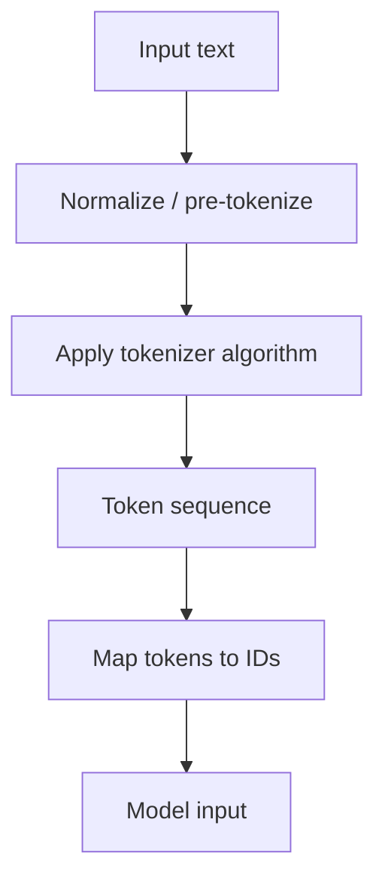

# TXT-070 — Tokenization: Character, Word and Subword Methods

> **Audience:** Beginner  
 > **Depth:** Engineer-level  
 > **Prerequisite:** Previous Text concepts in taxonomy order.

## Definition

Tokenization divides text into units called tokens for a task or model. A token may be a character, word, punctuation mark, word fragment or byte-level unit. The tokenizer defines splitting rules and a vocabulary. The same text can produce different token sequences under different tokenizers.

## How it is represented

Character tokenization is simple but creates long sequences. Word tokenization is intuitive but struggles with unseen words and morphology. Subword methods such as BPE and WordPiece reuse frequent pieces while allowing uncommon words to be represented as combinations of pieces.

## Processing pipeline



## Key models

Common approaches include character, whitespace/word, Byte Pair Encoding (BPE), WordPiece, Unigram Language Model and byte-level BPE. Production models must use the tokenizer associated with their checkpoint.

## I/O modes

Input: text string. Output: ordered tokens, IDs and possibly offsets or special-token metadata. Decoding maps IDs back to text using the same tokenizer.

## Python implementation

The example isolates the core mechanism; it is a learning exercise, not a full production pipeline.

```python
text = "Tokenization helps language models."
character_tokens = list(text)
whitespace_tokens = text.split()
print("Character tokens:", character_tokens[:10])
print("Whitespace tokens:", whitespace_tokens)
print("Character count:", len(character_tokens))
print("Whitespace token count:", len(whitespace_tokens))
```

## Failure modes

- Whitespace splitting is not a multilingual tokenizer.
- Tokenization is not UTF-8 encoding.
- Token IDs are meaningful only within the tokenizer vocabulary/version.
- A common word may split into several subword tokens.
- A tokenizer/checkpoint mismatch can make inference fail or degrade quality.

## Related project evidence
- [Separate evidence page](../../evidence/text/tiny-gpt-jetson-colab--tokenization-character-word-subword.md).
- Implementation claims and personal contribution are treated separately.

## Further reading
- [Hugging Face Tokenizers](https://huggingface.co/docs/tokenizers/)
- [BPE paper](https://arxiv.org/abs/1508.07909)
- [SentencePiece](https://arxiv.org/abs/1808.06226)

## Review checklist
- [ ] Explain the concept in your own words.
- [ ] Draw the pipeline and explain each stage.
- [ ] Run and modify the Python example.
- [ ] Identify failure modes and how to test them.