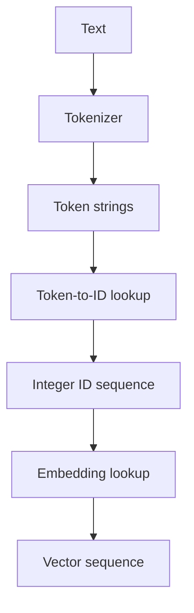

# TXT-080 — Vocabulary and Token IDs

> Audience: beginner | Depth: engineer-level

## Definition

A vocabulary is the set of token units known to a tokenizer. A token ID is the integer index assigned to one vocabulary entry. Neural networks use IDs because their layers operate on numeric tensors. An ID has no meaning by itself: ID 17 means whichever token the specific vocabulary assigns to index 17.

## How it is represented

A tokenizer commonly maintains token-to-ID and ID-to-token maps. Vocabularies may include special entries such as unknown, padding, beginning-of-sequence, end-of-sequence and separator tokens. Tokenizer files and model checkpoints must remain aligned.

## Processing pipeline



## Key models

Vocabulary lookup is used by LLM tokenizers and embedding layers. UNK, PAD, BOS, EOS and chat markers are common conventions, but exact tokens vary by tokenizer and model.

## I/O modes

Input: token strings. Output: integer IDs. Reverse lookup maps IDs back to token strings. Unknown-token behavior must be explicit.

## Python implementation

This is a small learning example, not a complete production system.

```python
tokens = ["<PAD>", "<UNK>", "hello", "world", "!"]
token_to_id = {token: idx for idx, token in enumerate(tokens)}
id_to_token = {idx: token for token, idx in token_to_id.items()}

sentence = ["hello", "world", "!"]
ids = [token_to_id.get(token, token_to_id["<UNK>"])
       for token in sentence]
restored = [id_to_token[i] for i in ids]
print("IDs:", ids)
print("Restored:", restored)
```

## Failure modes

- IDs cannot be compared across vocabularies as universal values.
- Changing vocabulary order changes the meaning of IDs.
- Missing unknown-token handling causes lookup failures.
- Special tokens must be consistent across training and serving.
- Save tokenizer data and configuration alongside the checkpoint.

## Related project evidence
- [Separate evidence page](../../evidence/text/tiny-gpt-jetson-colab--vocabulary-and-token-ids.md).

## Further reading
- [Hugging Face tokenizer components](https://huggingface.co/docs/tokenizers/components)
- [Transformers tokenizer API](https://huggingface.co/docs/transformers/main_classes/tokenizer)

## Review checklist
- [ ] Explain the concept in your own words.
- [ ] Draw and explain the pipeline.
- [ ] Run and modify the code.
- [ ] Describe failure modes and tests.