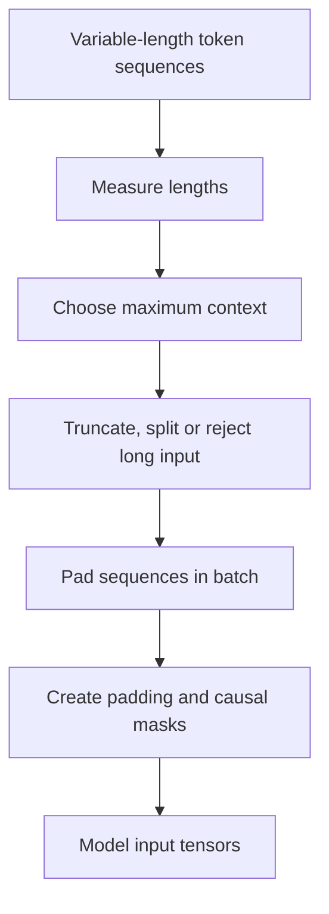

# TXT-090 — Sequence Length, Context Windows, Padding, Truncation and Masks

> Audience: beginner | Depth: engineer-level

## Definition

A text sequence is an ordered list of tokens or IDs. Its length is the number of units in that list. A model's context window limits how many positions it can process. Batching requires equal-shaped tensors, so shorter sequences may be padded and longer ones truncated or split. Masks tell a model which positions to ignore or which future positions it cannot inspect.

## How it is represented

A batch is commonly shaped [batch_size, sequence_length]. A padding mask marks real tokens and padding positions. A causal mask blocks future positions. These are different masks and framework APIs can use different boolean conventions.

## Processing pipeline



## Key models

Context limits depend on model architecture, position representation and serving implementation. Padding and causal masks are standard in Transformer pipelines. Bucketing and packing can improve training efficiency.

## I/O modes

Input: variable-length token sequences. Output: batched IDs, lengths and masks. An API must state whether overlength input is rejected, truncated, split or summarized.

## Python implementation

This is a small learning example, not a complete production system.

```python
sequences = [[11, 12, 13], [21, 22], [31]]
pad_id = 0
max_len = max(map(len, sequences))

padded, padding_masks = [], []
for seq in sequences:
    count = max_len - len(seq)
    padded.append(seq + [pad_id] * count)
    padding_masks.append([1] * len(seq) + [0] * count)

causal_mask = [[j > i for j in range(max_len)] for i in range(max_len)]
print("Padded:", padded)
print("Padding mask:", padding_masks)
print("Causal mask:", causal_mask)
```

## Failure modes

- Padding masks and causal masks are not interchangeable.
- Truncation can remove the question or supporting evidence.
- Chat history, system prompts and tool results also consume context.
- Mask boolean semantics differ across frameworks.
- Left/right padding can affect generation and positional handling.

## Related project evidence
- [Separate evidence page](../../evidence/text/tiny-gpt-jetson-colab--sequence-length-context-padding-truncation-masks.md).

## Further reading
- [Hugging Face padding and truncation](https://huggingface.co/docs/transformers/pad_truncation)
- [PyTorch MultiheadAttention](https://pytorch.org/docs/stable/generated/torch.nn.MultiheadAttention.html)

## Review checklist
- [ ] Explain the concept in your own words.
- [ ] Draw and explain the pipeline.
- [ ] Run and modify the code.
- [ ] Describe failure modes and tests.