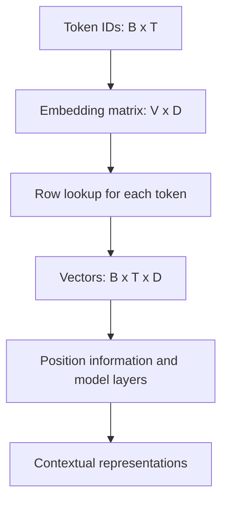

# TXT-100 — Text Embeddings

> Audience: beginner | Depth: engineer-level

## Definition

An embedding maps a discrete item such as a token ID to a dense numerical vector. In a language model, a learned embedding table provides an initial vector for each token ID. Training adjusts these vectors together with other parameters. Embeddings make token identity usable by neural-network operations; later layers produce context-dependent representations.

## How it is represented

An embedding matrix is often shaped [vocabulary_size, embedding_dimension]. Looking up IDs shaped [B, T] produces vectors shaped [B, T, D], where B is batch size, T is sequence length and D is embedding dimension.

## Processing pipeline



## Key models

Embedding tables appear in GPT, BERT and T5. Separate sentence-embedding models create vectors for whole queries or passages. Token embeddings and sentence embeddings serve different purposes.

## I/O modes

Input: token IDs. Output: a vector per token. A retrieval embedding model may instead map a whole query or passage to a fixed-size vector.

## Python implementation

This is a small learning example, not a complete production system.

```python
# Install PyTorch: python -m pip install torch
import torch
from torch import nn

vocab_size, embedding_dim = 100, 8
embedding = nn.Embedding(vocab_size, embedding_dim)
token_ids = torch.tensor([[4, 12, 7], [9, 2, 0]])
vectors = embedding(token_ids)

print("ID shape:", tuple(token_ids.shape))
print("Vector shape:", tuple(vectors.shape))  # (2, 3, 8)
```

## Failure modes

- An embedding is not a definition or one-hot vector; it is a learned dense representation.
- Vector dimensions are model-specific.
- Token embeddings are not automatically sentence embeddings.
- Similarity depends on the model and its training objective.
- Do not mix vectors from different embedding models or versions in one index without migration.

## Related project evidence
- [Separate evidence page](../../evidence/text/tiny-gpt-jetson-colab--text-embeddings.md).

## Further reading
- [PyTorch nn.Embedding](https://pytorch.org/docs/stable/generated/torch.nn.Embedding.html)
- [Word2Vec](https://arxiv.org/abs/1301.3781)
- [Sentence-BERT](https://arxiv.org/abs/1908.10084)

## Review checklist
- [ ] Explain the concept in your own words.
- [ ] Draw and explain the pipeline.
- [ ] Run and modify the code.
- [ ] Describe failure modes and tests.