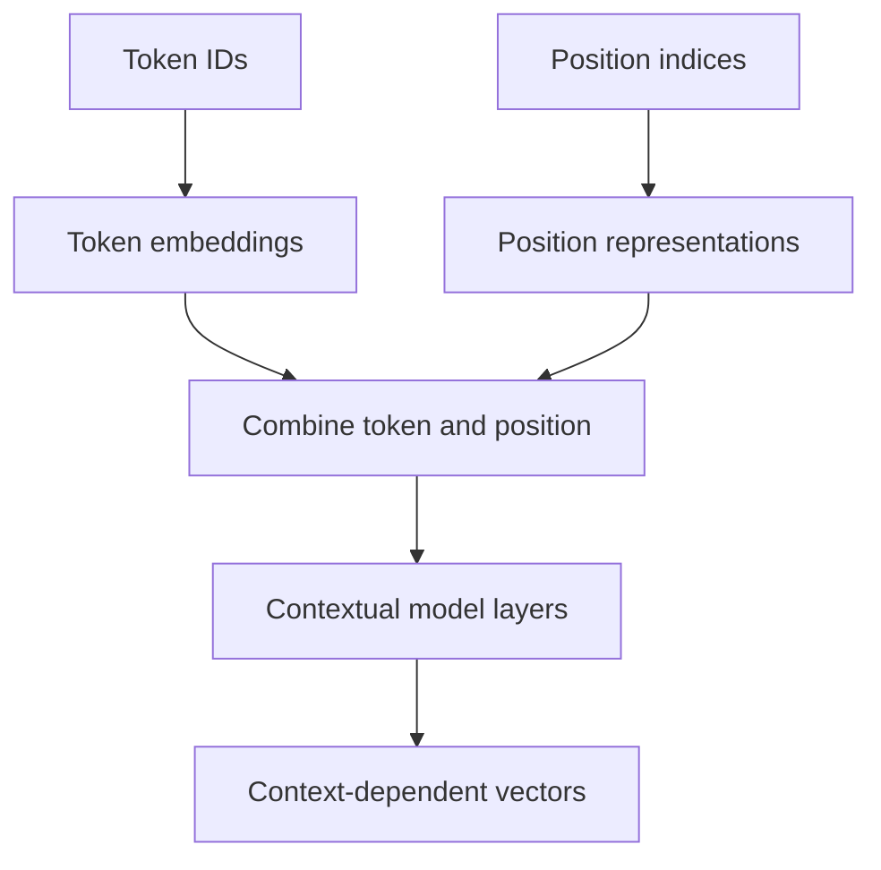

# TXT-110 — Static, Contextual and Positional Representations

> Audience: beginner | Depth: engineer-level

## Definition

A static embedding assigns the same vector to a token regardless of surrounding words. A contextual representation changes based on the token's context. Positional information tells a sequence model where a token occurs. Token identity alone does not encode word order.

## How it is represented

Static vectors include Word2Vec and GloVe. Contextual vectors are hidden states produced by ELMo or Transformers. Position may use learned absolute embeddings, sinusoidal encodings, relative position bias or rotary position embeddings.

## Processing pipeline



## Key models

Static: Word2Vec, GloVe. Contextual: ELMo, BERT, GPT. Position methods: learned absolute embeddings, sinusoidal, relative bias and RoPE.

## I/O modes

Input: token IDs and position indices. Output: static vectors, position-aware input vectors or contextual hidden states.

## Python implementation

This is a small learning example, not a complete production system.

```python
token_vector = [0.2, 0.8]
position_vectors = {0: [0.1, 0.0], 1: [0.0, 0.1]}

def add(a, b):
    return [x + y for x, y in zip(a, b)]

for position in (0, 1):
    print(position, add(token_vector, position_vectors[position]))

# Toy illustration only: contextual vectors are produced by trained model layers.
```

## Failure modes

- Static embeddings cannot represent different word senses as separate contextual vectors.
- Position vectors alone do not create contextual meaning; model layers combine information.
- Vector dimensions do not have guaranteed human-readable meanings.
- Position schemes have context-length and extrapolation tradeoffs.

## Related project evidence
- [Separate evidence page](../../evidence/text/tiny-gpt-jetson-colab--static-contextual-and-positional-representations.md).

## Further reading
- [Word2Vec](https://arxiv.org/abs/1301.3781)
- [ELMo](https://arxiv.org/abs/1802.05365)
- [Attention Is All You Need](https://arxiv.org/abs/1706.03762)
- [RoPE](https://arxiv.org/abs/2104.09864)

## Review checklist
- [ ] Explain the concept in your own words.
- [ ] Draw and explain the pipeline.
- [ ] Run and modify the code.
- [ ] Describe failure modes and tests.