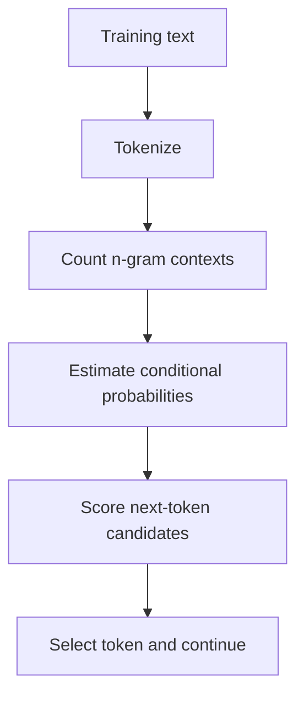

# TXT-120 — N-Gram and Statistical Language Models

> Audience: beginner | Depth: engineer-level

## Definition

An n-gram language model estimates the probability of a token using a limited window of preceding tokens. A unigram uses no preceding token, a bigram conditions on one previous token, and a trigram conditions on two. N-grams introduce the idea of predicting language from context before neural models.

## How it is represented

The model stores counts or probabilities for token sequences. A common approximation is P(w_t | previous n-1 tokens). Smoothing assigns probability to unseen sequences; backoff and interpolation use shorter contexts when longer contexts are rare.

## Processing pipeline



## Key models

Unigram, bigram and trigram models; add-k/Laplace smoothing; backoff and interpolated language models. Kneser-Ney is a classic advanced smoothing method.

## I/O modes

Input: a token context. Output: next-token probabilities or a generated token. Context length is fixed and limited.

## Python implementation

This is a small learning example, not a complete production system.

```python
from collections import Counter, defaultdict

tokens = "the cat sat on the mat the cat ate".split()
counts = defaultdict(Counter)
for left, right in zip(tokens, tokens[1:]):
    counts[left][right] += 1

def next_prob(context, candidate):
    total = sum(counts[context].values())
    return counts[context][candidate] / total if total else 0.0

print("P(cat | the) =", next_prob("the", "cat"))
```

## Failure modes

- Maximum-likelihood n-grams assign zero probability to unseen sequences without smoothing.
- Larger n increases sparsity and memory requirements.
- N-gram models have fixed context and weak long-range dependencies.
- Tokenization choices change the statistics.
- A tiny demonstration corpus is not representative language data.

## Related project evidence
- [Separate evidence page](../../evidence/text/todo-project--ngram-language-models.md).

## Further reading
- [Speech and Language Processing — Jurafsky & Martin](https://web.stanford.edu/~jurafsky/slp3/)
- [Kneser-Ney smoothing background](https://www.cs.cmu.edu/~roni/11761/)

## Review checklist
- [ ] Explain the concept in your own words.
- [ ] Draw and explain the pipeline.
- [ ] Run and modify the code.
- [ ] Describe failure modes and tests.