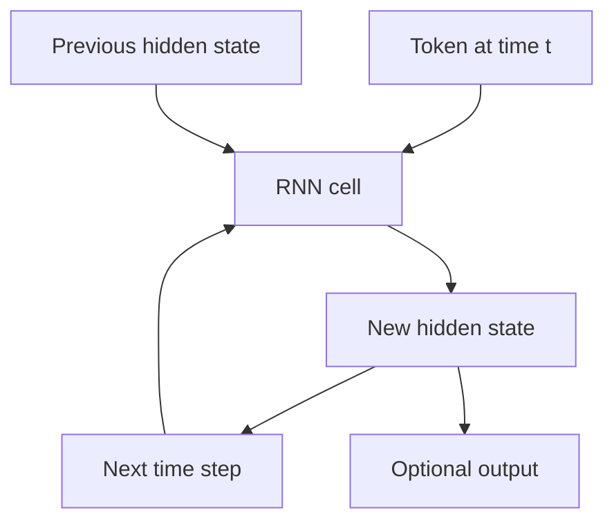

# TXT-130 — RNNs, LSTMs and GRUs

> Audience: beginner | Depth: engineer-level

## Definition

A recurrent neural network processes a sequence one step at a time while carrying a hidden state from earlier steps. The hidden state acts as a compressed memory of previous inputs. Basic RNNs can struggle with long-range dependencies because gradients can vanish or explode. LSTMs and GRUs add gates that control information flow.

## How it is represented

At time t, an RNN computes a new hidden state from the current input and previous hidden state. LSTM uses cell state plus input, forget and output gates. GRU uses update and reset gates and has a simpler state structure.

## Processing pipeline



## Key models

Vanilla RNN, LSTM, GRU and bidirectional variants. They are important sequence-model foundations and remain useful for some streaming or resource-constrained tasks, although Transformers dominate many modern LLM applications.

## I/O modes

Input: sequence tensor, often [batch, sequence, features]. Output: hidden states at every step, a final state or task predictions. Streaming inference can carry hidden state between chunks.

## Python implementation

This is a small learning example, not a complete production system.

```python
# Install PyTorch: python -m pip install torch
import torch
from torch import nn

x = torch.randn(2, 5, 8)  # batch, sequence, input features
for layer in (nn.RNN(8, 16, batch_first=True),
              nn.LSTM(8, 16, batch_first=True),
              nn.GRU(8, 16, batch_first=True)):
    output = layer(x)[0]
    print(type(layer).__name__, tuple(output.shape))
```

## Failure modes

- Basic RNNs can suffer vanishing or exploding gradients on long sequences.
- LSTM/GRU state tuple shapes differ; consult the framework API.
- Stateful streaming must preserve and reset hidden state at correct boundaries.
- Bidirectional models use future context and are not strictly causal online predictors.
- RNNs and Transformers have different parallelism and memory behavior.

## Related project evidence
- [Separate evidence page](../../evidence/text/todo-project--rnn-lstm-gru.md).

## Further reading
- [Understanding LSTM Networks](https://colah.github.io/posts/2015-08-Understanding-LSTMs/)
- [PyTorch RNN](https://pytorch.org/docs/stable/generated/torch.nn.RNN.html)
- [PyTorch LSTM](https://pytorch.org/docs/stable/generated/torch.nn.LSTM.html)
- [PyTorch GRU](https://pytorch.org/docs/stable/generated/torch.nn.GRU.html)

## Review checklist
- [ ] Explain the concept in your own words.
- [ ] Draw and explain the pipeline.
- [ ] Run and modify the code.
- [ ] Describe failure modes and tests.