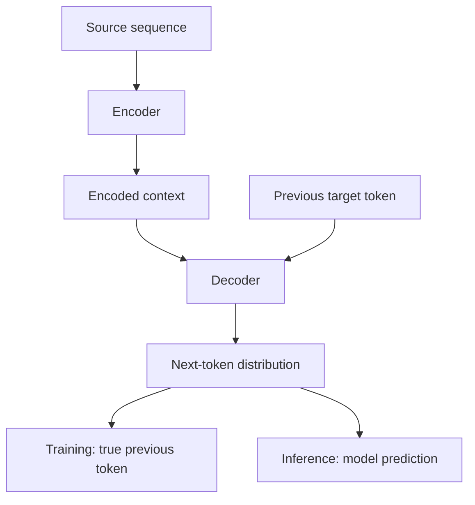

# TXT-140 — Sequence-to-Sequence Models and Teacher Forcing

> Audience: beginner | Depth: engineer-level

## Definition
A sequence-to-sequence (seq2seq) model maps an input sequence to an output sequence, often of a different length. A classic design uses an encoder to represent the input and a decoder to generate the output. Teacher forcing is a training strategy in which the decoder receives the true previous target token instead of its own previous prediction.

## How it is represented
The encoder produces hidden representations. The decoder predicts target tokens step by step, conditioned on encoder context and earlier target tokens. During training, teacher forcing supplies ground-truth previous tokens; during inference, the decoder consumes its own generated tokens.

## Processing pipeline


## Key models
Classic RNN encoder-decoder models, attention-based seq2seq and Transformer encoder-decoder models such as the original Transformer and T5. Translation and summarization are common seq2seq tasks.

## I/O modes
Input: source token sequence. Output: generated target sequence, often ending at an EOS token. Training has paired source/target sequences; inference does not have the target sequence.

## Python implementation
The example demonstrates the core mechanism; it is not a full production model.
```python
target = ["<BOS>", "hello", "world", "<EOS>"]
decoder_inputs = target[:-1]
training_labels = target[1:]
print("Decoder inputs:", decoder_inputs)
print("Labels:", training_labels)

# At inference the decoder feeds its own predictions back.
predictions = ["hello", "there", "<EOS>"]
generated = ["<BOS>"]
for token in predictions:
    generated.append(token)
    if token == "<EOS>":
        break
print("Generated:", generated)
```

## Failure modes
- Teacher forcing creates a train/inference mismatch: training sees correct previous tokens but inference sees model predictions.
- Padding positions must not contribute to the loss.
- Decoder inputs and labels are shifted; off-by-one mistakes are common.
- Encoder-decoder and decoder-only models have different conditioning interfaces.
- Generation needs stopping criteria and maximum-length controls.

## Related project evidence
- [Separate project evidence page](../../evidence/text/todo-project--sequence-to-sequence-and-teacher-forcing.md).

## Further reading
- [Sequence to Sequence Learning with Neural Networks](https://arxiv.org/abs/1409.3215)
- [Attention Is All You Need](https://arxiv.org/abs/1706.03762)
- [PyTorch seq2seq tutorial](https://pytorch.org/tutorials/intermediate/seq2seq_translation_tutorial.html)

## Review checklist
- [ ] Explain the concept without reading the definition.
- [ ] Draw and explain the pipeline.
- [ ] Run and modify the Python example.
- [ ] Identify failure modes and tests.