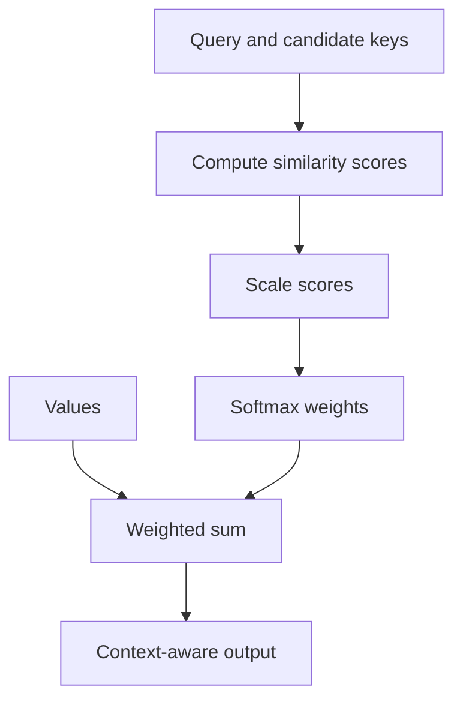

# TXT-150 — Attention Mechanism

> Audience: beginner | Depth: engineer-level

## Definition
Attention lets a model compute which parts of a sequence are most relevant when building a representation for a particular position. It computes compatibility scores between a query and candidate keys, turns the scores into weights and combines the corresponding values.

## How it is represented
A query expresses what information is being sought, a key provides a representation to compare against, and a value contains the information to combine. Similarity scores are normalized with softmax so weights sum to one. The weighted sum of values is the attention output.

## Processing pipeline


## Key models
Additive attention, dot-product attention and scaled dot-product attention are common forms. Transformer self-attention derives queries, keys and values from sequence representations.

## I/O modes
Input: queries, keys and values (usually tensors). Output: a weighted combination of values for each query, optionally with attention weights.

## Python implementation
The example demonstrates the core mechanism; it is not a full production model.
```python
import math

def softmax(values):
    peak = max(values)
    exp_values = [math.exp(x - peak) for x in values]
    total = sum(exp_values)
    return [x / total for x in exp_values]

query = [1.0, 0.0]
keys = [[1.0, 0.0], [0.0, 1.0], [0.7, 0.7]]
values = [[10.0, 0.0], [0.0, 10.0], [5.0, 5.0]]
scores = [sum(a*b for a, b in zip(query, key)) for key in keys]
weights = softmax(scores)
context = [sum(weights[i] * values[i][j] for i in range(len(values)))
           for j in range(2)]
print("Scores:", scores)
print("Weights:", weights)
print("Context:", context)
```

## Failure modes
- Attention weights are not guaranteed to be faithful explanations of model reasoning.
- Large unscaled dot products can saturate softmax; scaling helps control score magnitude.
- Attention is not automatically causal; autoregressive generation needs a causal mask.
- Full self-attention has compute and memory costs that grow with sequence length.
- Query, key and value dimensions must be compatible.

## Related project evidence
- [Separate project evidence page](../../evidence/text/tiny-gpt-jetson-colab--attention-mechanism.md).

## Further reading
- [Neural Machine Translation by Jointly Learning to Align and Translate](https://arxiv.org/abs/1409.0473)
- [Attention Is All You Need](https://arxiv.org/abs/1706.03762)

## Review checklist
- [ ] Explain the concept without reading the definition.
- [ ] Draw and explain the pipeline.
- [ ] Run and modify the Python example.
- [ ] Identify failure modes and tests.