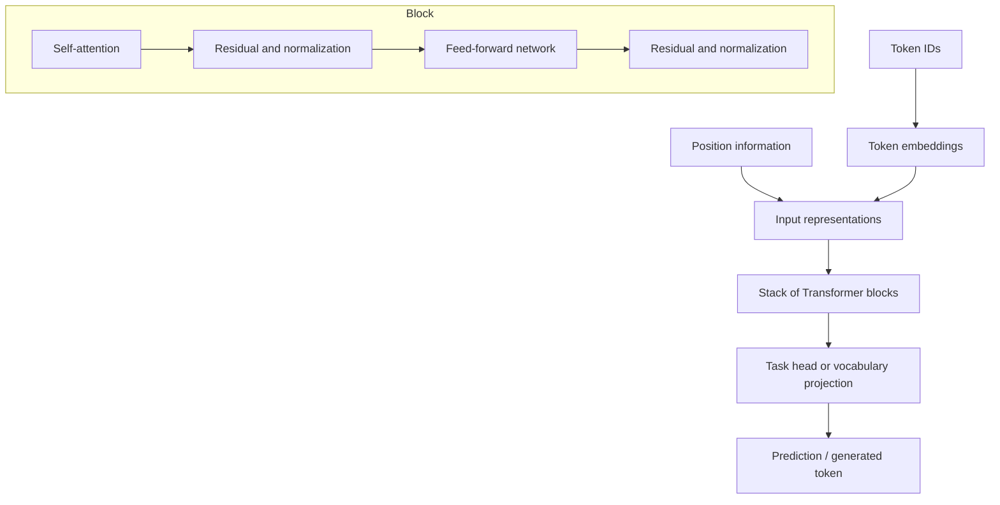

# TXT-160 — Transformer Architecture: Encoder, Decoder and Decoder-Only

> Audience: beginner | Depth: engineer-level

## Definition
A Transformer is a neural-network architecture built around attention and position-wise feed-forward networks. It processes sequence representations through stacked layers with residual connections and normalization. The original design used an encoder and decoder; later families include encoder-only BERT and decoder-only GPT.

## How it is represented
Input token IDs become vectors, position information is introduced, and the sequence passes through Transformer layers. Encoders commonly use bidirectional self-attention. Decoder layers use causal self-attention and may use cross-attention to encoder outputs. Decoder-only GPT models use causal self-attention to predict following tokens.

## Processing pipeline


## Key models
Encoder-only: BERT. Decoder-only: GPT-family models. Encoder-decoder: original Transformer and T5. Architectures differ in masks, cross-attention, objectives and I/O contracts.

## I/O modes
Input: tokenized sequence. Output can be contextual token vectors, a classification, labels, an embedding or generated text depending on architecture and task head.

## Python implementation
The example demonstrates the core mechanism; it is not a full production model.
```python
# Install PyTorch: python -m pip install torch
import torch
from torch import nn

layer = nn.TransformerEncoderLayer(d_model=32, nhead=4, batch_first=True)
encoder = nn.TransformerEncoder(layer, num_layers=2)
x = torch.randn(2, 6, 32)
y = encoder(x)
print("Input:", tuple(x.shape))
print("Output:", tuple(y.shape))
```

## Failure modes
- Transformer does not mean LLM; it is an architecture used for different tasks and scales.
- Encoder self-attention is not automatically causal.
- Position information is needed because attention alone does not encode sequence order.
- Tensor dimensions and mask conventions are common implementation bugs.
- A family name does not describe the entire training or deployment pipeline.

## Related project evidence
- [Separate project evidence page](../../evidence/text/tiny-gpt-jetson-colab--transformer-architecture-overview.md).

## Further reading
- [Attention Is All You Need](https://arxiv.org/abs/1706.03762)
- [BERT](https://arxiv.org/abs/1810.04805)
- [T5](https://arxiv.org/abs/1910.10683)

## Review checklist
- [ ] Explain the concept without reading the definition.
- [ ] Draw and explain the pipeline.
- [ ] Run and modify the Python example.
- [ ] Identify failure modes and tests.