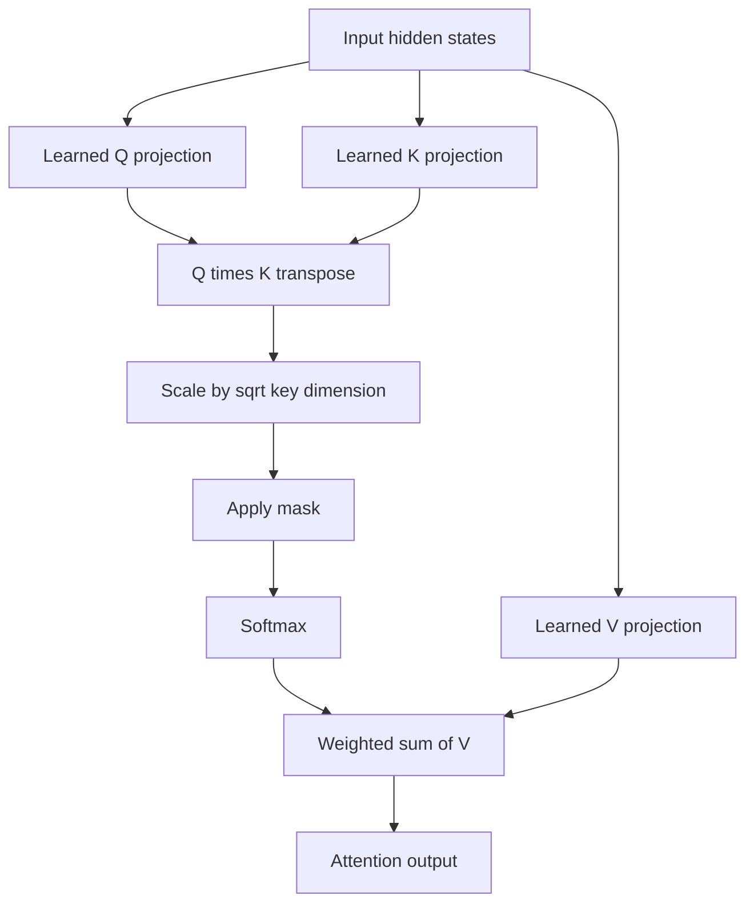

# TXT-170 — Query, Key and Value: Scaled Dot-Product Attention

> Audience: beginner | Depth: engineer-level

## Definition
In scaled dot-product attention, each token representation is projected into a query (Q), key (K) and value (V). Queries are compared with keys to calculate compatibility scores. Scores are divided by the square root of the key dimension, normalized with softmax and used to weight values.

## How it is represented
For Q shaped [B, heads, Tq, dk], K shaped [B, heads, Tk, dk] and V shaped [B, heads, Tk, dv], QKᵀ gives scores. Dividing by √dk controls score magnitude. Weighted values produce outputs shaped [B, heads, Tq, dv].

## Processing pipeline


## Key models
Scaled dot-product attention is the core attention operation in the original Transformer. Self-attention derives Q/K/V from one sequence; cross-attention derives queries from one sequence and keys/values from another.

## I/O modes
Input: Q, K and V tensors. Output: attended vectors and optionally attention weights. In self-attention, Q/K/V share a source sequence but use separate learned projections in typical Transformer implementations.

## Python implementation
The example demonstrates the core mechanism; it is not a full production model.
```python
import math
import torch

Q = torch.tensor([[1.0, 0.0]])
K = torch.tensor([[1.0, 0.0], [0.0, 1.0]])
V = torch.tensor([[10.0, 0.0], [0.0, 10.0]])
scores = Q @ K.T / math.sqrt(Q.shape[-1])
weights = torch.softmax(scores, dim=-1)
output = weights @ V
print("Scores:", scores)
print("Weights:", weights)
print("Output:", output)
```

## Failure modes
- Q, K and V are learned vector projections, not words or labels.
- In self-attention they share one input source but usually use separate learned projections.
- Forgetting K transpose or using incompatible dimensions causes shape errors.
- Scaling by √dk matters because large dot products can saturate softmax.
- Apply the mask before softmax.

## Related project evidence
- [Separate project evidence page](../../evidence/text/tiny-gpt-jetson-colab--query-key-value-scaled-dot-product-attention.md).

## Further reading
- [Attention Is All You Need](https://arxiv.org/abs/1706.03762)
- [The Annotated Transformer](https://nlp.seas.harvard.edu/annotated-transformer/)

## Review checklist
- [ ] Explain the concept without reading the definition.
- [ ] Draw and explain the pipeline.
- [ ] Run and modify the Python example.
- [ ] Identify failure modes and tests.