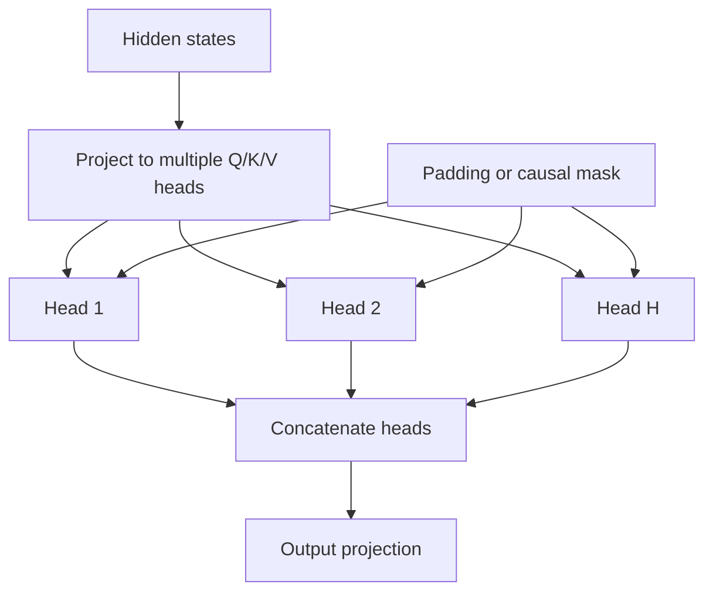

# TXT-180 — Multi-Head Attention and Attention Masks

> Audience: beginner | Depth: engineer-level

## Definition
Multi-head attention runs several attention operations in parallel using different learned projections. Each head can learn relationships in a different representation subspace. The outputs are concatenated and projected back into model dimension. Masks restrict which positions a query may use, for example to ignore padding or prevent access to future tokens.

## How it is represented
If model dimension is D and there are H heads, each head commonly uses dimension D/H. A padding mask suppresses padded keys. A causal mask blocks positions later than the current query position. Boolean mask conventions vary between frameworks.

## Processing pipeline


## Key models
Multi-head self-attention is standard in Transformer layers. Grouped-query attention and multi-query attention reduce key/value cache memory during autoregressive inference.

## I/O modes
Input: sequence tensor and optional masks. Output: updated sequence vectors and optionally attention weights. Mask shape and semantics depend on the framework/API.

## Python implementation
The example demonstrates the core mechanism; it is not a full production model.
```python
# Install PyTorch: python -m pip install torch
import torch
from torch import nn

x = torch.randn(2, 4, 16)
causal_mask = torch.triu(torch.ones(4, 4, dtype=torch.bool), diagonal=1)
attention = nn.MultiheadAttention(16, 4, batch_first=True)
output, weights = attention(x, x, x, attn_mask=causal_mask)
print("Output:", tuple(output.shape))
print("Weights:", tuple(weights.shape))
```

## Failure modes
- Model dimension commonly must be divisible by the number of heads.
- Padding and causal masks are different constraints.
- Boolean mask semantics vary; confirm whether True means allowed or blocked.
- Returning attention weights can consume substantial memory.
- Grouped-query/multi-query attention differ from ordinary multi-head attention.

## Related project evidence
- [Separate project evidence page](../../evidence/text/tiny-gpt-jetson-colab--multi-head-attention-and-masks.md).

## Further reading
- [PyTorch MultiheadAttention](https://pytorch.org/docs/stable/generated/torch.nn.MultiheadAttention.html)
- [Attention Is All You Need](https://arxiv.org/abs/1706.03762)
- [Grouped-Query Attention](https://arxiv.org/abs/2305.13245)

## Review checklist
- [ ] Explain the concept without reading the definition.
- [ ] Draw and explain the pipeline.
- [ ] Run and modify the Python example.
- [ ] Identify failure modes and tests.