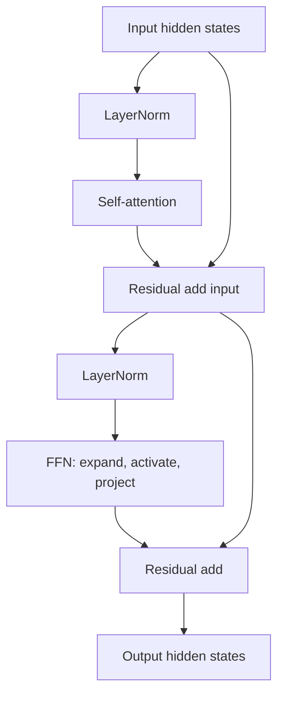

# TXT-190 — Transformer Block: Feed-Forward Networks, Residuals and Normalization

> Audience: beginner | Depth: engineer-level

## Definition
A Transformer block usually contains an attention sublayer and a position-wise feed-forward network (FFN). Residual connections add a sublayer's input back to its output, helping information and gradients flow through depth. Layer normalization stabilizes activations. The ordering of normalization and residual operations varies across architectures.

## How it is represented
An FFN typically expands each token vector from D dimensions to a wider hidden dimension, applies a nonlinearity such as GELU or ReLU, then projects back to D. Residual addition requires compatible shapes. LayerNorm normalizes features within each token representation.

## Processing pipeline


## Key models
Transformer blocks vary in pre-norm versus post-norm layout, activation function, FFN design and normalization choice (LayerNorm or RMSNorm). Check the specific architecture instead of assuming one universal block.

## I/O modes
Input and output usually have the same hidden-state shape [B, T, D], allowing blocks to be stacked. FFN activations temporarily use a wider dimension.

## Python implementation
The example demonstrates the core mechanism; it is not a full production model.
```python
# Install PyTorch: python -m pip install torch
import torch
from torch import nn

dim = 16
x = torch.randn(2, 5, dim)
ln1, attn_stub = nn.LayerNorm(dim), nn.Linear(dim, dim)
ln2 = nn.LayerNorm(dim)
ffn = nn.Sequential(nn.Linear(dim, 4*dim), nn.GELU(), nn.Linear(4*dim, dim))
h = x + attn_stub(ln1(x))
y = h + ffn(ln2(h))
print("Output shape:", tuple(y.shape))
```

## Failure modes
- Residual additions require matching dimensions or an explicit projection.
- Pre-norm and post-norm are different designs; ordering affects optimization behavior.
- LayerNorm normalizes feature dimensions, not the batch.
- Standard FFNs apply the same transformation independently at each sequence position.
- A residual path is not a substitute for understanding the full block data flow.

## Related project evidence
- [Separate project evidence page](../../evidence/text/tiny-gpt-jetson-colab--transformer-feedforward-residual-layernorm.md).

## Further reading
- [Attention Is All You Need](https://arxiv.org/abs/1706.03762)
- [PyTorch LayerNorm](https://pytorch.org/docs/stable/generated/torch.nn.LayerNorm.html)
- [RMSNorm](https://arxiv.org/abs/1910.07467)

## Review checklist
- [ ] Explain the concept without reading the definition.
- [ ] Draw and explain the pipeline.
- [ ] Run and modify the Python example.
- [ ] Identify failure modes and tests.