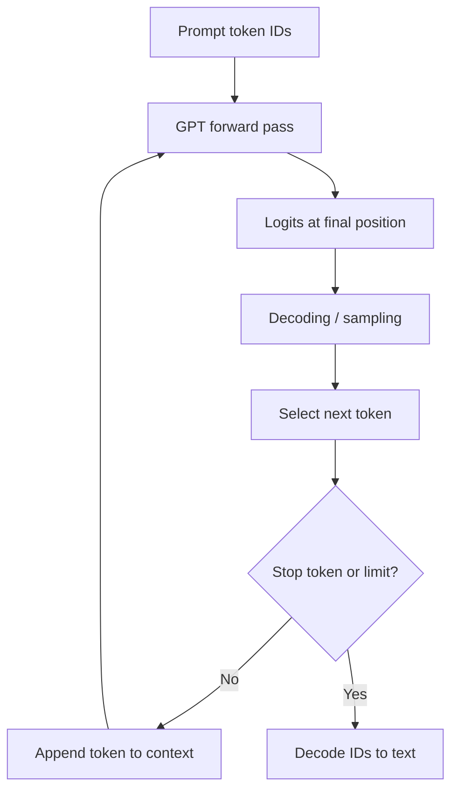

# TXT-200 — GPT, Next-Token Prediction and Autoregressive Generation

> Audience: beginner | Depth: engineer-level

## Definition
GPT-style decoder-only language models are trained to predict the next token from previous tokens. During generation, the model receives a prompt, computes a probability distribution for the next token, selects one token using a decoding strategy, appends it to the context and repeats. This is autoregressive generation.

## How it is represented
For a token sequence x₁...xₜ, a causal language model estimates P(xₜ₊₁ | x₁...xₜ). Training normally shifts inputs and targets by one position. The model outputs logits over the vocabulary; softmax converts logits into probabilities.

## Processing pipeline


## Key models
GPT-family decoder-only Transformers and other causal language models use autoregressive next-token prediction. Application layers may add instruction tuning, tools, retrieval or multimodal inputs.

## I/O modes
Input: prompt text or token IDs plus generation settings. Output: generated token IDs and decoded text. Systems may also emit structured data or tool calls.

## Python implementation
This is a small educational implementation, not a full production service.
```python
import random

# Tiny deterministic demonstration of next-token selection.
# This table is not a neural network or an LLM.
next_options = {
    "AI": ["learns", "processes"],
    "learns": ["patterns"],
    "processes": ["data"],
    "patterns": ["from"],
    "from": ["examples"],
    "data": ["."],
    "examples": ["."],
}
random.seed(7)
tokens = ["AI"]
for _ in range(6):
    tokens.append(random.choice(next_options.get(tokens[-1], ["."])))
    if tokens[-1] == ".":
        break
print(" ".join(tokens))
```

## Failure modes
- Next-token prediction is not the same as retrieving a verified fact.
- Generation needs EOS/stop conditions or a maximum-token limit.
- Sampling settings change diversity but do not repair incorrect knowledge.
- Context truncation can remove relevant instructions or history.
- A toy next-token table is not an LLM; distinguish illustrations from neural model implementations.

## Related project evidence
- [Separate project evidence page](../../evidence/text/tiny-gpt-jetson-colab--gpt-next-token-autoregressive-generation.md).

## Further reading
- [GPT-2 paper](https://openai.com/research/better-language-models/)
- [The Illustrated GPT-2](https://jalammar.github.io/illustrated-gpt2/)
- [Hugging Face generation strategies](https://huggingface.co/docs/transformers/generation_strategies)

## Review checklist
- [ ] Explain the concept.
- [ ] Draw and explain the pipeline.
- [ ] Run and modify the code.
- [ ] Describe failure modes and tests.