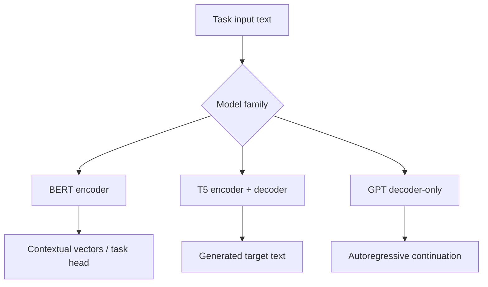

# TXT-210 — BERT, T5 and Transformer Architecture Comparison

> Audience: beginner | Depth: engineer-level

## Definition
BERT and T5 are Transformer model families designed around different input/output objectives. BERT is encoder-only and learns bidirectional contextual representations using masked-language modeling and related objectives. T5 uses an encoder-decoder design and frames many tasks as text-to-text transformations. GPT-style models are decoder-only and commonly use causal next-token prediction.

## How it is represented
BERT uses bidirectional attention over input tokens. T5 encodes an input and generates target tokens with a decoder and cross-attention. GPT consumes a causal prefix and predicts subsequent tokens. Tokenizers and special-token conventions differ by checkpoint.

## Processing pipeline


## Key models
BERT is encoder-only, T5 is encoder-decoder, and GPT is decoder-only. Related variants include RoBERTa, DeBERTa, FLAN-T5 and GPT-family checkpoints.

## I/O modes
BERT commonly maps text to representations, labels or extracted spans. T5 maps text to text. GPT maps a prompt to a continuation or response. These are common patterns, not absolute restrictions.

## Python implementation
This is a small educational implementation, not a full production service.
```python
architectures = {
    "BERT": ("encoder-only", "bidirectional", "classification / extraction"),
    "T5": ("encoder-decoder", "encoder + causal decoder", "text-to-text"),
    "GPT": ("decoder-only", "causal", "autoregressive generation"),
}
for name, details in architectures.items():
    print(name, "=>", details)
```

## Failure modes
- Transformer does not automatically mean decoder-only.
- BERT masked-token objectives differ from GPT next-token prediction.
- T5 has an encoder and decoder; it is not a GPT-style decoder-only model.
- Architecture, pretraining objective and fine-tuning task are distinct concepts.
- Use each checkpoint's matching tokenizer and input format.

## Related project evidence
- [Separate project evidence page](../../evidence/text/todo-project--bert-t5-and-architecture-comparison.md).

## Further reading
- [BERT](https://arxiv.org/abs/1810.04805)
- [T5](https://arxiv.org/abs/1910.10683)
- [GPT-2](https://openai.com/research/better-language-models/)

## Review checklist
- [ ] Explain the concept.
- [ ] Draw and explain the pipeline.
- [ ] Run and modify the code.
- [ ] Describe failure modes and tests.