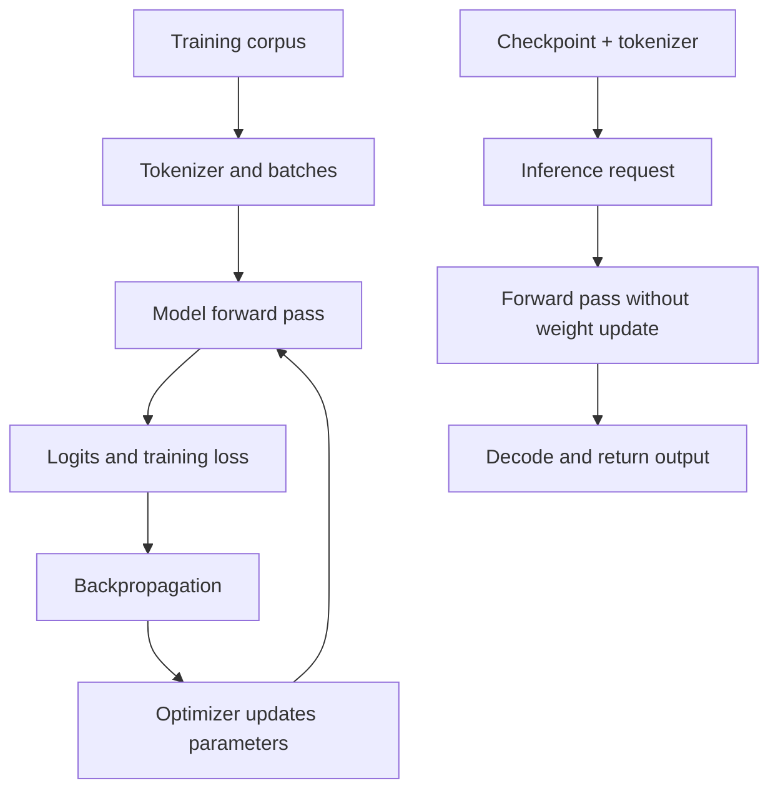

# TXT-220 — LLM Pretraining and Inference

> Audience: beginner | Depth: engineer-level

## Definition
Pretraining is a stage in which model parameters are learned from a training corpus using a general objective, such as predicting the next token. Inference is the use of a trained model to produce outputs for new inputs. Training updates parameters; ordinary inference uses learned parameters without optimizer updates.

## How it is represented
Training data becomes token ID sequences and batches. The model produces logits; a loss function compares predictions with target tokens. Backpropagation calculates gradients and an optimizer updates parameters. At inference, a checkpoint and matching tokenizer/configuration are loaded and a forward pass plus decoding generates output.

## Processing pipeline


## Key models
Autoregressive language-model pretraining, masked-language-model pretraining and encoder-decoder denoising objectives are common approaches. Serving systems may add batching, KV caching, quantization and other optimizations.

## I/O modes
Training input: batches of token IDs and labels. Training output: updated parameters and checkpoints. Inference input: prompt IDs and generation settings. Inference output: generated tokens or task predictions.

## Python implementation
This is a small educational implementation, not a full production service.
```python
# Install PyTorch: python -m pip install torch
import torch
from torch import nn

model = nn.Linear(4, 10)
optimizer = torch.optim.AdamW(model.parameters(), lr=1e-3)
x = torch.randn(2, 4)
target = torch.tensor([2, 5])

# Training: calculate loss, gradients and update parameters.
model.train()
loss = nn.functional.cross_entropy(model(x), target)
optimizer.zero_grad()
loss.backward()
optimizer.step()

# Inference: no gradient calculation or optimizer update.
model.eval()
with torch.no_grad():
    prediction = model(x).argmax(dim=-1)
print(prediction.tolist())
```

## Failure modes
- Pretraining, supervised fine-tuning and inference are different stages.
- Low training loss on a repeated toy corpus does not prove broad language competence.
- Model weights, tokenizer, configuration and special tokens must align.
- Loading weights alone is not a complete serving pipeline.
- Report data provenance, splits, hardware and evaluation method with results.

## Related project evidence
- [Separate project evidence page](../../evidence/text/tiny-gpt-jetson-colab--llm-pretraining-and-inference.md).

## Further reading
- [GPT-2](https://openai.com/research/better-language-models/)
- [BERT](https://arxiv.org/abs/1810.04805)
- [Hugging Face language modeling](https://huggingface.co/docs/transformers/tasks/language_modeling)

## Review checklist
- [ ] Explain the concept.
- [ ] Draw and explain the pipeline.
- [ ] Run and modify the code.
- [ ] Describe failure modes and tests.