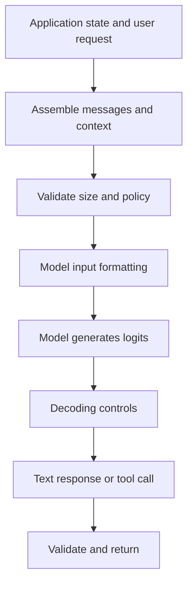

# TXT-230 — Prompting, Context Construction and Decoding Controls

> Audience: beginner | Depth: engineer-level

## Definition
A prompt is the input context supplied to a model. In chat systems, context can include system instructions, conversation history, user messages, retrieved material and tool results. Decoding controls determine how token probabilities are converted into output, for example greedy selection, temperature, top-k or top-p sampling.

## How it is represented
A chat request is commonly represented as ordered messages with roles and content. A provider converts that structure into its model-specific input format. Temperature rescales logits before sampling; top-k limits candidate tokens and top-p retains a probability-mass nucleus.

## Processing pipeline


## Key models
Prompting is an application/model interface pattern, not a model architecture. Chat templates, role-based messages, constrained decoding and provider-specific request schemas are common mechanisms.

## I/O modes
Input: prompt or structured messages plus decoding settings. Output: generated text, structured data or tool-call request. Identical weights can behave differently with different context and decoding configurations.

## Python implementation
This is a small educational implementation, not a full production service.
```python
messages = [
    {"role": "system", "content": "Answer clearly in Telugu."},
    {"role": "user", "content": "Explain battery maintenance."},
]
generation_config = {
    "temperature": 0.2,
    "top_p": 0.9,
    "max_output_tokens": 200,
}
request_payload = {"messages": messages, "generation_config": generation_config}
print(request_payload)
```

## Failure modes
- Prompt instructions do not guarantee behavior; enforce permissions in application code.
- Irrelevant history consumes context and can distract the model.
- Temperature does not make a model more factual.
- Role semantics differ by provider; follow the actual API contract.
- Do not expose secrets or privileged instructions in untrusted context.

## Related project evidence
- [Separate project evidence page](../../evidence/text/telugu-voice-assistant--prompting-context-and-decoding-controls.md).

## Further reading
- [OpenAI prompt engineering guide](https://platform.openai.com/docs/guides/prompt-engineering)
- [Hugging Face chat templates](https://huggingface.co/docs/transformers/chat_templating)
- [Nucleus Sampling](https://arxiv.org/abs/1904.09751)

## Review checklist
- [ ] Explain the concept.
- [ ] Draw and explain the pipeline.
- [ ] Run and modify the code.
- [ ] Describe failure modes and tests.