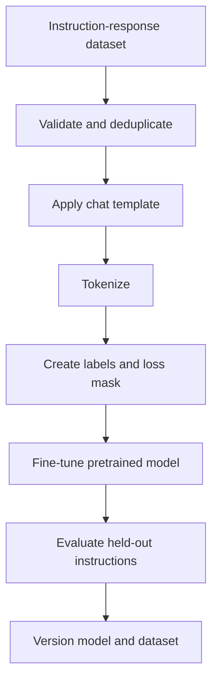

# TXT-240 — Instruction Tuning and Supervised Fine-Tuning

> Audience: beginner | Depth: engineer-level

## Definition
Supervised fine-tuning (SFT) updates a pretrained model using curated input/target examples. Instruction tuning is SFT in which examples teach a model to follow natural-language instructions across tasks. This adapts an existing model; it is not the same as pretraining a model from random initialization.

## How it is represented
A training example contains an instruction/context and a desired response. It is formatted using the model's chat template and tokenized. Some causal-LM pipelines mask prompt tokens in the loss so target response tokens drive supervised learning; exact objectives vary.

## Processing pipeline


## Key models
Full-parameter SFT updates all trainable model weights. Parameter-efficient alternatives such as LoRA train adapter parameters. Preference optimization uses preference comparisons rather than ordinary single-target SFT.

## I/O modes
Input: instruction, optional context and target response. Output: updated checkpoint or adapter. Inference uses the same message format expected during training.

## Python implementation
This is a small educational implementation, not a full production service.
```python
IGNORE_INDEX = -100
prompt_ids = [101, 102, 103]
answer_ids = [201, 202, 203]
input_ids = prompt_ids + answer_ids
labels = [IGNORE_INDEX] * len(prompt_ids) + answer_ids
print("Inputs:", input_ids)
print("Labels:", labels)
print("Loss target positions:", [i for i, x in enumerate(labels) if x != IGNORE_INDEX])
```

## Failure modes
- Poor, duplicated or inconsistent instruction examples can teach poor behavior.
- Train/evaluation leakage makes results optimistic.
- Prompt formatting must match inference conventions.
- Incorrect loss masking can train on the wrong tokens or ignore the answer.
- Fine-tuning does not guarantee up-to-date facts; retrieval may still be needed.

## Related project evidence
- [Separate project evidence page](../../evidence/text/todo-project--instruction-tuning-and-supervised-finetuning.md).

## Further reading
- [FLAN](https://arxiv.org/abs/2109.01652)
- [Hugging Face TRL SFTTrainer](https://huggingface.co/docs/trl/sft_trainer)
- [Hugging Face language modeling](https://huggingface.co/docs/transformers/tasks/language_modeling)

## Review checklist
- [ ] Explain the concept.
- [ ] Draw and explain the pipeline.
- [ ] Run and modify the code.
- [ ] Describe failure modes and tests.