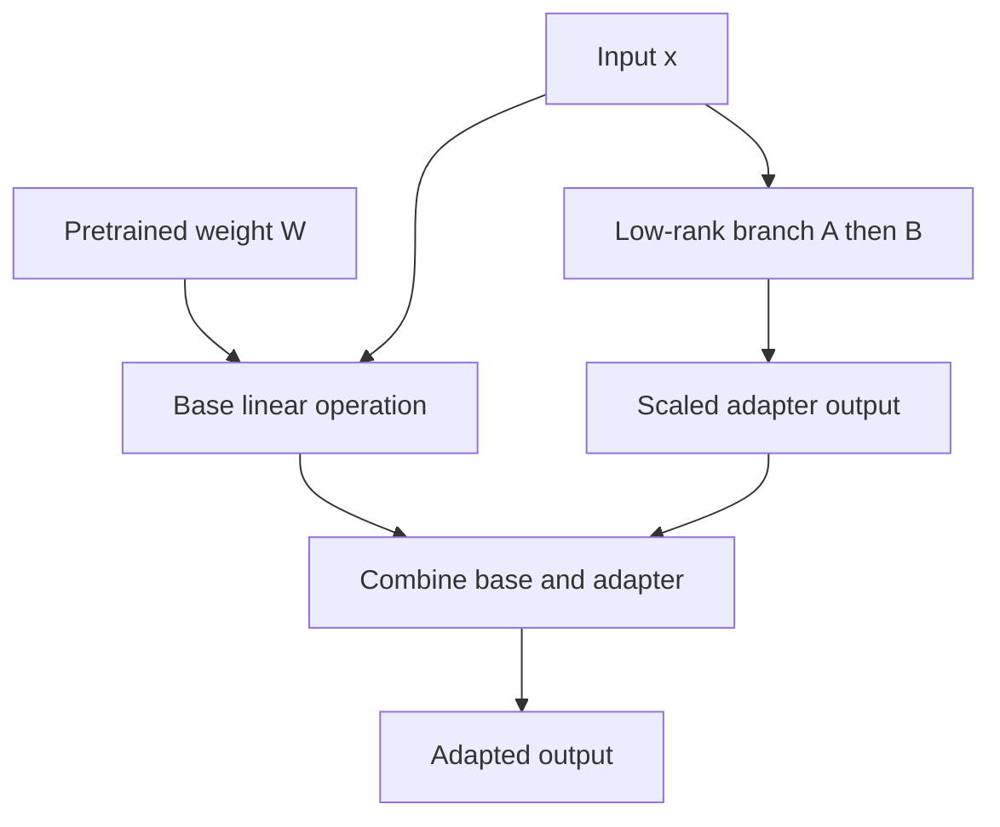

# TXT-250 — LoRA and Parameter-Efficient Adapters

> Audience: beginner | Depth: engineer-level

## Definition
Low-Rank Adaptation (LoRA) is a parameter-efficient fine-tuning method. Instead of updating a large pretrained weight matrix directly, LoRA freezes the original weights and learns a low-rank update represented as the product of two smaller matrices. Adapters are small trainable modules inserted into or alongside a model.

## How it is represented
For a weight matrix W, LoRA represents an update ΔW = B A, where A and B have a small rank r compared with the original matrix dimensions. The effective weight is W plus a scaled BA update. The original weights remain frozen in basic LoRA.

## Processing pipeline


## Key models
LoRA, QLoRA, bottleneck adapters, prefix tuning and prompt tuning are parameter-efficient adaptation approaches. They differ in which parameters are trained and where trainable components enter the model.

## I/O modes
Input/output tensor shapes match the adapted layer. Training produces adapter weights and configuration; inference loads the base model plus adapter or merges the update into the base weights.

## Python implementation
This is a small educational implementation, not a full production service.
```python
# Tiny numerical illustration of a low-rank update.
def matvec(matrix, vector):
    return [sum(a*b for a, b in zip(row, vector)) for row in matrix]

A = [[0.2, 0.1, 0.0], [0.0, 0.3, 0.4]]
B = [[0.5, 0.0], [0.1, 0.6], [0.2, 0.2]]
x = [1.0, 2.0, 3.0]
print("Low-rank contribution:", matvec(B, matvec(A, x)))
```

## Failure modes
- LoRA rank is a capacity/compute tradeoff, not a universal quality setting.
- Base model, tokenizer, target modules and adapter configuration must align.
- Incorrect adapter merge/scaling changes model outputs.
- Adapter training still needs representative data and evaluation.
- Do not claim LoRA was used merely because it appears in a proposed workflow; inspect the actual run and saved adapter.

## Related project evidence
- [Separate project evidence page](../../evidence/text/todo-project--lora-and-adapters.md).

## Further reading
- [LoRA paper](https://arxiv.org/abs/2106.09685)
- [QLoRA paper](https://arxiv.org/abs/2305.14314)
- [PEFT documentation](https://huggingface.co/docs/peft/)

## Review checklist
- [ ] Explain the concept.
- [ ] Draw and explain the pipeline.
- [ ] Run and modify the code.
- [ ] Describe failure modes and tests.