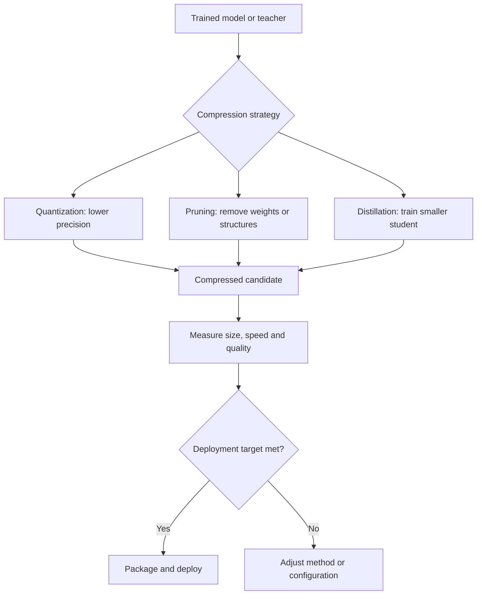

# TXT-260 — Quantization, Pruning and Knowledge Distillation

> Audience: beginner | Depth: engineer-level

## Definition
Quantization reduces the numeric precision used to store or compute model values. Pruning removes or sparsifies weights or structures judged less important. Knowledge distillation trains a smaller student model to imitate a larger teacher. These approaches aim to reduce memory, latency or deployment cost, often with quality tradeoffs.

## How it is represented
Quantization maps higher-precision values to lower-precision representations using scales and sometimes zero-points. Pruning creates zeros or removes channels, heads or blocks. Distillation compares student outputs with teacher outputs, often using softened probability distributions and task loss.

## Processing pipeline


## Key models
Post-training quantization, quantization-aware training, weight-only quantization, structured/unstructured pruning, teacher-student distillation and low-bit formats are common approaches. Hardware kernels determine whether a compressed representation actually runs faster.

## I/O modes
Input: trained model/checkpoint and optional calibration or distillation data. Output: compressed model, pruned model or student checkpoint. Evaluation compares the candidate with the original on the same task and data.

## Python implementation
This example demonstrates the core mechanism; it is not a full production implementation.
```python
weights = [-1.0, -0.5, 0.0, 0.25, 0.9]
qmax = 127
scale = max(abs(x) for x in weights) / qmax
quantized = [max(-qmax, min(qmax, round(x / scale))) for x in weights]
dequantized = [q * scale for q in quantized]
print("Original:", weights)
print("Int8-like values:", quantized)
print("Reconstructed:", dequantized)
```

## Failure modes
- Smaller checkpoint size does not guarantee lower latency; supported kernels and hardware matter.
- Aggressive quantization can damage quality, especially in sensitive layers.
- Pruning without sparse-kernel support may not speed inference.
- Distillation requires representative teacher outputs and well-designed losses.
- Measure quality, memory, throughput, latency and energy on the target hardware.

## Related project evidence
- [Separate project evidence page](../../evidence/text/tiny-gpt-jetson-colab--quantization-pruning-distillation.md).

## Further reading
- [LLM.int8()](https://arxiv.org/abs/2208.07339)
- [GPTQ](https://arxiv.org/abs/2210.17323)
- [Knowledge Distillation](https://arxiv.org/abs/1503.02531)
- [PyTorch quantization](https://pytorch.org/docs/stable/quantization.html)

## Review checklist
- [ ] Explain the concept.
- [ ] Draw and explain the pipeline.
- [ ] Run and modify the Python example.
- [ ] Identify failure modes and tests.