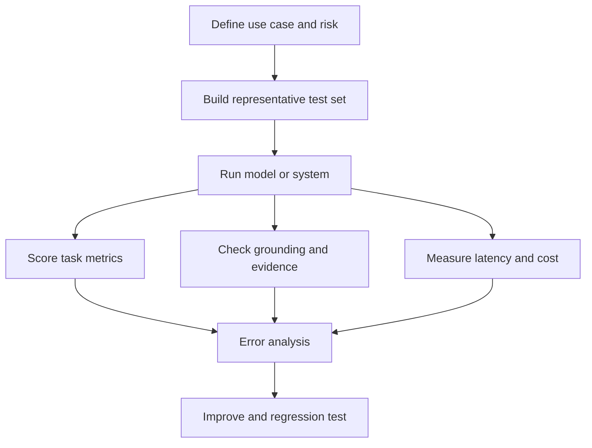

# TXT-270 — LLM Evaluation, Hallucinations and Grounding

> Audience: beginner | Depth: engineer-level

## Definition
LLM evaluation measures whether a model produces useful, correct and safe outputs for a defined task. A hallucination is an output that is unsupported or incorrect while presented as true. Grounding connects an answer to trusted evidence, such as retrieved documents or structured data. Evaluation must test the complete system, not only the base model.

## How it is represented
Evaluation uses prompts, expected answers, reference documents, labels or human judgments. Metrics may include exact match, task accuracy, retrieval recall, citation correctness, latency and cost. The right metric depends on the application and consequences of errors.

## Processing pipeline


## Key models
Evaluation approaches include task metrics, human evaluation, pairwise preference review, LLM-as-judge with calibration, retrieval metrics and citation/groundedness checks. No single metric captures every quality dimension.

## I/O modes
Input: model outputs plus labels, references, evidence or evaluator judgments. Output: metric reports, error categories and regression decisions. Preserve model version, prompt, decoding settings and test-set version.

## Python implementation
This example demonstrates the core mechanism; it is not a full production implementation.
```python
def exact_match(predictions, references):
    if not references or len(predictions) != len(references):
        raise ValueError("Inputs must have the same non-zero length")
    correct = sum(p.strip() == r.strip()
                  for p, r in zip(predictions, references))
    return correct / len(references)

pred = ["Paris", "4", "Canberra"]
gold = ["Paris", "4", "Canberra"]
print("Exact-match accuracy:", exact_match(pred, gold))
```

## Failure modes
- A high benchmark score may not predict performance on actual users' inputs.
- Exact match is too strict for some open-ended tasks and too weak for others.
- LLM-as-judge can be biased or inconsistent; calibrate it against humans.
- A citation's presence does not prove the source supports the claim.
- Measure correctness, grounding, helpfulness, safety, latency and cost separately.

## Related project evidence
- [Separate project evidence page](../../evidence/text/tiny-gpt-jetson-colab--llm-evaluation-hallucinations-and-grounding.md).

## Further reading
- [HELM](https://crfm.stanford.edu/helm/)
- [RAGAS](https://docs.ragas.io/)
- [TruthfulQA](https://arxiv.org/abs/2109.07958)
- [OpenAI Evals](https://github.com/openai/evals)

## Review checklist
- [ ] Explain the concept.
- [ ] Draw and explain the pipeline.
- [ ] Run and modify the Python example.
- [ ] Identify failure modes and tests.