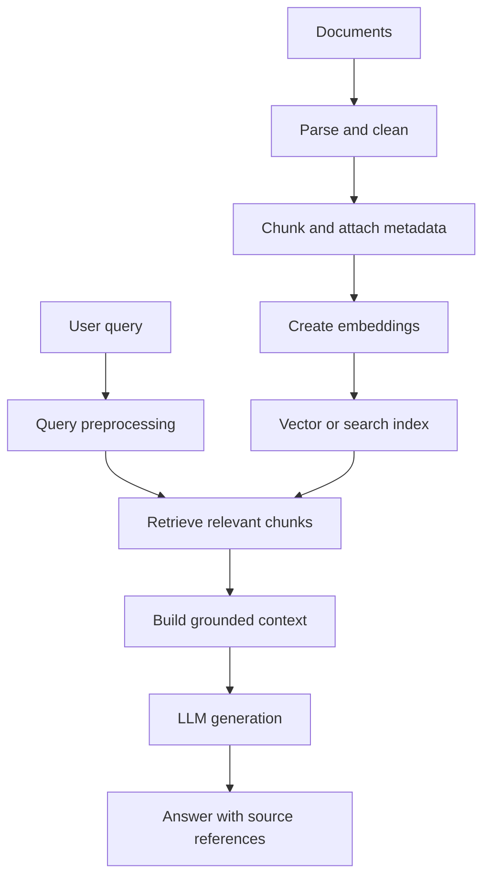

# TXT-280 — Retrieval-Augmented Generation (RAG) Fundamentals

> Audience: beginner | Depth: engineer-level

## Definition
Retrieval-Augmented Generation combines information retrieval with language generation. A system retrieves relevant external information for a user query and provides it as context to a language model. RAG is useful when an answer must use private or changing knowledge not reliably contained in model parameters.

## How it is represented
Documents are parsed into text and metadata, split into chunks and commonly embedded as vectors. A query is converted into a retrieval representation. The system searches an index, selects useful passages and builds a prompt containing evidence plus the user's question.

## Processing pipeline


## Key models
RAG systems combine embedding models, lexical search such as BM25, vector databases, rerankers and an LLM. Retriever and generator may be independently selected and evaluated.

## I/O modes
Input: query plus a document corpus/index. Output: an answer grounded in retrieved passages, ideally with source references. The system may return an insufficient-evidence response when retrieval does not support an answer.

## Python implementation
This example demonstrates the core mechanism; it is not a full production implementation.
```python
documents = [
    "A battery stores energy for an electric vehicle.",
    "A Transformer processes sequences using attention.",
    "UTF-8 encodes Unicode text as bytes.",
]
query = "How does UTF-8 encode text?"
terms = set(query.lower().replace("?", "").split())
ranked = []
for doc in documents:
    score = sum(term in doc.lower() for term in terms)
    ranked.append((score, doc))
retrieved = [doc for score, doc in sorted(ranked, reverse=True) if score]
context = "\n".join(retrieved)
prompt = "Use only this context:\n" + context + "\nQuestion: " + query
print(prompt)
```

## Failure modes
- RAG cannot fix poor source documents, parsing or retrieval.
- Very small chunks lose context; very large chunks dilute relevance.
- Vector similarity is not factual correctness.
- Retrieved text is untrusted input and may contain prompt injection.
- Enforce access control during retrieval; never retrieve documents the user cannot access.
- Evaluate retrieval and generation separately.

## Related project evidence
- [Separate project evidence page](../../evidence/text/telugu-voice-assistant--rag-fundamentals.md).

## Further reading
- [Retrieval-Augmented Generation paper](https://arxiv.org/abs/2005.11401)
- [Sentence-BERT](https://arxiv.org/abs/1908.10084)
- [FAISS](https://faiss.ai/)
- [RAGAS](https://docs.ragas.io/)

## Review checklist
- [ ] Explain the concept.
- [ ] Draw and explain the pipeline.
- [ ] Run and modify the Python example.
- [ ] Identify failure modes and tests.