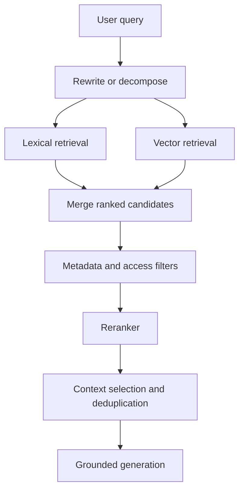

# TXT-290 — Advanced RAG: Hybrid Search, Reranking and Query Transformation

> Audience: beginner | Depth: engineer-level

## Definition
Advanced RAG improves retrieval and context selection when a basic retrieve-then-generate pipeline is insufficient. Techniques include hybrid lexical/vector search, query rewriting, metadata filters, parent-child chunking, multi-query retrieval, reranking and iterative retrieval. Introduce them in response to measured retrieval failures, not by default.

## How it is represented
Hybrid search combines lexical and vector results. Reciprocal Rank Fusion (RRF) combines ranked lists without requiring raw scores to be calibrated. Rerankers score query-passage pairs. Parent-child retrieval searches small chunks but may return larger parent context.

## Processing pipeline


## Key models
BM25, dense vector retrievers, cross-encoder rerankers, ColBERT-style late interaction, query decomposition and RRF are common components. Graph retrieval and agentic retrieval are later options with greater complexity.

## I/O modes
Input: query, index and retrieval configuration. Output: ranked evidence passages and a grounded answer. Traces should record query variants, candidates, scores and filters for debugging.

## Python implementation
This example demonstrates the core mechanism; it is not a full production implementation.
```python
def reciprocal_rank_fusion(rankings, k=60):
    scores = {}
    for ranking in rankings:
        for rank, item in enumerate(ranking, start=1):
            scores[item] = scores.get(item, 0.0) + 1.0 / (k + rank)
    return sorted(scores, key=scores.get, reverse=True)

lexical = ["doc-A", "doc-B", "doc-C"]
vector = ["doc-B", "doc-D", "doc-A"]
print(reciprocal_rank_fusion([lexical, vector]))
```

## Failure modes
- Hybrid search requires rank/score fusion and duplicate handling.
- Query expansion can drift from the user's intent.
- Reranking only improves ordering if candidate recall is adequate.
- Metadata filters can accidentally exclude useful sources or leak restricted sources.
- Each retrieval stage adds latency and operational complexity; measure incremental benefit.

## Related project evidence
- [Separate project evidence page](../../evidence/text/todo-project--advanced-rag-retrieval-strategies.md).

## Further reading
- [Reciprocal Rank Fusion](https://plg.uwaterloo.ca/~gvcormac/cormacksigir09-rrf.pdf)
- [ColBERT](https://arxiv.org/abs/2004.12832)
- [BEIR benchmark](https://arxiv.org/abs/2104.08663)

## Review checklist
- [ ] Explain the concept.
- [ ] Draw and explain the pipeline.
- [ ] Run and modify the Python example.
- [ ] Identify failure modes and tests.