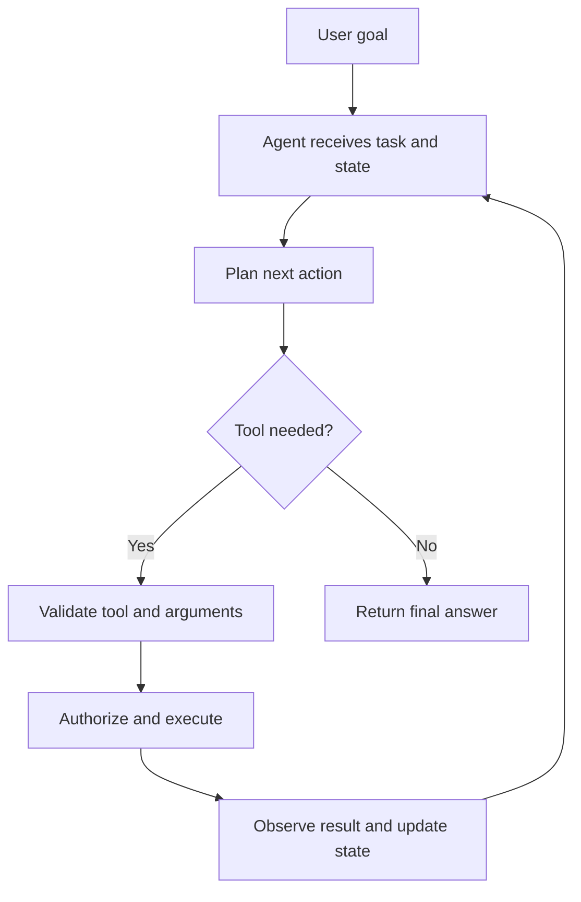

# TXT-300 — AI Agents: Tool Calling, Planning and Memory

> Audience: beginner | Depth: engineer-level

## Definition
An AI agent is a system in which a model or decision component chooses actions toward a goal, often by calling tools and observing results. Tool calling lets a model request a typed operation; the application validates and executes it. Planning decomposes a goal into steps. Memory stores information useful beyond one model call.

## How it is represented
A tool has a name, description and input schema. The model proposes a call, but the orchestrating application must validate arguments, check authorization, execute the operation and return the result. State records the task, actions, observations and completion criteria.

## Processing pipeline


## Key models
Tool-using LLMs, ReAct-style loops, function calling, workflow graphs and state-machine agents are common approaches. Retrieval memory, conversation summaries and external state stores serve different memory needs.

## I/O modes
Input: user goal, state and available tool schemas. Output: answer, plan step, tool call or human-approval request. Tool outputs become observations that may enter the next model context.

## Python implementation
This example demonstrates the core mechanism; it is not a full production implementation.
```python
def add_numbers(a: float, b: float) -> float:
    return a + b

TOOLS = {"add_numbers": add_numbers}

def dispatch(name, arguments):
    if name not in TOOLS:
        raise ValueError("Tool is not allowed")
    if set(arguments) != {"a", "b"}:
        raise ValueError("Unexpected arguments")
    return TOOLS[name](float(arguments["a"]), float(arguments["b"]))

request = {"name": "add_numbers", "arguments": {"a": 2, "b": 3}}
print(dispatch(request["name"], request["arguments"]))
```

## Failure modes
- A model-generated tool call is a proposal, not authorization.
- Never expose arbitrary shell, filesystem, network or payment operations without scoped controls.
- Tool arguments need schema validation and permission checks.
- Long loops need step limits, timeouts, retries and stop conditions.
- Memory can be stale, poisoned or over-retained; define provenance, privacy and retention policies.

## Related project evidence
- [Separate project evidence page](../../evidence/text/yoda-agentic-workflows--agents-tool-calling-planning-memory.md).

## Further reading
- [ReAct](https://arxiv.org/abs/2210.03629)
- [Toolformer](https://arxiv.org/abs/2302.04761)
- [OpenAI function calling guide](https://platform.openai.com/docs/guides/function-calling)

## Review checklist
- [ ] Explain the concept.
- [ ] Draw and explain the pipeline.
- [ ] Run and modify the Python example.
- [ ] Identify failure modes and tests.