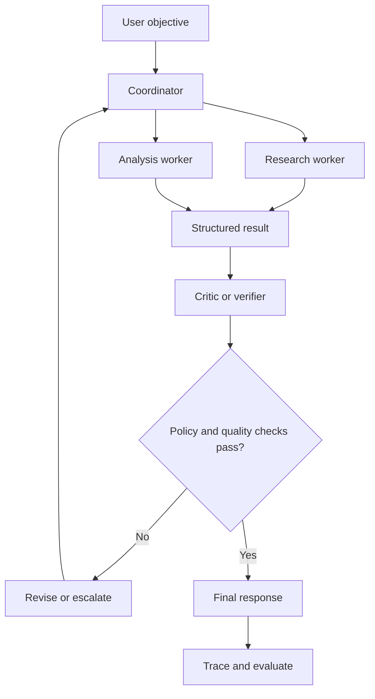

# TXT-310 — Multi-Agent Systems, Guardrails and Evaluation

> Audience: beginner | Depth: engineer-level

## Definition
A multi-agent system coordinates multiple agents or specialized roles to complete a task. Agents may divide work, critique results, retrieve information or execute distinct tools. Guardrails constrain inputs, outputs and actions. Evaluation measures whether the workflow is correct, efficient, safe and more useful than a simpler baseline.

## How it is represented
A multi-agent workflow may use a coordinator, specialized workers, shared or private state, message schemas and a stopping policy. Guardrails belong at input validation, tool authorization, data access, output validation and human-approval boundaries.

## Processing pipeline


## Key models
Patterns include manager-worker, sequential specialists, debate/critique, shared blackboard and graph-based workflows. A deterministic workflow with one model can outperform a multi-agent system for straightforward tasks.

## I/O modes
Input: task, agent roles, tools and policies. Output: coordinated result, trace, intermediate artifacts and possible approval requests. Inter-agent messages should have schemas and provenance.

## Python implementation
This example demonstrates the core mechanism; it is not a full production implementation.
```python
def research_agent(task):
    return {"role": "research", "finding": "TODO: verified sources"}

def review_agent(research):
    if not research.get("finding"):
        return {"approved": False, "reason": "Missing finding"}
    return {"approved": False, "reason": "Human/source review required"}

research = research_agent("Compare two technical approaches")
review = review_agent(research)
print(review)
```

## Failure modes
- More agents do not automatically improve quality; they can amplify errors and cost.
- Shared memory and tool access create security and privacy boundaries.
- Agents may agree without independent evidence.
- A critic model is not a substitute for external validation.
- Compare against a simpler baseline; track success, tool errors, latency, cost and human intervention.

## Related project evidence
- [Separate project evidence page](../../evidence/text/yoda-agentic-workflows--multi-agent-systems-guardrails-evaluation.md).

## Further reading
- [AutoGen](https://arxiv.org/abs/2308.08155)
- [SWE-agent](https://arxiv.org/abs/2405.15793)
- [NIST AI Risk Management Framework](https://www.nist.gov/itl/ai-risk-management-framework)

## Review checklist
- [ ] Explain the concept.
- [ ] Draw and explain the pipeline.
- [ ] Run and modify the Python example.
- [ ] Identify failure modes and tests.