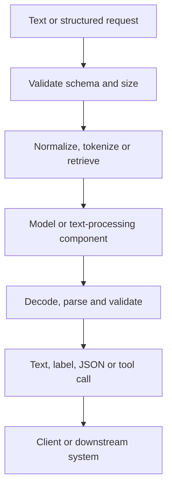

# TXT-320 — Text Input/Output Patterns Across AI Systems

> Audience: beginner | Depth: engineer-level

## Definition
Text I/O patterns describe how text enters and leaves an AI component. Text can be a prompt, generated response, classification target, extracted structure, retrieved context or transcript from another modality. Naming input/output contracts makes system architecture and testing more precise.

## How it is represented
An I/O contract defines media type, schema, encoding, maximum length, required fields, validation and error behavior. Common forms include strings, message arrays, JSON objects, token IDs and text with source metadata.

## Processing pipeline


## Key models
I/O patterns can wrap classifiers, extractors, encoder models, decoder-only LLMs, encoder-decoder models, RAG pipelines and tool-using systems. API contracts should remain explicit.

## I/O modes
Examples: Text → Text (chat, translation, summary); Text → Label (classification); Text → JSON (extraction); Text + retrieved text → Text (RAG); Audio → Text (ASR); Text → Audio (TTS); Image + Text → Text (VQA).

## Python implementation
This example demonstrates the core mechanism; it is not a full production implementation.
```python
from dataclasses import dataclass
from typing import Literal

@dataclass
class TextRequest:
    text: str
    task: Literal["summarize", "classify", "extract"]

@dataclass
class TextResponse:
    output_text: str
    task: str
    status: Literal["ok", "error"]

def handle(request: TextRequest) -> TextResponse:
    if not request.text.strip():
        return TextResponse("", request.task, "error")
    return TextResponse("TODO: model output", request.task, "ok")

print(handle(TextRequest("A sample paragraph", "summarize")))
```

## Failure modes
- Ambiguous response formats make downstream integration fragile.
- Validate model outputs against schemas; never trust generated JSON without parsing it.
- Treat user, retrieval and tool text as untrusted input.
- Define length limits, encoding and error behavior.
- Document whether failures use HTTP errors, structured payloads or partial results.

## Related project evidence
- [Separate project evidence page](../../evidence/text/tiny-gpt-jetson-colab--text-input-output-patterns.md).

## Further reading
- [JSON Schema](https://json-schema.org/)
- [FastAPI request bodies](https://fastapi.tiangolo.com/tutorial/body/)
- [OpenAI structured outputs](https://platform.openai.com/docs/guides/structured-outputs)

## Review checklist
- [ ] Explain the concept.
- [ ] Draw and explain the pipeline.
- [ ] Run and modify the Python example.
- [ ] Identify failure modes and tests.