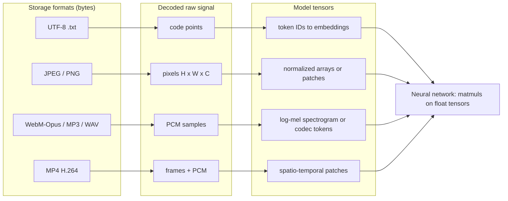

# 00.1 · Data as Numbers

> **Modality:** all · **Prereqs:** none · **Used in project:** ✅

## 1. First principles

A computer stores exactly one kind of thing: **bits**. Text, images, sound and video are *conventions* for interpreting bit patterns. A neural network can't read any of them directly. It only operates on **tensors of numbers**. So every AI system starts with the same two-step pipeline:

1. **Decode** the storage format into a raw signal (code points, pixels, samples, frames).
2. **Encode** that signal into a tensor the model can consume (token IDs, normalized pixel arrays, spectrograms, patch embeddings).

| Modality | Raw signal | Natural structure | Typical model input |
|---|---|---|---|
| Text | Sequence of Unicode code points | 1-D, discrete, variable length | Token IDs `[T]` → embeddings `[T, d]` |
| Image | Grid of pixels × channels | 2-D, continuous, fixed grid | `[C, H, W]` floats, or patches `[N, d]` |
| Audio | Air-pressure samples over time | 1-D, continuous, very long (16k–48k/s) | Waveform `[S]` or log-mel spectrogram `[F, T]` |
| Video | Sequence of images + audio track | 3-D (T×H×W), massive redundancy | Sampled frames / spatio-temporal patches |

**Discrete vs continuous** is the deepest divide. Text is already discrete symbols, so we look up an embedding per symbol. Images and audio are continuous, so we either feed them directly as numbers or **quantize** them into discrete tokens (e.g., audio codecs, VQ image tokens). That is how modern multimodal LLMs treat everything as tokens.

## 2. Diagram

## 3. Deep dive

### Numeric types and why they matter
| Type | Bits | Range / precision | Used for |
|---|---|---|---|
| `uint8` | 8 | 0–255 | Pixels, packed quantized weights |
| `int16` | 16 | ±32767 | 16-bit PCM audio |
| `int8` | 8 | ±127 | Quantized weights/activations |
| `fp32` | 32 | ~7 decimal digits, exp 8 bits | Master weights, optimizer state |
| `fp16` | 16 | exp 5 bits (max ~65504) → **overflow risk** | Inference, older AMP |
| `bf16` | 16 | exp 8 bits (fp32 range), mantissa 7 bits | Modern training (A100+, Orin) |
| ternary | ~1.58 | {-1, 0, +1} × scale | Extreme weight compression |

Rule of thumb: **memory = parameters × bytes per parameter.** 3B params × 2 bytes (bf16) = 6 GB. That one equation drives most hardware decisions (see [06.1](../06-systems/01-gpu-memory-hardware.md)).

### Tensors
A tensor is an n-dimensional array with a **shape**, a **dtype** and a **device**. Most model bugs are shape bugs. Canonical layouts:
- Text batch: `[B, T]` int64 → embeddings `[B, T, d]`
- Image batch: `[B, C, H, W]` (PyTorch) or `[B, H, W, C]` (TF/NumPy)
- Audio batch: `[B, S]` waveform or `[B, n_mels, frames]`

### Information density (why modalities cost differently)
- 1 s of 16 kHz mono 16-bit audio = 32 KB raw, but a speaker says only ~2–3 words.
- One 224×224 RGB image = 150 KB raw, which becomes 196 ViT patches.
- One sentence of text = ~100 bytes, which becomes ~20 tokens.

Continuous modalities are **highly redundant**. Compression (codecs) and learned encoders exist to strip that redundancy before the expensive model sees it.

## 4. In our project

- **Text → tensor:** every `tiny_llm*.py` builds a character vocabulary and converts the corpus to an `int64` tensor ([`tiny_llm.py#L12-L16`](https://github.com/SEVT-Logistics-Private-Limited/tiny-llm-jetson/blob/9a7b564c8d764d1eff92218261f2fd2cef99099e/tiny_llm.py#L12-L16)).
- **Audio → bytes → model:** the browser records `audio/webm` blobs. They are base64-encoded into JSON and decoded server-side to raw bytes, then sent *inline* to Gemini for transcription ([`api.py#L159-L176`](https://github.com/SEVT-Logistics-Private-Limited/tiny-llm-jetson/blob/9a7b564c8d764d1eff92218261f2fd2cef99099e/voice-assistant/api.py#L159-L176)).
- **Dtype as a design lever:** large rungs cast checkpoints to bf16 before saving, which halves disk size ([`tiny_llm_3b.py#L76-L81`](https://github.com/SEVT-Logistics-Private-Limited/tiny-llm-jetson/blob/9a7b564c8d764d1eff92218261f2fd2cef99099e/tiny_llm_3b.py#L76-L81)). The compression pipeline goes further, down to 2-bit packed ternary codes ([`ternary_qat_3b.py#L181-L189`](https://github.com/SEVT-Logistics-Private-Limited/tiny-llm-jetson/blob/9a7b564c8d764d1eff92218261f2fd2cef99099e/compression/ternary_qat_3b.py#L181-L189)).

## 5. Common pitfalls

- **Base64 bloat:** base64 inflates payloads by ~33%. That's fine for short voice clips but wasteful for long audio and video. Prefer multipart uploads or object storage URLs at scale.
- **fp16 overflow:** logits or activations above 65504 become `inf` and produce NaN loss. Prefer bf16 on hardware that supports it.
- **Layout mismatch:** feeding `HWC` into a model expecting `CHW` produces garbage, not an error, whenever H, W and C happen to be broadcast-compatible.
- **Silent dtype promotion:** `int8 * float` silently upcasts. Measure memory, don't assume it.
- **Confusing file size with tensor size:** a 50 KB JPEG decodes to MBs of pixels, and RAM/VRAM sees the decoded size.

## 6. References
- IEEE 754 floating point; Google Brain bfloat16 format.
- Micikevicius et al., *Mixed Precision Training*, arXiv:1710.03740.
