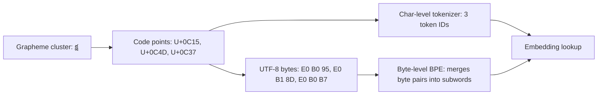

# 00.2 · Text

> **Modality:** text · **Prereqs:** [00.1](01-data-as-numbers.md) · **Used in project:** ✅

## 1. First principles

Text is a **sequence of abstract characters**. Three layers sit between "a letter" and "bytes on disk":

| Layer | What it is | Example (Telugu "క") |
|---|---|---|
| **Character / grapheme** | What a human perceives as one symbol | క |
| **Code point** | Unicode's integer ID for an abstract character | `U+0C15` |
| **Encoding** | How code points become bytes | UTF-8: `E0 B0 95` (3 bytes) |

**Unicode** assigns a code point to every character in every script (about 150k). **UTF-8** is a variable-length encoding. ASCII takes 1 byte, most Indic scripts including Telugu take 3 bytes, and emoji take 4. UTF-8 is backward-compatible with ASCII and self-synchronizing, which is why it dominates.

### Graphemes ≠ code points (critical for Indic scripts)
Telugu is an **abugida**. A visible syllable is often several code points: consonant + virama (`్`, U+0C4D) + consonant + vowel sign. Example: "క్ష" = క + ్ + ష = 3 code points, 9 UTF-8 bytes, 1 visible cluster.

Consequences:
- `len(s)` in Python counts **code points**, not visible characters.
- Character-level models see virama and vowel signs as separate tokens and must learn to compose them.
- Slicing a string mid-cluster produces broken glyphs.

## 2. Diagram

## 3. Deep dive

- **Normalization (NFC/NFD):** the same visible text can have different code point sequences. Normalize to NFC before tokenizing or deduplicating, or identical strings won't match.
- **Unicode blocks as features:** Telugu occupies `U+0C00–U+0C7F`. A range check is a cheap, robust "is this Telugu?" detector, and our project uses exactly that.
- **Script mixing (code-switching):** real Telugu speech mixes in English ("engine oil మార్చాలి"). Pipelines must decide whether to keep, transliterate or strip the English.
- **Byte cost:** Telugu costs 3× more UTF-8 bytes per character than English. Byte-level tokenizers trained mostly on English fragment Telugu heavily (high "fertility"), which inflates sequence length, cost and latency. See [01.1](../01-text/01-tokenization.md).
- **Whitespace and punctuation** are tokens too. Markdown symbols (`*`, `#`) in LLM output are harmless on screen but get *read aloud* by TTS.

## 4. In our project

- **Telugu-script detection by code point range:**
  - `clean_for_tts` counts chars in `'ఀ' <= c <= '౿'` (U+0C00–U+0C7F). If fewer than 3 Telugu chars survive, it replies "మళ్ళీ చెప్పగలరా?" ([`api.py#L178-L191`](https://github.com/SEVT-Logistics-Private-Limited/tiny-llm-jetson/blob/9a7b564c8d764d1eff92218261f2fd2cef99099e/voice-assistant/api.py#L178-L191)).
  - `telugu_ratio` uses the same range to score how "Telugu" a fine-tuned model's answers are ([`finetune_telugu_3b.py#L176-L180`](https://github.com/SEVT-Logistics-Private-Limited/tiny-llm-jetson/blob/9a7b564c8d764d1eff92218261f2fd2cef99099e/compression/finetune_telugu_3b.py#L176-L180)).
- **Code-switching policy evolved:**
  - The older API (`telugu_voice_api.py`, v8) deleted *every* Latin word with `\b[a-zA-Z]+\b`.
  - The current API (v10) keeps lines that contain any Telugu and only drops all-English lines. This preserves technical terms that Telugu speakers actually say.
- **Telugu vocabulary:** `tiny_llm_telugu.py` builds a char vocab from 50k samanantar sentences, giving **245 symbols** vs 13 for the English toy corpus ([`tiny_llm_telugu.py#L19-L31`](https://github.com/SEVT-Logistics-Private-Limited/tiny-llm-jetson/blob/9a7b564c8d764d1eff92218261f2fd2cef99099e/tiny_llm_telugu.py#L19-L31)).

## 5. Common pitfalls

- **Unknown chars silently dropped:** `encode = [stoi[c] for c in s if c in stoi]` in `tiny_llm_telugu.py` discards out-of-vocab characters with no warning. Log the OOV rate instead.
- **No NFC normalization** → duplicate vocab entries and train/infer mismatch.
- **Regex `\w` / `[a-zA-Z]` assumptions** break on non-Latin scripts. Combining marks are not "word characters" in some engines.
- **Reading files without `encoding="utf-8"`** on Windows defaults to cp1252 and corrupts Telugu.
- **Truncating by bytes** (e.g., DB column limits) can cut a UTF-8 sequence mid-character.

## 6. References
- The Unicode Standard, Telugu block chart (U+0C00–U+0C7F).
- RFC 3629 (UTF-8). Unicode TR15 (normalization forms). Unicode TR29 (grapheme clusters).
