# 00.3 · Images

> **Modality:** image · **Prereqs:** [00.1](01-data-as-numbers.md) · **Used in project:** ⬜ Not yet used

## 1. First principles

A digital image is a **sampled 2-D light field**. A sensor measures light intensity on a grid. Each cell is a **pixel**, and each pixel has one value per **channel**.

- **Resolution** `H × W`: spatial sampling density.
- **Channels** `C`: 1 (grayscale), 3 (RGB) or 4 (RGBA). A color sensor actually records one color per photosite (Bayer filter), and **demosaicing** interpolates full RGB.
- **Bit depth:** usually 8 bits per channel (0–255). HDR/RAW uses 10–16.
- Raw size = `H × W × C × bytes`. A 1920×1080 RGB 8-bit frame is about 6.2 MB.

### Color spaces
| Space | Idea | Why it exists |
|---|---|---|
| RGB | Additive primaries | Matches displays and sensors |
| sRGB | RGB + gamma curve | Perceptually uniform storage. **Not linear light.** |
| YCbCr / YUV | Luma + 2 chroma | Humans see brightness detail better than color, so chroma can be subsampled (4:2:0) |
| HSV/HSL | Hue/saturation/value | Human-friendly editing |

### Compression
- **PNG:** lossless (DEFLATE + prediction filters). Good for UI and diagrams.
- **JPEG:** lossy. RGB → YCbCr → 4:2:0 chroma subsampling → 8×8 **DCT** → quantization (where loss happens) → entropy coding.
- **WebP/AVIF:** modern codecs, better ratio. AVIF reuses AV1 video intra-frame coding.

## 2. Diagram

```mermaid
flowchart LR
    L["Light"] --> S["Sensor with Bayer filter"] --> D["Demosaic to RGB"]
    D --> Y["RGB to YCbCr"] --> SUB["Chroma subsample 4:2:0"] --> DCT["8x8 DCT"] --> Q["Quantize: lossy"] --> E["Entropy code"] --> J["JPEG file"]
    J --> DEC["Decode"] --> T["uint8 H x W x 3"] --> N["Normalize to float, CHW, mean/std"] --> M["CNN or ViT"]
```

## 3. Deep dive

- **Preprocessing contract:** resize → center crop → `float32 / 255` → subtract per-channel mean / divide by std (e.g., ImageNet stats) → `CHW`. The model only works if inference preprocessing matches training *exactly*.
- **Images as tokens:** ViT cuts the image into `P×P` patches (e.g., 16×16), flattens each and projects it to `d` dims. 224×224 / 16² = **196 tokens**. Token count grows **quadratically** with resolution, which is the main cost driver for vision-LLMs.
- **Spatial inductive bias:** CNNs assume locality and translation equivariance. ViTs learn them from data, so they need more data but scale better. See [03.1](../03-vision/01-computer-vision.md).
- **EXIF orientation:** phone photos store rotation as metadata, not pixels. Ignoring it feeds sideways images to the model.

## 4. In our project

**Not yet used.** The Yodha assistant is voice and text only.

Natural extensions for a vehicle-service assistant:
- A user photographs a dashboard warning light or a damaged part, and a VLM identifies it.
- OCR of scanned vehicle manuals during RAG ingestion.

## 5. Common pitfalls

- **BGR vs RGB:** OpenCV loads BGR, PIL/torchvision load RGB. Swapped channels silently degrade accuracy.
- **Gamma:** doing math (blending, resizing) in sRGB space instead of linear light causes darkened edges.
- **Resize aliasing:** downscaling without anti-aliasing creates moiré. Use area/antialiased interpolation.
- **Preprocessing drift:** different resize libraries (PIL vs cv2) produce different pixels, and that alone can cost accuracy.
- **Normalization mismatch:** using `[0,1]` at inference when the model was trained on ImageNet-normalized inputs.

## 6. References
- ITU-T T.81 (JPEG). PNG specification (W3C).
- Dosovitskiy et al., *An Image is Worth 16x16 Words* (ViT), arXiv:2010.11929.
