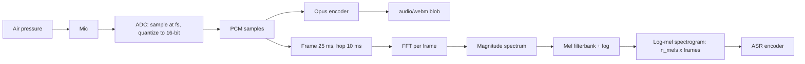

# 00.4 · Audio

> **Modality:** audio · **Prereqs:** [00.1](01-data-as-numbers.md) · **Used in project:** ✅

## 1. First principles

Sound is a **pressure wave**. A microphone converts pressure to voltage, and an ADC samples that voltage at fixed intervals.

| Parameter | Meaning | Typical values |
|---|---|---|
| **Sample rate** `fs` | Samples per second | 8 kHz (telephony), **16 kHz (ASR)**, 24 kHz (TTS), 44.1/48 kHz (music) |
| **Bit depth** | Bits per sample → dynamic range (~6 dB/bit) | 16-bit PCM (96 dB) |
| **Channels** | Mono / stereo | Speech = mono |

**Nyquist–Shannon:** a sample rate `fs` can represent frequencies up to `fs/2`. Speech intelligibility lives below ~8 kHz, so **16 kHz** is enough for ASR. Content above `fs/2` must be low-pass filtered before sampling, or it **aliases** into lower frequencies.

**PCM** (pulse-code modulation) is the raw stream of integer samples. **WAV** is PCM plus a 44-byte header (rate, channels, bit depth).

### Codecs
| Codec | Type | Notes |
|---|---|---|
| WAV/PCM | Uncompressed | 16 kHz mono 16-bit = 32 KB/s |
| MP3 | Lossy, psychoacoustic | Universal playback |
| **Opus** (in WebM/Ogg) | Lossy, built for speech + music, low latency | Browser `MediaRecorder` default in Chrome |
| AAC | Lossy | Safari / iOS default (`audio/mp4`) |

## 2. Diagram

## 3. Deep dive

- **Time vs frequency domain:** raw waveforms are long (16k samples/s) and phase-heavy. The **STFT** slices audio into overlapping windows (≈25 ms window, 10 ms hop) and FFTs each one. The **mel scale** warps frequency to match human pitch perception, and taking the log compresses dynamic range. The result is a log-mel spectrogram of 80–128 bins × 100 frames/s, the standard ASR input (Whisper uses 80 mels).
- **Energy-based VAD:** voice activity detection in its simplest form checks whether frame energy (RMS, or mean FFT magnitude) is above a threshold for N frames. It's cheap but fragile with noise. Learned VADs (Silero, WebRTC VAD) are far more robust.
- **Neural audio codecs** (EnCodec, SoundStream) compress audio into discrete tokens, which lets LLM-style models "speak" (see [02.2](../02-audio/02-text-to-speech.md)).
- **Latency budget:** at 16 kHz, a 20 ms frame = 320 samples. Real-time voice systems think in frames, not files.

## 4. In our project

- **Capture format:** the fallback recorder uses `MediaRecorder` with 100 ms chunks, assembled into an `audio/webm` blob ([`telugu_assistant.html#L689-L736`](https://github.com/SEVT-Logistics-Private-Limited/tiny-llm-jetson/blob/9a7b564c8d764d1eff92218261f2fd2cef99099e/voice-assistant/telugu_assistant.html#L689-L736)). The server tells Gemini the mime type is `audio/webm` ([`api.py#L159-L176`](https://github.com/SEVT-Logistics-Private-Limited/tiny-llm-jetson/blob/9a7b564c8d764d1eff92218261f2fd2cef99099e/voice-assistant/api.py#L159-L176)).
- **Spectral energy VAD:** a Web Audio `AnalyserNode` (`fftSize=512`) averages FFT bin magnitudes per animation frame:
  - `avg > 12` counts as speech.
  - 1.1 s of silence stops recording.
  - 9 s with no speech aborts.

  ([`telugu_assistant.html#L704-L726`](https://github.com/SEVT-Logistics-Private-Limited/tiny-llm-jetson/blob/9a7b564c8d764d1eff92218261f2fd2cef99099e/voice-assistant/telugu_assistant.html#L704-L726))
- **PCM → WAV by hand:** the v8 API wrapped Gemini TTS raw 24 kHz 16-bit mono PCM in a WAV header using Python's `wave` module (`_pcm_to_wav` in [`telugu_voice_api.py`](https://github.com/SEVT-Logistics-Private-Limited/tiny-llm-jetson/blob/9a7b564c8d764d1eff92218261f2fd2cef99099e/telugu_voice_api.py)). The v10 API returns gTTS MP3 (`audio/mpeg`).

## 5. Common pitfalls

- **Container ≠ codec:** `.webm` can hold Opus or Vorbis, and Safari records `audio/mp4` (AAC). Hard-coding `audio/webm` server-side mislabels Safari uploads. Read `blob.type` from the client.
- **Sample-rate mismatch:** feeding 48 kHz audio to a 16 kHz model gives "chipmunk" input and garbage transcripts. Always resample explicitly.
- **Fixed energy thresholds:** threshold `12` behaves differently on every mic, gain setting and room. *Note: the project README claims the threshold was raised 12 → 25, but the code still uses `12`.* Calibrate on ambient noise at session start.
- **Headerless PCM:** raw PCM has no metadata. Playing it with the wrong rate or width gives noise.
- **Autoplay policies:** browsers block audio not started from a user gesture. The project solved mobile playback with one shared `<audio>` element unlocked on first tap.

## 6. References
- Shannon, *Communication in the Presence of Noise* (1949). RFC 6716 (Opus).
- Radford et al., *Whisper*, arXiv:2212.04356 (log-mel frontend).
