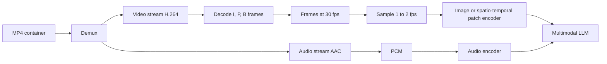

# 00.5 · Video

> **Modality:** video · **Prereqs:** [00.3](03-images.md), [00.4](04-audio.md) · **Used in project:** ⬜ Not yet used

## 1. First principles

Video is a **sequence of images (frames) sampled in time**, usually muxed with an audio track in a **container** (MP4, WebM, MKV).

- **Frame rate:** 24/30/60 fps. Raw 1080p30 RGB ≈ 6.2 MB × 30 = **~187 MB/s**, which is impossible to store or stream raw.
- **Temporal redundancy:** consecutive frames are nearly identical. Codecs exploit that with **motion compensation**: store how blocks *moved* plus a small residual.

### Frame types (GOP structure)
| Type | Contents | Cost |
|---|---|---|
| **I-frame** (keyframe) | Full image, intra-coded like a JPEG | Large |
| **P-frame** | Motion vectors + residual vs a *previous* frame | Small |
| **B-frame** | Predicted from previous *and future* frames | Smallest. Decode order ≠ display order. |

A **GOP** (group of pictures) runs from one I-frame to the next. Seeking lands on keyframes.

| Codec | Notes |
|---|---|
| H.264/AVC | Universal hardware support |
| H.265/HEVC | ~50% better than H.264, licensing friction |
| VP9 / **AV1** | Royalty-free. AV1 is the modern default for web. |

## 2. Diagram

## 3. Deep dive

- **Models don't watch 30 fps.** Video-LLMs sample sparse frames (e.g., 1 fps) because tokens = frames × patches per frame. One minute at 1 fps × 256 tokens per frame ≈ 15k tokens.
- **Spatio-temporal patches ("tubelets"):** ViViT/VideoMAE patch across time (e.g., 2 frames × 16×16) so each token captures motion, not just appearance.
- **Video generation** (diffusion transformers) denoises a latent spatio-temporal volume produced by a video VAE. Compression in latent space is what makes this tractable.
- **Decode is often the bottleneck** in video pipelines. Use hardware decoders (NVDEC, Jetson's NVDEC/NVENC) and decode only the frames you sample.

## 4. In our project

**Not yet used.**

Potential use: Jetson Orin Nano has hardware video decode, so an on-edge camera pipeline (e.g., vehicle inspection) would be a natural next step for the "offline edge deployment" roadmap item.

## 5. Common pitfalls

- **Variable frame rate (VFR):** phone videos are often VFR. Assuming a constant fps breaks timestamp alignment with audio and transcripts.
- **Seeking to non-keyframes** returns the wrong frame unless you decode forward from the previous I-frame.
- **A/V sync:** sample audio and video against the container timestamps (PTS), not frame indices.
- **Token blow-up:** naive "every frame" sampling exhausts context and budget. Sample adaptively (scene changes).
- **Color range:** limited (16–235) vs full (0–255) YUV range mismatches produce washed-out frames.

## 6. References
- ITU-T H.264 / H.265. AOMedia AV1 specification.
- Arnab et al., *ViViT*, arXiv:2103.15691.
