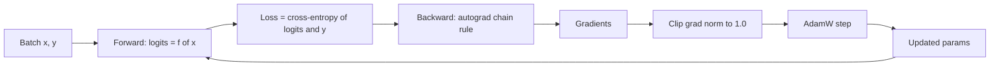

# 00.6 · ML Fundamentals

> **Modality:** all · **Prereqs:** [00.1](01-data-as-numbers.md) · **Used in project:** ✅

## 1. First principles

A neural network is a **parameterized function** `ŷ = f(x; θ)`. Learning means finding `θ` that minimizes a **loss** `L(ŷ, y)` averaged over data.

1. **Forward pass:** compute `ŷ` and `L`.
2. **Backward pass (backpropagation):** apply the chain rule from `L` back through every operation to get `∂L/∂θ` for every parameter. Autograd records the op graph during forward and replays it in reverse.
3. **Update:** `θ ← θ − η · g` (gradient descent), or a smarter rule (Adam).

Everything else, from LLMs to diffusion, is a choice of `f` (architecture), `L` (objective) and data.

### Cross-entropy (the LLM loss)
For a classification over `V` classes with logits `z`:
`L = −log softmax(z)[y] = −z_y + log Σ_j exp(z_j)`
- Random guessing over `V` classes gives `L = ln V`. For our 13-char vocab, ln 13 ≈ **2.56**.
- `L = 0` means 100% probability on the correct class.
- **Perplexity** = `exp(L)`: the effective number of equally-likely choices.

## 2. Diagram

## 3. Deep dive

### Optimizers
| Optimizer | Update | State memory per param |
|---|---|---|
| SGD | `θ −= η g` | 0 |
| SGD + momentum | velocity EMA of `g` | 1× |
| **Adam** | per-param step `η · m̂ / (√v̂ + ε)`; `m` = EMA(g), `v` = EMA(g²) | 2× (fp32) |
| **AdamW** | Adam + *decoupled* weight decay `θ −= η λ θ` | 2× |
| AdamW8bit | Adam states quantized to 8-bit | ~0.5× |

Adam's **2× fp32 state** is why training costs ~16 bytes/param (weights 4 + grads 4 + m 4 + v 4) vs 2 bytes/param for bf16 inference.

### Generalization vs memorization
- **Train loss low, held-out loss high** = overfitting / memorization.
- Model capacity must match **data diversity**. A huge model on tiny data memorizes perfectly, and that's not intelligence.
- Always hold out data the model never trains on.

### Stability tools
- **Learning-rate warmup + cosine decay:** avoids early divergence and anneals at the end.
- **Gradient clipping:** caps `‖g‖` to prevent single-batch spikes from blowing up weights.
- **Normalization (LayerNorm)** and **residual connections:** keep activations and gradients well-scaled in deep nets.

## 4. In our project

- **The scaling ladder is a memorization experiment:** rungs 1–8 train on `"to be or not to be that is the question " * 200`, which is 13 unique chars and one sentence ([`tiny_llm.py#L12`](https://github.com/SEVT-Logistics-Private-Limited/tiny-llm-jetson/blob/9a7b564c8d764d1eff92218261f2fd2cef99099e/tiny_llm.py#L12)). Loss near 0 there means perfect memorization, not language ability. The repo itself states this in `compression/README.md`: "It memorised one sentence."
- **Initial loss far above `ln V`:** model cards report initial losses of 137 (1M) and 2222 (3B) vs a theoretical ~2.56 for uniform predictions. Large untuned embedding init plus **weight tying** gives huge initial logits. GPT-2-style init (std 0.02, scaled residual projections) fixes it.
- **Optimizer choices across the codebase:**
  - Plain AdamW in the scratch models.
  - AdamW + warmup/cosine `LambdaLR` + grad clipping in LoRA ([`finetune_telugu_3b.py#L128-L135`](https://github.com/SEVT-Logistics-Private-Limited/tiny-llm-jetson/blob/9a7b564c8d764d1eff92218261f2fd2cef99099e/compression/finetune_telugu_3b.py#L128-L135)).
  - `bitsandbytes` AdamW8bit for 3B QAT, which saves ~18 GB ([`ternary_qat_3b.py#L120-L126`](https://github.com/SEVT-Logistics-Private-Limited/tiny-llm-jetson/blob/9a7b564c8d764d1eff92218261f2fd2cef99099e/compression/ternary_qat_3b.py#L120-L126)).
- **Rung 3 (150M) is a documented negative result:** it kept the 1M model's lr=3e-3 and loss oscillated between 1–2. That's lr too high for that width (see `model-card-150m.md`). Later rungs dropped lr to 3e-4 → 3e-5 as width grew.

## 5. Common pitfalls

- **No held-out split** (all scratch rungs): you can't distinguish learning from memorizing. The LoRA script fixes this with a 2% held-out set.
- **Reusing lr across scales:** wider models need smaller lr. µP-style scaling or a quick lr sweep per rung.
- **Reading single-batch loss:** noisy. Use an EMA or periodic eval-set loss.
- **Forgetting `model.eval()` / `torch.no_grad()`** at inference: dropout stays on and memory is wasted on the graph.
- **Comparing losses across vocab sizes:** loss 1.42 on a 245-char vocab and loss 0.11 on 13 chars are not comparable. Use bits-per-character or a fixed eval set.

## 6. References
- Rumelhart, Hinton, Williams, *Learning representations by back-propagating errors* (1986).
- Kingma & Ba, *Adam*, arXiv:1412.6980. Loshchilov & Hutter, *AdamW*, arXiv:1711.05101.
