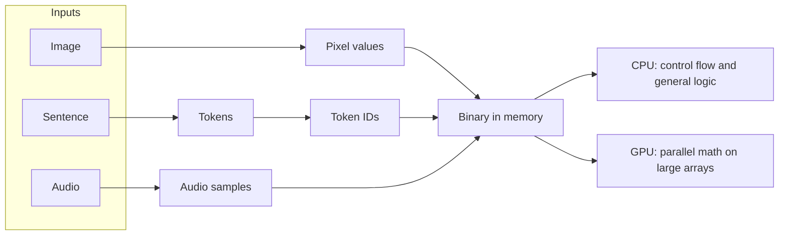
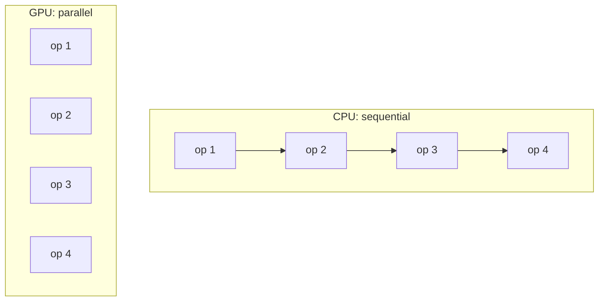

# Computing Foundations

> Computers only understand numbers. Every AI system, whether it works with text, images, audio or video, starts by turning its input into numbers.

| | |
|---|---|
| **Chapter** | 1 of 5 |
| **Prerequisites** | None |
| **Example code** | [`examples/computing_foundations/binary_and_bytes.py`](../../examples/computing_foundations/binary_and_bytes.py) |
| **Used in project** | Yes. Models were trained on GPUs (Jetson Orin Nano, Colab A100). |

---

## Introduction

Before learning how an LLM reads a sentence or how a vision model "sees" a photo, you need one mental model: **inside a computer, everything is a number**. This chapter covers how data is represented (binary, bits, bytes), and which hardware does the heavy number-crunching that AI needs (CPU vs GPU).

## What is it?

| Concept | Definition |
|---|---|
| **Binary** | A number system that uses only two digits, **0 and 1** ("binary" means two). |
| **Bit** | A single binary digit: one 0 or one 1. |
| **Byte** | A group of **8 bits**. It can store 256 different values (0–255). |
| **CPU** (Central Processing Unit) | The processor that executes instructions and does general-purpose computing. |
| **GPU** (Graphics Processing Unit) | A processor designed to perform **many calculations in parallel**. |

## Why is it needed?

A computer doesn't understand photos, videos, languages or sounds. **It only understands numerical information.** So every input has to be converted first:

| Input | Converted to |
|---|---|
| Image | Numerical pixel values |
| Sentence | Text → tokens → token numbers |
| Audio | Numerical audio signals (samples of the sound wave) |

Once everything is numbers, the same hardware and the same math (mostly matrix multiplication) can process any kind of data. That's why one family of models (Transformers) can handle text, images and audio.

## How does it work?

### Binary: on and off

Physically, a bit is an electrical signal:

| Digit | Meaning |
|---|---|
| 0 | OFF / low voltage |
| 1 | ON / high voltage |

Counting in binary:

| Binary | Decimal |
|---|---|
| `0000` | 0 |
| `0001` | 1 |
| `0010` | 2 |
| `0011` | 3 |
| `0100` | 4 |

### Bits and bytes

| Example | Size |
|---|---|
| `1` | 1 bit |
| `1010` | 4 bits |
| `11001010` | 8 bits = 1 byte |

| Unit | Size |
|---|---|
| 1 Byte | 8 bits |
| 1 KB | 1024 bytes |
| 1 MB | 1024 KB |
| 1 GB | 1024 MB |
| 1 TB | 1024 GB |

> **Note on units:** strictly, the 1024-based units are called KiB, MiB, GiB and TiB, and KB, MB and GB mean 1000-based units. Operating systems often mix the two, which is why a "500 GB" drive shows up as about 465 GB.

### CPU vs GPU

**CPU:** responsible for executing instructions and performing general-purpose computations.
- Generally used for everyday work. Example: it can run small games like Road Dash or card games.
- Not built to process large sets of high-resolution images or video quickly.

**GPU:** designed to perform **many calculations in parallel** to handle huge tasks.
- It can process sets of images and video at high resolution.
- It can read images at a much higher rate.
- That's why games like Call of Duty and PUBG run smoothly on a GPU.

| | CPU | GPU |
|---|---|---|
| Cores | A few powerful cores | Thousands of simpler cores |
| Works on | Few tasks, step by step | Many small tasks at the same time |
| Best for | Operating system, programs, logic | Graphics, video, **training and running AI models** |

## Architecture

How different kinds of data reach the processor:



Why AI workloads go to the GPU:



## Practical implementation

- **Text** is stored using an encoding such as **UTF-8**. English letters take 1 byte each; Telugu letters take 3 bytes each.
- **Images** are stored as 1 byte per colour channel per pixel (see [Digital Images](../04-computer-vision/01-digital-images.md)).
- **AI frameworks** (PyTorch, TensorFlow) move these arrays onto the GPU, where matrix multiplications run in parallel.

## Code example

[`examples/computing_foundations/binary_and_bytes.py`](../../examples/computing_foundations/binary_and_bytes.py)

```python
def to_binary(n: int, width: int = 8) -> str:
    return format(n, f"0{width}b")

for ch in "AI":
    for byte in ch.encode("utf-8"):
        print(ch, byte, to_binary(byte))
```

```bash
python examples/computing_foundations/binary_and_bytes.py
```

```text
Text is stored as numbers (UTF-8)
  'A': byte  65 = 01000001
  'I': byte  73 = 01001001

The Telugu letter 'అ' needs 3 bytes in UTF-8

One uncompressed 1920x1080 RGB image = 6,220,800 bytes = 5.93 MiB
```

## Real-world use cases

| Use case | Where this chapter applies |
|---|---|
| Training an LLM | Billions of numbers multiplied in parallel on GPUs |
| Storing multilingual text | UTF-8 encoding (Telugu needs 3× the bytes of English) |
| Image and video processing | Millions of pixel values per frame, processed on a GPU |

**In my project:** the [tiny-llm-jetson](https://github.com/SEVT-Logistics-Private-Limited/tiny-llm-jetson) models were trained on GPUs: an NVIDIA Jetson Orin Nano (edge device) for the small models, and a Google Colab A100 for models up to 3 billion parameters.

## Common mistakes and best practices

| Mistake | Better approach |
|---|---|
| Assuming 1 character = 1 byte | Use UTF-8 byte counts. Many scripts (including Telugu) use 3 bytes per character. |
| Confusing file size with memory size | A 50 KB JPEG decodes to millions of bytes of pixels in memory. |
| Training models on a CPU | Use a GPU for anything beyond toy models. The speed-up is often 10–100×. |
| Mixing KB (1000) and KiB (1024) | State which one you mean when sizes matter. |

## Key takeaways

- Computers only understand numbers. Images, text and audio are all converted first.
- Binary uses 0 and 1. One digit is a bit, and 8 bits make a byte.
- CPUs handle general work step by step. GPUs run thousands of calculations in parallel, which is what AI needs.

---

[Home](../../README.md) · **Next:** [AI Fundamentals →](../02-ai-fundamentals/README.md)
