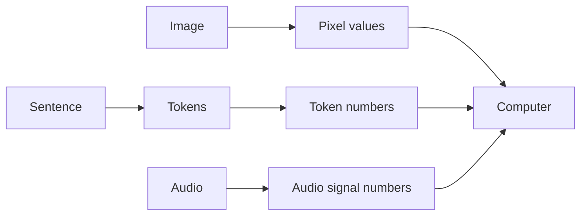
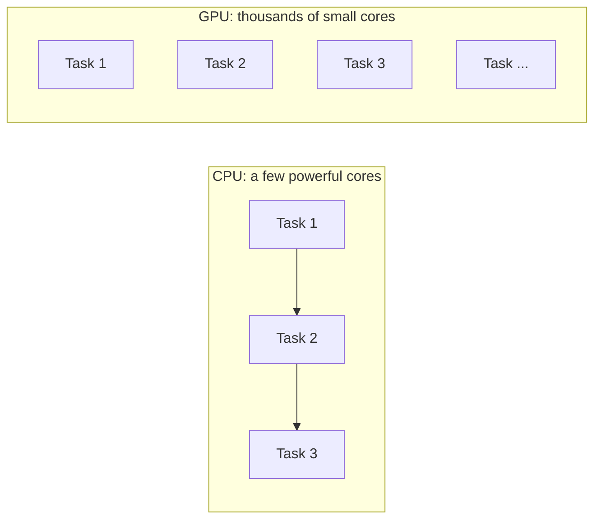

# 1. How Computers Understand Data

[← Back to contents](../README.md)

---

## Computers only understand numbers

A computer doesn't understand photos, videos, languages or sounds. **It only understands numbers.**

So before a computer can work with anything, it has to be turned into numbers:

| What we give it | What the computer turns it into |
|---|---|
| 🖼️ Image | Numbers for each pixel (pixel values) |
| 📝 Sentence | Text → tokens → numbers |
| 🔊 Audio | Numbers that describe the sound wave (audio signals) |

> This is the most important idea in the whole handbook. Every AI model, whether it handles text, images or audio, starts by turning its input into numbers.

---

## Binary numbers

Binary is a number system that uses only two digits: **0 and 1**. ("Binary" means two.)

Inside the computer these are electrical signals:

| Digit | Meaning |
|---|---|
| 0 | OFF / low voltage |
| 1 | ON / high voltage |

Counting in binary:

| Binary | Normal number |
|---|---|
| 0000 | 0 |
| 0001 | 1 |
| 0010 | 2 |
| 0011 | 3 |
| 0100 | 4 |

---

## Bits and bytes

A single binary digit is called a **bit**.

| Example | Size |
|---|---|
| `1` | 1 bit |
| `1010` | 4 bits |
| `11001010` | 8 bits |

Bigger units:

| Unit | Size |
|---|---|
| 1 Bit | a single 0 or 1 |
| 1 Byte | 8 bits |
| 1 KB | 1024 bytes |
| 1 MB | 1024 KB |
| 1 GB | 1024 MB |
| 1 TB | 1024 GB |

---

## CPU vs GPU: the hardware that does the work

### CPU (Central Processing Unit)

The CPU **executes instructions** and does **general-purpose computing**.

- Good for everyday, smaller work. Example: simple games like Road Dash or card games.
- Not good at processing lots of high-resolution images or video quickly.

### GPU (Graphics Processing Unit)

This is where the GPU comes in. A GPU is designed to **perform many calculations in parallel** (at the same time), so it can handle huge tasks.

- It can process sets of images and video at high resolution.
- It can read images at a much higher rate.
- That's why heavy games like Call of Duty and PUBG run smoothly on a GPU.

| | CPU | GPU |
|---|---|---|
| Works on | A few tasks at a time, step by step | Many tasks at the same time |
| Best for | General computing, running programs | Images, video, games, **training AI models** |

> **Why this matters for AI:** an image is millions of pixel numbers, and an AI model is millions or billions of numbers too. Doing that math in parallel is exactly what GPUs are built for.

**In my project:** I trained my small language models on a GPU: an NVIDIA Jetson Orin Nano and a Google Colab A100 ([repo](https://github.com/SEVT-Logistics-Private-Limited/tiny-llm-jetson)).

---

## Remember

- Computers only understand numbers. Images, text and audio all get converted first.
- Binary = 0 and 1. One digit = 1 bit, 8 bits = 1 byte.
- CPU = general work, step by step. GPU = many calculations in parallel, which is what AI needs.
