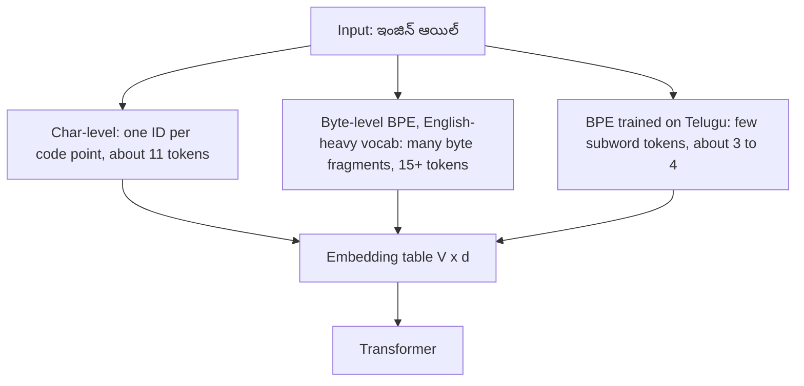

# 01.1 · Tokenization

> **Modality:** text · **Prereqs:** [00.2 Text](../00-foundations/02-text.md) · **Used in project:** ✅

## 1. First principles

A model has a fixed vocabulary of `V` symbols and an embedding table of shape `[V, d]`. **Tokenization** is the reversible mapping `string ↔ list[int]`. The choice of unit trades off three things:

| Granularity | Vocab size | Sequence length | OOV handling | Weakness |
|---|---|---|---|---|
| **Character** | Tiny (13–300) | Longest | Only unseen chars | Model must learn spelling, so context fills up fast |
| **Word** | Huge (100k+) | Shortest | Breaks on new or inflected words | Telugu is agglutinative, so the word vocab explodes |
| **Subword (BPE / Unigram / WordPiece)** | 32k–256k | Medium | Falls back to pieces or bytes | Fragmentation on under-represented scripts |
| **Byte-level BPE** | 256 base + merges | Medium | None. Any byte sequence works. | Non-Latin scripts cost 3 bytes/char before merges |

**BPE (Byte-Pair Encoding):** start from characters or bytes, repeatedly merge the most frequent adjacent pair into a new token, and stop at a target vocab size. Encoding replays the merges greedily.

## 2. Diagram



## 3. Deep dive

- **Fertility** = tokens per word. English on GPT-style tokenizers: ~1.3. Indic scripts on English-centric tokenizers: often 4–8+. High fertility means:
  - more cost per request
  - less effective context
  - slower generation
  - worse learning, because each token carries less meaning

  This is why Indic-focused models (e.g., Sarvam's) ship Indic-heavy tokenizers.
- **Vocab size vs params:** the embedding table (and the untied LM head) are `V × d`. At `V=128k, d=3072` that's ~393M params, a big slice of a 3B model. In our ternary export the embeddings alone are **0.39 GB** of the ~1.1 GB file.
- **Special tokens & chat templates:** instruction models wrap turns in special tokens (`<|start_header_id|>user...`). The **chat template** (Jinja in `tokenizer_config.json`) must match training *exactly*.
- **Train/inference parity:** the same tokenizer artifact must ship with the weights. Our scratch checkpoints save `stoi` inside the `.pt` for exactly this reason.

## 4. In our project

- **Character-level tokenizer from scratch** (all `tiny_llm*.py`):
  ```python
  chars = sorted(set(text)); vocab_size = len(chars)
  stoi = {c: i for i, c in enumerate(chars)}; itos = {i: c for c, i in stoi.items()}
  ```
  English toy corpus → `V=13`. ([`tiny_llm.py#L12-L15`](https://github.com/SEVT-Logistics-Private-Limited/tiny-llm-jetson/blob/9a7b564c8d764d1eff92218261f2fd2cef99099e/tiny_llm.py#L12-L15))
- **Telugu char vocab:** 2.9M characters from samanantar give **V=245**, saved with the checkpoint (`stoi`, `itos`) ([`tiny_llm_telugu.py#L24-L31`](https://github.com/SEVT-Logistics-Private-Limited/tiny-llm-jetson/blob/9a7b564c8d764d1eff92218261f2fd2cef99099e/tiny_llm_telugu.py#L24-L31)).
- **Subword tokenizer + chat template for the 3B pipeline:** `finetune_telugu_3b.py` uses Llama-3.2's tokenizer and `apply_chat_template`. It also *asserts the template is prefix-stable* before computing answer-only labels, a subtle correctness check most fine-tuning scripts skip ([`finetune_telugu_3b.py#L55-L70`](https://github.com/SEVT-Logistics-Private-Limited/tiny-llm-jetson/blob/9a7b564c8d764d1eff92218261f2fd2cef99099e/compression/finetune_telugu_3b.py#L55-L70)).
- **Pad token fallback:** Llama ships without a pad token, so the script sets `pad = eos`. Labels for padding are masked with `-100` so this is safe.

## 5. Common pitfalls

- **Char-level on real language:** works (Telugu 25M reached loss 1.42) but burns context. A 128-char block covers only ~20 Telugu words.
- **Building the vocab from training text only:** chars missing from the training set are silently dropped at inference (`if c in stoi`). Add an `<unk>` token.
- **Wrong chat template** (or adding BOS twice) gives a fine-tuned model that "forgets" its training format. Always use `apply_chat_template` and check for duplicate special tokens.
- **Measuring cost in characters** while the API bills tokens. Telugu can be 3–5× more tokens than equivalent English.
- **`pad = eos` without label masking:** the model learns to never emit EOS, or to emit it everywhere.

## 6. References
- Sennrich et al., *Neural Machine Translation of Rare Words with Subword Units* (BPE), arXiv:1508.07909.
- Kudo & Richardson, *SentencePiece*, arXiv:1808.06226.
