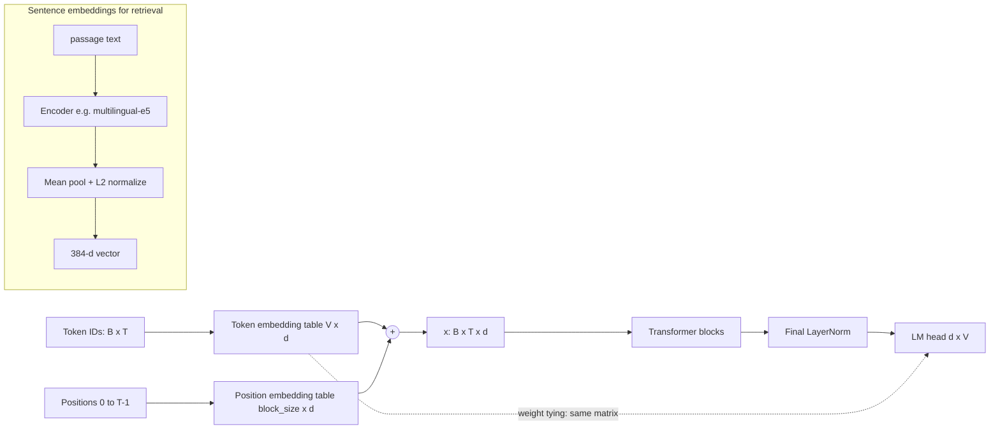

# 01.2 · Embeddings

> **Modality:** text (and all others) · **Prereqs:** [01.1](01-tokenization.md) · **Used in project:** ✅

## 1. First principles

A token ID is an arbitrary integer. ID 7 isn't "closer" to 8 than to 200. An **embedding** maps each discrete ID to a learned dense vector in `ℝ^d`, where geometry carries meaning: similar usage gives nearby vectors.

Mechanically, `nn.Embedding(V, d)` is a lookup table, equivalent to `one_hot(id) @ W` with `W ∈ ℝ^{V×d}`, but O(d) instead of O(V·d).

Two distinct uses:

| Kind | Granularity | Purpose | Example |
|---|---|---|---|
| **Token embeddings** | Per token, inside a model | Input representation for the transformer | `self.tok = nn.Embedding(V, d)` |
| **Positional embeddings** | Per position | Attention is permutation-invariant, so position must be injected | Learned `nn.Embedding(block_size, d)`, sinusoidal, RoPE |
| **Sentence / text embeddings** | One vector per passage | Semantic search, clustering, RAG retrieval | `multilingual-e5-small` → 384-d |

## 2. Diagram



## 3. Deep dive

- **Weight tying:** the output projection `d → V` reuses the input embedding matrix. This saves `V×d` params and often improves perplexity, because input and output token spaces are shared.
- **Positional schemes:**
  - *Learned absolute* (GPT-2, our models): simple, but the model can't run past `block_size`.
  - *Sinusoidal* (original Transformer): fixed functions, can extrapolate a bit.
  - *RoPE* (Llama, most modern LLMs): rotates Q/K vectors by position-dependent angles, so attention scores depend on *relative* offset. Context can be extended by scaling frequencies.
- **Sentence embeddings** come from encoder models trained contrastively, pulling (query, relevant passage) pairs together and pushing negatives apart. Similarity = cosine, which is a dot product after L2 normalization.
- **E5 prefixes:** the E5 family was trained with `"query: "` and `"passage: "` prefixes. Omitting them, or using the same one on both sides, measurably degrades retrieval.

## 4. In our project

- **Token + learned positional embeddings with tying** in every scratch model:
  ```python
  self.tok = nn.Embedding(vocab_size, n_embd)
  self.pos = nn.Embedding(block_size, n_embd)
  self.head.weight = self.tok.weight  # weight tying
  ```
  ([`tiny_llm.py#L41-L47`](https://github.com/SEVT-Logistics-Private-Limited/tiny-llm-jetson/blob/9a7b564c8d764d1eff92218261f2fd2cef99099e/tiny_llm.py#L41-L47))
- **Sentence embeddings for RAG:**
  - The voice API loads `intfloat/multilingual-e5-small` and encodes the (translated) query with the correct `"query: "` prefix.
  - It then searches a ChromaDB collection of vehicle-manual passages ([`api.py#L111-L127`](https://github.com/SEVT-Logistics-Private-Limited/tiny-llm-jetson/blob/9a7b564c8d764d1eff92218261f2fd2cef99099e/voice-assistant/api.py#L111-L127)).
  - The model is baked into the Docker image so it never downloads at runtime ([`Dockerfile#L11-L14`](https://github.com/SEVT-Logistics-Private-Limited/tiny-llm-jetson/blob/9a7b564c8d764d1eff92218261f2fd2cef99099e/voice-assistant/Dockerfile#L11-L14)).
- **Embeddings protected during compression:**
  - Ternary QAT skips `lm_head`.
  - Export keeps embeddings at **int8 with per-row scales** rather than ternary ([`ternary_qat_3b.py#L203-L208`](https://github.com/SEVT-Logistics-Private-Limited/tiny-llm-jetson/blob/9a7b564c8d764d1eff92218261f2fd2cef99099e/compression/ternary_qat_3b.py#L203-L208)).
  - The README's rationale: "they are easy to damage".

## 5. Common pitfalls

- **Generating past `block_size` with learned positions:** index error or garbage. Our `generate()` crops context to the last `block_size` tokens (`idx[:, -block_size:]`).
- **Unnormalized vectors with cosine/IP mismatch:** Chroma's default space is **L2**. With normalized vectors, L2² = 2 − 2·cos, so thresholds behave differently depending on the space the collection was created with. Pin `hnsw:space` explicitly.
- **Missing E5 prefixes** on the ingestion side (`"passage: "`). The ingestion script isn't in the repo, so verify it.
- **Mixing embedding models** between ingestion and query: vectors live in incompatible spaces, and retrieval silently returns noise.
- **Weight tying + careless init** → huge initial logits (see initial losses of 137–2243 in our model cards).

## 6. References
- Press & Wolf, *Using the Output Embedding to Improve Language Models*, arXiv:1608.05859.
- Su et al., *RoFormer (RoPE)*, arXiv:2104.09864. Wang et al., *E5*, arXiv:2212.03533.
